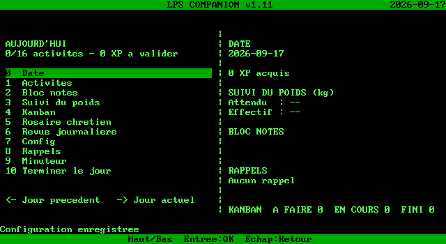
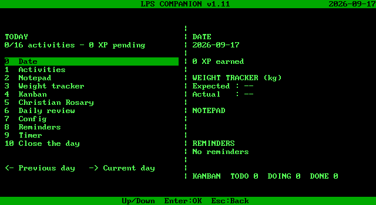

# LPS Companion for MS-DOS

**English** | [Francais](#lps-companion-pour-ms-dos)

A full port of [LPS Companion v1.11](https://github.com/TME520/LPS-Companion-PicoCalc) (PicoCalc) to real-mode 16-bit MS-DOS
for Intel **8088**-class PCs with **640 KB** conventional memory. Keyboard only
(no mouse). Text mode **80×25** (content laid out in 40 columns, same as the
Companion). Data lives under `C:\LPS\` by default and uses the **same**
`SAVE_A.BIN` / `SAVE_B.BIN`, `EXPORT\*.ics` and `WEIGHTS\*.csv` formats as the
PicoCalc firmware and LPS Console.




## Requirements

- MS-DOS 3.3+ / FreeDOS / MS-DOS 7.x (FAT12/16)
- Intel 8088 or compatible (EXE built with Open Watcom `-0`)
- ~60 KB free disk for `LPSCOMP.EXE`; data folder grows with history
- Colour text (CGA/EGA/VGA) for palettes; mono still readable
- Open Watcom C/C++ (v2) to build; gcc to run the host tests

## Feature parity (Companion v1.11)

| Feature | Status |
|---|---|
| Date entry (2000–2099) | Yes |
| 16 activities, 2 pages | Yes |
| Notepad 96 chars | Yes |
| Weight expected/measured | Yes |
| Kanban 24 tasks TODO/DOING/DONE | Yes |
| Christian Rosary (4 modes, FR/EN) | Yes (accents ASCII-folded for CP437) |
| Daily review | Yes |
| Config language EN/FR + 5 palettes | Yes (text attributes) |
| 3 reminders | Yes |
| Timer 5/15/30 (BIOS tick) | Yes |
| Close day + XP + 6 keepsakes | Yes |
| 31-day history ←/→ | Yes |
| Dual A/B SAVE + CRC + v1–v6 migrate | Yes (read **and** write) |
| ICS + weights CSV byte-compatible | Yes |

## Build

Install [Open Watcom V2](https://github.com/open-watcom/open-watcom-v2/releases) for your host.
The Linux x64 release file is a zip archive (it also has an ELF installer stub; unzipping is enough):

```sh
curl -fL -o /tmp/ow-c-linux-x64 \
  https://github.com/open-watcom/open-watcom-v2/releases/download/2026-11-01-Build/open-watcom-2_0-c-linux-x64
unzip -q /tmp/ow-c-linux-x64 -d "$HOME/watcom"
# The zip stores host tools without the executable bit.
chmod a+x "$HOME/watcom"/binl64/* "$HOME/watcom"/binl/* 2>/dev/null || true
export WATCOM="$HOME/watcom"
export PATH="$WATCOM/binl64:$PATH"   # binl/ on a 32-bit host
export INCLUDE="$WATCOM/h"
export LIB="$WATCOM/lib286"
```

On Windows, use the official installer and point `WATCOM` at that directory
(`binnt` / `binw` instead of `binl64`; the Makefile picks `binl64` or `binl`).

From this directory:

```sh
make dos      # LPSCOMP.EXE  (-0 -bt=dos -ms, 8086/8088, soft FP, 4 KB stack)
make hello    # HELLO.EXE    BIOS smoke test
make test     # host gcc tests (no WATCOM required)
make clean
```

`make` (no target) builds both EXEs and runs the host tests. `make dos` and
`make hello` prepend `$WATCOM/binl64` (or `binl`) to `PATH` for that command:
`wcl` looks up `wcc` and `wlink` on `PATH`, not beside the `wcl` binary.
`make captures` regenerates text dumps under `captures/` with the host UI driver.

The same DOS link line, without Make:

```sh
wcl -0 -bt=dos -ms -ox -fpc -k4096 -dLPS_DOS -i=src -fe=LPSCOMP.EXE \
  src/state.c src/ics.c src/save.c src/paths.c src/rosary.c \
  src/app.c src/plat_dos.c src/main.c
```

### Host tests (gcc, no DOS)

Run from this directory so the test finds `tests/fixtures/v12_payload.bin`:

```sh
gcc -std=c89 -Wall -Wextra -Wno-unused-parameter -O2 -Isrc -DLPS_HOST \
  -o tests/test_storage \
  tests/test_storage.c src/state.c src/ics.c src/save.c src/paths.c \
  src/rosary.c src/app.c src/plat_host.c
./tests/test_storage
```

## Book 8088 / real hardware notes

On the first Book 8088 test, `LPSCOMP.EXE` cleared the screen then hung with a
blinking cursor. Root cause: the DOS default **stack was only 2 KB**, while
`app_start` / `commit` put a **~6 KB `Blob` and ~4.6 KB `State` on the stack**
→ immediate stack smash after `int 10h` mode setup (blank screen, cursor, no UI).

Fixes kept in this tree:

- `Blob` / `State` scratch moved to **static BSS** (`g_blob`, `g_scratch`)
- Linker stack raised off the 2 KB default. It was **8 KB** (`-k8192`) in that
  first fix; after the SAVE buffers below moved to BSS, the link uses **4 KB**
  (`-k4096`), which is what `make dos` passes
- Video: detect MDA vs CGA via BIOS equipment word + mode `0Fh`; use **B000**
  or **B800** accordingly; only set mode `03h`/`07h` if not already text
- Early BIOS teletype banner (`LPS COMPANION v1.11`) before dirs / UI
- Soft FP (`-fpc`) — no 8087 required
- **`HELLO.EXE`** (built with `make hello`): tiny BIOS-only smoke test (prints mode / equipment)

### Keyboard freeze on Date / Activities (fixed)

Second Book 8088 bug: first save (confirm date or toggle activity) hung the UI.
Cause: `save_write_ab` / `decode_state` put **~14 KB of locals on the stack**
(record + verify + `State`) while DGROUP stack was only a few KB → smash on
first commit. Fix: all large SAVE/decode buffers are **static BSS**, shared where
safe; keyboard is pure **int 16h** (no `conio`, no mouse int 33h); AZERTY
unshifted top-row maps to digits for Date/Weight.

### Deferred SAVE (Book 8088 HDD)

Edits (date, activities, note, kanban, …) update **RAM only** and set a dirty
flag. Disk write of one `SAVE_A`/`SAVE_B` slot (~4.6 KB) happens on:
Esc back to Home (if dirty), confirming Date/Note/Weight/Config, Close the day,
and Quit (`Q`). Status shows `Saving...` / `Saved`. Post-write verify-read was
removed (too slow on 8088 + tiny HDD).

### What to try on the Book

1. Build **`HELLO.EXE`** and **`LPSCOMP.EXE`** (`make hello` and `make dos`) and copy them to the HDD or a floppy.
2. Run `HELLO` — you must see `LPS COMPANION - HELLO` and video info; any key quits.
3. Run `LPSCOMP` or `LPSCOMP C:\LPS` — you should briefly see the banner, then the home screen.
4. Quit with **Q** from Home.
5. If the banner appears but the UI does not, note whether the machine is mono or colour and open an issue.



Other screens (activities, kanban, rosary, timer) are in `captures/`.

## Install on a real machine / DOSBox

1. Copy `LPSCOMP.EXE` to a floppy or the hard disk.
2. Create `C:\LPS` (or pass the path as argv: `LPSCOMP D:\DATA`).
3. Optional: `SET LPSDIR=C:\LPS`
4. Run `LPSCOMP` or `LPSCOMP C:\LPS`.
5. Quit from Home with **Q**.

DOSBox-X or DOSBox Staging, from this directory after `make dos` (`dosbox.conf` mounts the current directory as `C:` and sets an 8086 CPU with EGA):

```sh
dosbox-x -conf dosbox.conf
```

Equivalent by hand:

```
mount C /path/to/lps-companion
C:
LPSCOMP.EXE C:\LPS
```

Use `machine=ega` and `cputype=8086` (or `8088`) to match the Book 8088.
DOSBox 0.74 cannot set `cputype=8086`; use DOSBox-X or DOSBox Staging.

## Keys (same ideas as Companion / LPS Console)

Global: **Up/Down** select, **Enter** confirm, **Esc** back. **Q** quits on Home.

Home digits `0`–`9` open Date / Activities / Note / Weight / Kanban / Rosary /
Daily review / Config / Reminders / Timer; item 10 closes the day.
**Left/Right** browse the last 31 closed days (read-only).

The PicoCalc README documents the full per-screen binding list; this port follows
the same map (F1–F5 on Kanban, N/Del on Kanban and Reminders, etc.).

## Data layout

```
C:\LPS\
  SAVE_A.BIN     dual-slot snapshots (magic LPR1 + generation + CRC)
  SAVE_B.BIN
  EXPORT\YYYY-MM-DD_LPS-Companion.ics
  WEIGHTS\YYYY.csv
```

Files are interchangeable with the PicoCalc SD card and with LPS Console
imports/exports. Do not change the on-disk layout: `SAVE_A`/`SAVE_B`, ICS, and
CSV stay byte-compatible with the firmware.

## Source layout

| File | Role |
|---|---|
| `src/state.c` | Dates, XP, encode/decode v1–v6 |
| `src/save.c` | A/B SAVE read/write |
| `src/ics.c` | ICS + weights CSV |
| `src/app.c` | Full UI state machine |
| `src/rosary.c` | Rosary texts and step engine |
| `src/plat_dos.c` | BIOS video/keyboard/timer |
| `src/plat_host.c` | Linux host for tests |
| `src/hello.c` | `HELLO.EXE` BIOS smoke test |
| `tests/test_storage.c` | Host encode/decode, ICS, CSV, A/B, v1.2 fixture |
| `tests/fixtures/v12_payload.bin` | Synthetic Companion v1.2 payload |

## Captures

PNG screenshots under `captures/` (home EN/FR, a few feature screens, and a
DOSBox 8086 home grab). Text dumps are not stored; `make captures` rewrites
`captures/*.txt` from the host UI driver.

---

# LPS Companion pour MS-DOS

Port complet de [LPS Companion v1.11](https://github.com/TME520/LPS-Companion-PicoCalc)
vers MS-DOS 16 bits (8088, 640 Ko), clavier uniquement, mode texte 80×25.
Memes formats `SAVE_A/B.BIN`, ICS et CSV que le firmware PicoCalc et LPS Console.

## Book 8088 / materiel reel

Premier essai Book 8088 : ecran vide + curseur. Cause : **pile DOS 2 Ko** trop
petite pour `Blob` (~6 Ko) / `State` (~4,6 Ko) alloues sur la pile au demarrage.
Correctifs : tampons en BSS, pile a **4 Ko** (`-k4096`; elle avait ete montee a
8 Ko avant le deplacement des gros tampons SAVE), video CGA/MDA, banniere BIOS,
`HELLO.EXE`. Deuxieme bug : gel clavier sur Date/Activites — tampons SAVE encore
trop gros sur la pile ; tout est en BSS, clavier en int 16h pur. Les editions
restent en RAM (drapeau dirty) et un seul slot A/B est ecrit en quittant un
ecran, en confirmant Date/Note/Poids/Config, en cloturant le jour, ou avec **Q**.

## Compilation

Open Watcom V2, variable `WATCOM` pointant sur la racine du compilateur
(voir la section **Build** ci-dessus). Puis, dans ce dossier :

```sh
make dos      # LPSCOMP.EXE (-0 -bt=dos -ms)
make hello    # HELLO.EXE
make test     # tests gcc, sans Watcom
```

## Utilisation

Copier `LPSCOMP.EXE`, creer `C:\LPS`, lancer `LPSCOMP` (ou `LPSCOMP chemin`).
**Q** quitte depuis l'accueil. Les touches reprennent celles du Companion.

DOSBox-X / DOSBox Staging, depuis ce dossier : `dosbox-x -conf dosbox.conf`
(`cputype=8086`, `machine=ega`).

## Empreinte

`LPSCOMP.EXE` fait environ **57–60 Ko** (mode small, 8086, pile 4 Ko). `HELLO.EXE` ~3 Ko.

## Ecarts connus

- Accents francais ASCII-ises pour le code page 437 (le sens des chaines est
  conserve ; le Companion PicoCalc garde Latin-1/UTF-8).
- Pas d'avertissement batterie (pas de materiel equivalent).
- Config n'a pas d'entree « import SD » : le disque DOS **est** le stockage.
