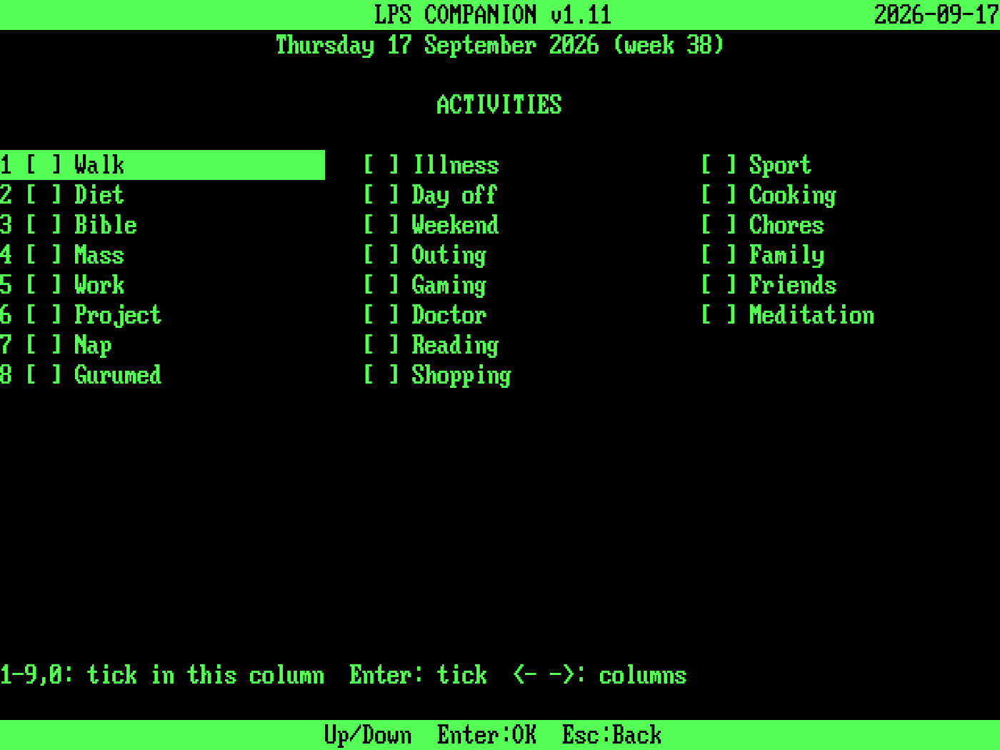

# LPS Companion for MS-DOS

**English** | [Francais](#lps-companion-pour-ms-dos)

A full port of [LPS Companion v1.11](https://github.com/TME520/LPS-Companion-PicoCalc) (PicoCalc) to real-mode 16-bit MS-DOS
for Intel **8088**-class PCs with **640 KB** conventional memory. Keyboard only
(no mouse). Text mode **80×25** (content laid out in 40 columns, same as the
Companion). Data lives under `C:\LPS\` by default and uses the **same**
`SAVE_A.JSN` / `SAVE_B.JSN` (JSON save, schema 2), `EXPORT\*.ics` and
`WEIGHTS\*.csv` formats as the PicoCalc firmware v1.13 and later.

Ready-to-run files are at the **repository root** (the directory above this one): [`../LPSCOMP.EXE`](../LPSCOMP.EXE), [`../ROSARY.DAT`](../ROSARY.DAT) and [`../HELLO.EXE`](../HELLO.EXE). Copy **both `LPSCOMP.EXE` and `ROSARY.DAT` into the same directory** on the Book 8088; `ROSARY.DAT` holds the rosary prayer texts. Without it everything works except the Rosary, which then shows *ROSARY.DAT not found: copy it next to LPSCOMP.EXE*. `make dos`, `make rosary` and `make hello` rebuild into this directory only; those local copies are gitignored. After a source change, copy the new files up (`cp LPSCOMP.EXE ROSARY.DAT HELLO.EXE ..`) so the root copies stay current. CI rebuilds and fails if the root files differ.

The screen is the full **80×25** text mode (no 43/50-line modes). Home is two panes: the menu on the left, and a day summary (date, weight, reminders, kanban counts) on the right. The 22 activities sit on one page in three columns (see *Activities* below). Kanban shows TODO, DOING and DONE side by side. The rosary uses 80-character lines; the timer stays centered. Keys, English and French wording, palettes, and the SAVE/ICS/CSV bytes are unchanged. On the 8088 the video driver rewrites only the rows that changed.

Long texts (the rosary prayers) wrap at spaces, never inside a word; a word longer than the 80-column line is cut (LPS-DOS-115-CHG03c). Highlighted bars no longer blink on CGA, EGA or VGA: at start-up the program makes attribute bit 7 mean "bright background" (INT 10h AX=1003h on EGA/VGA, the 3D8h mode register on CGA), and on exit it restores the blink setting and the cursor shape, and leaves the last screen without bit 7. The five palettes keep their colours; their bars are now the bright shade of the text colour (orange stays brown).

As in PicoCalc v1.12, XP and keepsakes no longer appear on any screen (LPS-DOS-115-CHG01). The line under the title bar shows the long date and ISO week of the viewed day, for example **Sunday 8 November 2026 (week 45)** / **Dimanche 8 Novembre 2026 (semaine 45)**; it stays blank for an undated day. XP is still banked in `SAVE_A`/`SAVE_B` so old and new saves stay compatible, and the ICS description keeps an empty `XP:` line, byte for byte like the PicoCalc.

As in PicoCalc v1.12, the notepad is gone (LPS-DOS-115-CHG02) and the Home menu is renumbered **0 Date, 1 Activities, 2 Weight tracker, 3 Kanban, 4 Christian Rosary, 5 Daily review, 6 Config, 7 Reminders, 8 Timer, 9 Close the day**; an archived day offers **1 Activities, 2 Weight tracker**.

**Activities** (LPS-DOS-115-CHG05, as PicoCalc v1.13 CHG08/08b/08c) come from the activity catalog in the save, not from a fixed list. A new save starts with the PicoCalc's **22 default activities**, with the same ids, names and order: the 16 earlier ones plus **Sport, Cooking, Chores, Family, Friends, Meditation** / **Sport, Cuisine, Ménage, Famille, Amis, Méditation**. A catalog customised on the PicoCalc (up to 30 entries, renamed or reordered) shows on DOS as it is.
- The screen has **three columns** of up to 10 rows, filled top to bottom: 22 activities are 8 + 8 + 6, and 30 fit in 10 + 10 + 10, so the whole list is on one page. Names longer than 20 characters are cut in the grid; the selected one is shown whole under the grid.
- **Up/Down** move within a column and wrap. **Left/Right** move to the next or previous column, keep the row (or the column's last entry), and wrap from the last column to the first. **Enter** (or Space) ticks the selected activity.
- **1–9, 0** tick rows 1 to 10 of the column the cursor is in. Only that column shows the key numbers, so the shortcut you see is the one you press, as on a PicoCalc page. A digit past the column's last entry does nothing. On an AZERTY keyboard the unshifted top row works too (see *Keyboard* below).
- Home shows **n/22 activities**, with the catalog's size as the total.
- An **archived day** shows the names it was closed with, read-only, as on the PicoCalc: the catalog ticks, then, ticked, any name the catalog no longer has. A day with more than 30 items (only possible in an archive) gets pages, shown as `ACTIVITIES  1/2`; Left/Right move across them.
- **Closing the day** freezes the ticked names in the history, in catalog order, as the PicoCalc does. The ICS lists the ticked activities in catalog order in the ICS language, and the save is written the PicoCalc's way, so the ICS, the CSV and the save stay byte-compatible.

**Custom activities** (LPS-DOS-115-CHG06, as PicoCalc v1.13 CHG07/07b), from the Activities screen, keyboard only:
- **E** renames the activity under the cursor, **N** adds one at the end (30 at most: *Limit: 30 activities*), **Del** deletes it after a confirmation (*Delete Walk?*, **Enter** yes, **Esc** no), **F4** / **F5** move it up or down and wrap from the first to the last place and back, as in the Kanban. Today's tick and the cursor follow the moved entry.
- A name is saved **in the current language only** (`"fr"` or `"en"` of the catalog entry); if the other language has no name, the same name shows in both. Up to 24 characters; spaces at the ends are trimmed; an empty name cancels; a name already in the list (any case) is refused with *That name already exists*.
- Names are typed in CP437 on screen and saved in UTF-8, so **é, è, ç, à** and the other CP437 letters work, from a French keyboard (`KEYB FR`) as well. The save allows 24 bytes, and an accented letter takes two of them: a longer name gets *Name is too long*. Text fields keep the characters; every screen keyed by digits reads the top row by key position (see *Keyboard* below).
- **Past days keep the names they were closed with.** Renaming an activity in French (the name a day stores) or deleting it leaves the old name in history: the archive shows it after the catalog, ticked and read-only. In an archived day, E, N, Del, F4 and F5 say *Archived day: read-only*.
- Edits are written to the save on Esc back to Home, like the other DOS edits. The save and the ICS stay byte-compatible with the PicoCalc for the same list.

### Keyboard: top row by key position (LPS-DOS-115-CHG06b)

On every screen keyed by digits (Home, the archived-day menu, Config, Language, Colors, Timer, Activities, Kanban moves, the reminder date and days, Date, Weight), the main keyboard's top row is read by its **BIOS scan code** (int 16h, 02h–0Bh = 1–9, 0), whatever the layout and Shift. On AZERTY (`KEYB FR`) `&`, `é`, `"`, … give 1, 2, 3, … without Shift; with Shift they still give the digits. On QWERTY, Shift+7 (`&`) is 7, never 1 by accident. The numeric keypad (NumLock on) gives digits too.

- Text fields get the real characters: activity names, Kanban task names and reminder text (é, è, ç, à, and ê, ô, ë… from the dead keys).
- Where a hyphen is typed (Date, reminder date, Kanban reorder), the AZERTY unshifted 6 key stays `-`; use Shift+6 for the digit 6.
- AltGr on a top-row key (AZERTY `~ # { [ | \` ^ @ ] }`) also counts as its digit on those screens.

### Accented task names and reminders (LPS-DOS-115-CHG06c)

Kanban task names and reminder texts take the CP437 letters, like activity names: é è ê ë à â ä å ç î ï ì ô ö ò û ù ü ÿ É Ç Ä Å Æ Ö Ü æ ñ Ñ á í ó ú, and ¢ £ ¥ ₧ ƒ. With `KEYB FR`, é è ç à ù are on their keys and ê â ô û î, ë ï ü come from the ^ and ¨ dead keys.

- On screen and in memory they are CP437; the JSON save holds UTF-8, as on the PicoCalc, which reads these saves and writes them back byte for byte (`tests/fixtures/picocalc_accents.jsn`). PicoCalc saves with accented tasks and reminders load and show on DOS.
- The limit is the PicoCalc's: **32 bytes of UTF-8**. An accented letter takes 2 bytes (₧ takes 3), so a name holds 32 plain letters or 16 accented ones; a letter that would not fit is not typed. The task counter counts these bytes, as on the PicoCalc (*32/32 characters*).
- Tasks and reminders are not in the ICS (as on the PicoCalc); the note and activity names there are UTF-8. The old `.BIN` saves never held accents (both writers were ASCII-only); after the migration, accents go to the JSON save.




The **Timer / Minuteur** offers **5, 30 or 60 minutes** (LPS-DOS-115-CHG02b, as PicoCalc v1.12 CHG01/CHG02). Keys **1**, **2** and **3** start a duration directly, without Enter. On the completion screen they start a new countdown at once and Enter returns to the duration menu; while a countdown runs they are ignored, and Enter pauses or resumes. Timing still comes from the BIOS tick (about 55 ms).

French is shown with its accents (LPS-DOS-115-CHG03): **Activités, Journée, Rosaire chrétien, Revue journalière, Février, Août, Décembre…**, with the PicoCalc's wording, in the PC's own code page 437 font. CP437 has é è ê ë à â ä ç î ï ô û ù ü and É, but no other accented capitals, so À, È, Ê, Ô and  show without their accent (À FAIRE → A FAIRE, NOTRE PÈRE → NOTRE PERE, TÂCHE → TACHE). Files stay UTF-8 like the PicoCalc's: a French ICS now writes `Activités:` and accented activity names exactly as the PicoCalc does (earlier DOS builds wrote `Activites:`). See *Text encoding* below. A note already saved by an older version is kept in the save and still exported to the ICS (`\NNote: ...`) when its day is closed; it is no longer shown or editable.

Saves are JSON files, `SAVE_A.JSN` and `SAVE_B.JSN`, exactly as on the PicoCalc v1.13 and later (LPS-DOS-115-CHG04, PicoCalc LPS-113-CHG06). The data folder can be copied both ways between the PicoCalc SD card (`LPS/`) and `C:\LPS\`: the two machines write the same schema 2 file, with the same keys in the same order, the A/B alternation, the generation number and the CRC-32 as the last key, and each machine opens the other's saves.
- **Migration**: when `C:\LPS\` has no `.JSN` save yet, LPSCOMP reads the old `SAVE_A.BIN`/`SAVE_B.BIN` (formats v1 to v6, as before) and writes `SAVE_A.JSN` at start-up. The `.BIN` files are never modified or deleted; they stay as a backup. A `.JSN` save cannot be read by an earlier DOS build.
- **The activity catalog** (`{"id","fr","en"}` entries) is used since LPS-DOS-115-CHG05, and each day's activity names are kept, including names the catalog no longer has.
- **PicoCalc data that DOS does not use yet is kept**: the Meal Planner deck (`"meals":{"played":[…]}`) and the hidden Home entries (`"homeHidden"`). DOS writes them back unchanged. Closing the day on DOS resets the meal deck, as the PicoCalc does. A DOS tick on an activity that the PicoCalc renamed goes under the PicoCalc's name, as it does there.
- **Text** (notes, tasks, reminders) is UTF-8 in the file, as on the PicoCalc, and CP437 on screen. A character that CP437 does not have (for example `€`, `œ` or an emoji) is read as `?` and written back as `?`.
- Unknown keys are skipped, as on the PicoCalc, and are not written back. A save from a newer schema (version 3 or later) is refused and protected: LPSCOMP shows the read error and does not overwrite it.
- After each write, LPSCOMP reads the file back and checks its CRC-32 and generation before it marks the slot as current. The PicoCalc parses the whole file again at this point; DOS checks the CRC only, which is much faster on the 8088.


## Requirements

- MS-DOS 3.3+ / FreeDOS / MS-DOS 7.x (FAT12/16)
- Intel 8088 or compatible (EXE built with Open Watcom `-0`)
- ~97 KB free disk for `LPSCOMP.EXE` (~87 KB) and `ROSARY.DAT` (~10 KB); the data folder grows with history (each JSON save is up to about 10 KB)
- Colour text (CGA/EGA/VGA) for palettes; mono still readable
- Open Watcom C/C++ (v2) to build; gcc to run the host tests

## Feature parity (Companion v1.11)

| Feature | Status |
|---|---|
| Date entry (2000–2099) | Yes |
| Activities: 22 defaults, catalog of up to 30 from the save, 3 columns | Yes (LPS-DOS-115-CHG05) |
| Custom activities: E rename, N new, Del delete, F4/F5 move | Yes (LPS-DOS-115-CHG06) |
| Notepad | Removed, as in v1.12 (legacy notes kept in SAVE and ICS) |
| Weight expected/measured | Yes |
| Kanban 24 tasks TODO/DOING/DONE | Yes |
| Christian Rosary (4 modes, FR/EN) | Yes (French accents in CP437) |
| Daily review | Yes |
| Config language EN/FR + 5 palettes | Yes (text attributes) |
| 3 reminders | Yes |
| Timer 5/30/60, keys 1-3 (BIOS tick) | Yes |
| Close day (XP and keepsakes hidden, as in v1.12) | Yes |
| 31-day history ←/→ | Yes |
| Dual A/B JSON save (`SAVE_A/B.JSN`, schema 2) + CRC | Yes (read **and** write, PicoCalc-compatible) |
| `SAVE_A/B.BIN` v1–v6 migration | Yes (read once; `.BIN` files left untouched) |
| ICS + weights CSV byte-compatible | Yes |

## Build

Install [Open Watcom V2](https://github.com/open-watcom/open-watcom-v2/releases) for your host.
The Linux x64 release file is a zip archive (it also has an ELF installer stub; unzipping is enough):

```sh
curl -fL -o /tmp/ow-c-linux-x64 \
  https://github.com/open-watcom/open-watcom-v2/releases/download/2026-11-01-Build/open-watcom-2_0-c-linux-x64
unzip -q /tmp/ow-c-linux-x64 -d "$HOME/watcom"
# The zip stores host tools without the executable bit.
chmod a+x "$HOME/watcom"/binl64/* "$HOME/watcom"/binl/* 2>/dev/null || true
export WATCOM="$HOME/watcom"
export PATH="$WATCOM/binl64:$PATH"   # binl/ on a 32-bit host
export INCLUDE="$WATCOM/h"
export LIB="$WATCOM/lib286"
```

On Windows, use the official installer and point `WATCOM` at that directory
(`binnt` / `binw` instead of `binl64`; the Makefile picks `binl64` or `binl`).

From this directory:

```sh
make dos      # LPSCOMP.EXE  (-0 -bt=dos -ml, 8086/8088, soft FP, 4 KB stack)
make rosary   # ROSARY.DAT   prayer texts, built by tools/mkrosary (host gcc)
make hello    # HELLO.EXE    BIOS smoke test
make test     # host gcc tests (no WATCOM required; builds ROSARY.DAT first)
make clean
```

`make` (no target) builds both EXEs and `ROSARY.DAT`, and runs the host tests. `make dos` and
`make hello` prepend `$WATCOM/binl64` (or `binl`) to `PATH` for that command:
`wcl` looks up `wcc` and `wlink` on `PATH`, not beside the `wcl` binary.
`make captures` regenerates text dumps under `captures/` with the host UI driver.

Every build first converts the sources to CP437 (see *Text encoding*), so use
Make rather than calling `wcl` or `gcc` on `src/` directly. The steps Make runs:

```sh
gcc -std=c89 -Wall -Wextra -O2 -Isrc -DLPS_HOST -o tools/cp437 tools/cp437.c src/cp437.c
mkdir -p build/cp437
for f in src/*.c src/*.h tests/test_storage.c tools/mkrosary.c; do
  ./tools/cp437 "$f" build/cp437/$(basename "$f"); done
G=build/cp437
wcl -0 -bt=dos -ml -zt256 -ox -fpc -k4096 -dLPS_DOS -i=$G -fe=LPSCOMP.EXE \
  $G/state.c $G/ics.c $G/save.c $G/jsave.c $G/paths.c $G/rosary.c $G/app.c $G/cp437.c $G/wrap.c \
  $G/plat_dos.c $G/main.c
```

### Host tests (gcc, no DOS)

`make test` builds `tools/mkrosary` and `ROSARY.DAT`, then
`tests/test_storage` from the CP437 copies, and runs it from this directory so
it finds `tests/fixtures/v12_payload.bin`, the PicoCalc JSON saves
`tests/fixtures/picocalc_*.jsn` and `ROSARY.DAT`. The JSON tests cover the
round trip and A/B alternation, byte-identical rewriting of the PicoCalc
fixtures, BIN migration, a damaged A falling back to B, unknown keys and a
newer schema.

`tools/picocalc_fixture.cpp` builds the PicoCalc's own save code (from a
checkout of [LPS-Companion-PicoCalc](https://github.com/TME520/LPS-Companion-PicoCalc))
to regenerate the fixtures or to check a DOS save with the PicoCalc reader:

```sh
P=/path/to/LPS-Companion-PicoCalc
g++ -std=c++17 -I$P/src -I$P/tests -o /tmp/pcfix tools/picocalc_fixture.cpp
/tmp/pcfix full tests/fixtures/picocalc_full.jsn
/tmp/pcfix custom tests/fixtures/picocalc_custom.jsn
/tmp/pcfix check C:/LPS/SAVE_A.JSN      # prints valid / damaged / ...
```

### Text encoding (LPS-DOS-115-CHG03)

- **Sources are UTF-8**, like the PicoCalc's, so French strings read and diff
  the same as there (`"Activités"`, `"Rosaire chrétien"`).
- **The screen is CP437.** `tools/cp437` copies each source file into
  `build/cp437/` and rewrites every non-ASCII character *inside a string or
  character literal* as a three-digit octal escape of its CP437 byte
  (`é` → `\202`). Comments and code are copied unchanged, line for line, so
  compiler messages keep their line numbers. DOS, the host tests and
  `mkrosary` all compile these copies and see the same bytes.
- Characters CP437 lacks are folded by a fixed table (À Â → A, È Ê → E,
  Ô → O, œ → oe, curly quotes and dashes → ASCII). Any other character stops
  the build with its file and line, so nothing is lost silently.
- **Files are UTF-8**, byte for byte like the PicoCalc: `ics.c` turns CP437
  bytes back into UTF-8 (`cp437_to_utf8`, same table as the tool). The JSON
  save (LPS-DOS-115-CHG04) converts user text (notes, tasks, reminders) from
  UTF-8 to CP437 on read and back on write with the same table; a character
  CP437 lacks becomes `?`.
- This was chosen over hand-written `\x82` escapes: those are hard to read,
  easy to get wrong (`"\x82e"` is one byte, not two) and cannot be compared
  with the PicoCalc's sources.

### Memory layout (LPS-DOS-115-CHG03b)

The EXE uses Open Watcom's **large model** (`-ml`): far data pointers and one
code segment per module. The 64 KB DGROUP (near data + 4 KB stack) used to be
almost full (63,088 bytes); it is now about 17 KB (17,504 bytes with
LPS-DOS-115-CHG06), which leaves room for the EGA Meal Planner.

- The prayer texts are not in the EXE. `tools/mkrosary` builds `ROSARY.DAT`
  from `src/rosary_text.c`, the single source of the texts, and LPSCOMP loads
  it into the far heap when the Rosary opens and frees it on leaving.
  `LPSCOMP` looks for it next to itself (the path in `argv[0]`), then in the
  current directory. A missing or damaged file shows a message on Home; it
  never crashes.
- The big work buffers (two `State` copies, the legacy BIN record, the ICS
  and CSV export buffers) are one far-heap block allocated at start-up
  (`lps_buffers_init`), as are the `App` and the screen shadow. The CSV buffer
  used to be an 8 KB local on the 4 KB stack.
- The JSON save (`jsave.c`) reads a whole slot into one far-heap buffer (up to
  65,000 bytes, freed at once) and parses it in a single pass with a pointer,
  without recursion or big locals. Writing goes through a 512-byte near buffer
  and folds each chunk into the CRC-32. The activity catalog (30 × 2 names of
  24 bytes) is part of `State`. Each day's activity names (31 days + today,
  30 names each) sit in a separate ~24 KB far-heap table, so the `State`
  copied at each save stays small. The PicoCalc data DOS keeps without using it
  (meals, hidden Home entries) sits in a small far-heap block.
- `ROSARY.DAT` layout (little-endian): `LPSROSRY` magic, u16 version 2,
  u16 string count (138: 69 texts × EN/FR), u32 payload size, u32 CRC-32 of the
  payload, then a u16 offset table and the NUL-terminated strings: printable
  ASCII plus the CP437 accented letters 0x80–0xA5. Version 2 (LPS-DOS-115-CHG03)
  holds the accented French texts; a version 1 file from an earlier build is
  refused with *ROSARY.DAT is damaged: copy it again*, so copy both files
  together.

Check the segment sizes with `wcl ... -fm=LPSCOMP.MAP` and look at `DGROUP`.

## Book 8088 / real hardware notes

On the first Book 8088 test, `LPSCOMP.EXE` cleared the screen then hung with a
blinking cursor. Root cause: the DOS default **stack was only 2 KB**, while
`app_start` / `commit` put a **~6 KB `Blob` and ~4.6 KB `State` on the stack**
→ immediate stack smash after `int 10h` mode setup (blank screen, cursor, no UI).

Fixes kept in this tree:

- `Blob` / `State` scratch moved to **static BSS** (`g_blob`, `g_scratch`);
  since LPS-DOS-115-CHG03b they live in the far heap (see *Memory layout*)
- Linker stack raised off the 2 KB default. It was **8 KB** (`-k8192`) in that
  first fix; after the SAVE buffers below moved to BSS, the link uses **4 KB**
  (`-k4096`), which is what `make dos` passes
- Video: detect MDA vs CGA via BIOS equipment word + mode `0Fh`; use **B000**
  or **B800** accordingly; only set mode `03h`/`07h` if not already text
- Early BIOS teletype banner (`LPS COMPANION v1.11`) before dirs / UI
- Soft FP (`-fpc`) — no 8087 required
- **`HELLO.EXE`** (built with `make hello`): tiny BIOS-only smoke test (prints mode / equipment)

### Keyboard freeze on Date / Activities (fixed)

Second Book 8088 bug: first save (confirm date or toggle activity) hung the UI.
Cause: `save_write_ab` / `decode_state` put **~14 KB of locals on the stack**
(record + verify + `State`) while DGROUP stack was only a few KB → smash on
first commit. Fix: all large SAVE/decode buffers are **static BSS**, shared where
safe; keyboard is pure **int 16h** (no `conio`, no mouse int 33h); the top
row maps to digits by scan code on digit screens (CHG06b).

### Deferred SAVE (Book 8088 HDD)

Edits (date, activities, weight, kanban, …) update **RAM only** and set a dirty
flag. Disk write of one `SAVE_A.JSN`/`SAVE_B.JSN` slot (2 to 10 KB) happens on:
Esc back to Home (if dirty), confirming Date/Weight/Config, Close the day,
and Quit (`Q`). Status shows `Saving...` / `Saved`. Since LPS-DOS-115-CHG04 the
written slot is read back and its CRC-32 checked (no full re-parse), so a bad
write never replaces the good slot.

Measured in DOSBox Staging, `cputype=8086`, `cycles=fixed 300` (about a
4.77 MHz 8088; disk time on the real machine comes on top): a small save
(2.3 KB) loads in 0.6 s and saves in 0.7 s; a full one (31 days, 24 tasks,
about 10 KB) loads in 2.4 s and saves in 3.6 s. The old BIN code took 9.9 s to
load and 6.2 s to save the same full state.

Keypress to redrawn screen on the 3-column Activities screen, same setup
(LPS-DOS-115-CHG05): 96 ms for Up/Down, 116–123 ms for Left/Right, 113–116 ms
for a tick. The CHG04 build took 500–630 ms per key on its 2-column screen:
the video driver compared the 2,000 cells one by one, and text was copied a
character at a time. It now compares whole rows (`memcmp`) and copies text in
blocks, which speeds up every screen (Home redraws in about 100 ms).

Custom activities, same setup (LPS-DOS-115-CHG06), on a new save / on a full
save with 31 closed days: E opens the editor in about 130 ms (so does Esc back),
a typed letter shows in about 70 ms, Enter on a rename or a new activity takes
165 / 220 ms, F4/F5 130 / 178 ms, Del 55 ms and its Enter 110 / 220 ms. Esc
back to Home then writes the save: 0.6 s / 3.4 s. A move or a delete renumbers
the history's ticks in place instead of matching every closed day's names
again (0.7 s with 31 days); when two entries share a stored name, which only a
PicoCalc-edited list can have, it falls back to the full match.

### What to try on the Book

1. Copy **`HELLO.EXE`** and **`LPSCOMP.EXE`** from the repository root to the HDD or a floppy.
2. Run `HELLO` — you must see `LPS COMPANION - HELLO` and video info; any key quits.
3. Run `LPSCOMP` or `LPSCOMP C:\LPS` — you should briefly see the banner, then the home screen.
4. Quit with **Q** from Home.
5. If the banner appears but the UI does not, note whether the machine is mono or colour and open an issue.


Other screens (activities, kanban, rosary, timer) are in `captures/`.

## Install on a real machine / DOSBox

1. Copy the repository-root `LPSCOMP.EXE` **and `ROSARY.DAT`** into the same directory on a floppy or the hard disk (and `HELLO.EXE` for the smoke test).
2. Create `C:\LPS` (or pass the path as argv: `LPSCOMP D:\DATA`).
3. Optional: `SET LPSDIR=C:\LPS`
4. Run `LPSCOMP` or `LPSCOMP C:\LPS`.
5. Quit from Home with **Q**.

DOSBox-X or DOSBox Staging. `dosbox.conf` mounts the current directory as `C:` and sets an 8086 CPU with EGA, so the EXE has to sit in this directory. Copy the root binaries down (they are gitignored here) or use a local `make dos`, then start DOSBox:

```sh
cp ../LPSCOMP.EXE ../ROSARY.DAT ../HELLO.EXE .
dosbox-x -conf dosbox.conf
```

Equivalent by hand, mounting the repository root:

```
mount C /path/to/Book8088-slopware
C:
LPSCOMP.EXE C:\LPS
```

Use `machine=ega` and `cputype=8086` (or `8088`) to match the Book 8088.
DOSBox 0.74 cannot set `cputype=8086`; use DOSBox-X or DOSBox Staging.

## Keys (same ideas as Companion / LPS Console)

Global: **Up/Down** select, **Enter** confirm, **Esc** back. **Q** quits on Home.

Home digits, as in PicoCalc v1.12:

| Key | Today | Archived day |
|---|---|---|
| `0` | Date | — |
| `1` | Activities | Activities (read-only) |
| `2` | Weight tracker | Weight tracker (read-only) |
| `3` | Kanban | — |
| `4` | Christian Rosary | — |
| `5` | Daily review | — |
| `6` | Config | — |
| `7` | Reminders | — |
| `8` | Timer | — |
| `9` | Close the day | — |

**Left/Right** browse the last 31 closed days (read-only).

Activities (LPS-DOS-115-CHG05): **Up/Down** within a column, **Left/Right**
between columns (both wrap), **Enter** or **Space** ticks, **1–9, 0** tick
rows 1–10 of the cursor's column (the numbers are shown on that column only).
LPS-DOS-115-CHG06: **E** rename, **N** new, **Del** delete (Enter confirms,
Esc cancels), **F4/F5** move up/down.

The PicoCalc README documents the full per-screen binding list; this port follows
the same map (F1–F5 on Kanban, N/Del on Kanban and Reminders, etc.).

## Data layout

```
C:\LPS\
  SAVE_A.JSN     dual-slot JSON saves (schema 2, generation + CRC-32), as on the PicoCalc
  SAVE_B.JSN
  SAVE_A.BIN     old saves (before LPS-DOS-115-CHG04): read once for migration, never changed
  SAVE_B.BIN
  EXPORT\YYYYMMDD.ICS        e.g. EXPORT\20260917.ICS
  WEIGHTS\YYYY.csv
```

The ICS file name differs from the PicoCalc's `YYYY-MM-DD_LPS-Companion.ics`
(LPS-DOS-115-CHG02c): DOS keeps only 8.3 names and cut the long name to
`YYYY-MM-.ICS`, so every day of a month overwrote the same file. The new name is
`YYYYMMDD.ICS`, one file per day; the file content is unchanged and older files
already in `EXPORT\` are left alone. On Linux a FAT disk usually shows these
names in upper case, so a reader that looks only for `*.ics` misses them.

The folder is interchangeable with the PicoCalc SD card's `LPS/` folder: copy
`SAVE_A.JSN`, `SAVE_B.JSN`, `EXPORT\` and `WEIGHTS\` either way (copy both
saves together). Do not change the on-disk layout: the saves, ICS and CSV stay
byte-compatible with the firmware.

## Source layout

| File | Role |
|---|---|
| `src/state.c` | Dates, ISO week, long date, banked XP, encode/decode v1–v6, activity catalog and day names |
| `src/save.c` | A/B slot choice, load, store and BIN migration |
| `src/jsave.c` | JSON save (schema 2): single-pass reader, writer, CRC readback, catalog and day names, PicoCalc extras |
| `src/ics.c` | ICS + weights CSV |
| `src/app.c` | Full UI state machine |
| `src/rosary.c` | Rosary step engine; loads `ROSARY.DAT` |
| `src/rosary_text.c` | Rosary texts (single source, not linked into the EXE) |
| `tools/mkrosary.c` | Writes `ROSARY.DAT` from `src/rosary_text.c` |
| `src/cp437.c` | CP437 ↔ Unicode table; CP437 ↔ UTF-8 for the save and the ICS |
| `tools/cp437.c` | Build step: UTF-8 string literals → CP437 copies in `build/cp437/` |
| `src/wrap.c` | Word wrap at spaces for the 80-column screen (rosary texts) |
| `src/plat_dos.c` | BIOS video/keyboard/timer |
| `src/plat_host.c` | Linux host for tests |
| `src/hello.c` | `HELLO.EXE` BIOS smoke test |
| `tests/test_storage.c` | Host encode/decode, ICS, CSV, A/B, `ROSARY.DAT`, v1.2 fixture, French CP437 screens, JSON saves, activities, custom activities |
| `tests/fixtures/v12_payload.bin` | Synthetic Companion v1.2 payload |
| `tests/fixtures/picocalc_*.jsn` | JSON saves written by the PicoCalc's own code |
| `tools/picocalc_fixture.cpp` | Builds the PicoCalc save code on the host: fixtures and checks |

## Captures

PNG screenshots under `captures/` (home EN/FR, a few feature screens, and a
DOSBox 8086 home grab). Text dumps are not stored; `make captures` rewrites
`captures/*.txt` from the host UI driver.

---

# LPS Companion pour MS-DOS

Port complet de [LPS Companion v1.11](https://github.com/TME520/LPS-Companion-PicoCalc)
vers MS-DOS 16 bits (8088, 640 Ko), clavier uniquement, mode texte 80×25.
Memes formats `SAVE_A/B.JSN` (sauvegarde JSON, schema 2), ICS et CSV que le firmware PicoCalc v1.13 et suivants.

Seul le nom du fichier ICS differe de la PicoCalc (LPS-DOS-115-CHG02c) : `EXPORT\YYYYMMDD.ICS`, par exemple `EXPORT\20260917.ICS`, au lieu de `YYYY-MM-DD_LPS-Companion.ics`. DOS ne garde que des noms 8.3 et coupait le nom long en `YYYY-MM-.ICS` : tous les jours d'un mois ecrasaient le meme fichier. Le contenu ne change pas, et les anciens fichiers deja dans `EXPORT\` restent en place. Sous Linux, un disque FAT affiche en general ces noms en majuscules : un lecteur qui ne cherche que `*.ics` ne les voit pas.

Les fichiers prets a lancer sont a la **racine du depot** : [`../LPSCOMP.EXE`](../LPSCOMP.EXE), [`../ROSARY.DAT`](../ROSARY.DAT) et [`../HELLO.EXE`](../HELLO.EXE). Copiez **`LPSCOMP.EXE` et `ROSARY.DAT` dans le meme dossier** sur le Book 8088 ; `ROSARY.DAT` contient les textes du rosaire. Sans lui, tout fonctionne sauf le rosaire, qui affiche *ROSARY.DAT introuvable : copiez-le a cote de LPSCOMP.EXE*. `make dos` / `make rosary` / `make hello` reconstruisent seulement dans ce dossier (copies non versionnees). Apres une modification des sources, recopiez-les a la racine (`cp LPSCOMP.EXE ROSARY.DAT HELLO.EXE ..`). La CI reconstruit et echoue si les fichiers a la racine different.

L'ecran utilise tout le mode texte **80×25**. L'accueil a deux volets : le menu a gauche, le resume du jour a droite (date, poids, rappels, kanban). Les 22 activites tiennent sur une page en trois colonnes (voir *Activites* plus bas). Le kanban montre A FAIRE, EN COURS et FINI cote a cote. Le rosaire utilise des lignes de 80 caracteres ; le minuteur reste centre. Les touches, les textes, les palettes et les octets SAVE/ICS/CSV ne changent pas. Sur 8088, seules les lignes modifiees sont reecrites.

Les textes longs (prières du rosaire) passent à la ligne entre les mots, jamais au milieu d'un mot ; un mot plus long que la ligne de 80 colonnes est coupé (LPS-DOS-115-CHG03c). Les barres en surbrillance ne clignotent plus sur CGA, EGA ou VGA : au démarrage, le bit 7 de l'attribut devient « fond clair » (INT 10h AX=1003h sur EGA/VGA, registre 3D8h sur CGA) ; en quittant, le programme rétablit le clignotement et la forme du curseur, et laisse le dernier écran sans bit 7. Les cinq palettes gardent leurs couleurs ; leurs barres prennent la teinte claire de la couleur du texte (l'orange reste brun).

Comme sur la PicoCalc v1.12, l'XP et les souvenirs n'apparaissent plus sur aucun ecran (LPS-DOS-115-CHG01). La ligne sous la barre de titre affiche la date longue et la semaine ISO du jour affiche, par exemple **Dimanche 8 Novembre 2026 (semaine 45)** ; elle reste vide pour un jour sans date. L'XP reste enregistree dans `SAVE_A`/`SAVE_B` pour la compatibilite, et la description ICS garde une ligne `XP:` vide, comme sur la PicoCalc.

Comme sur la PicoCalc v1.12, le bloc notes disparait (LPS-DOS-115-CHG02) et le menu d'accueil est renumerote : **0 Date, 1 Activites, 2 Suivi du poids, 3 Kanban, 4 Rosaire chretien, 5 Revue journaliere, 6 Config, 7 Rappels, 8 Minuteur, 9 Terminer le jour**. Un jour archive propose **1 Activites, 2 Suivi du poids**.

Le français s'affiche avec ses accents (LPS-DOS-115-CHG03) : **Activités, Journée, Rosaire chrétien, Revue journalière, Février, Août, Décembre…**, avec le texte exact de la PicoCalc, dans la police du PC (page de code 437). La CP437 a é è ê ë à â ä ç î ï ô û ù ü et É, mais pas les autres capitales accentuées : À, È, Ê, Ô et  s'affichent sans accent (À FAIRE → A FAIRE, NOTRE PÈRE → NOTRE PERE, TÂCHE → TACHE). Les sources restent en UTF-8 comme celles de la PicoCalc ; `tools/cp437` convertit les chaînes en CP437 à la compilation (voir *Text encoding*). Les fichiers restent en UTF-8 : un ICS en français écrit désormais `Activités:` et les noms d'activités accentués, octet pour octet comme la PicoCalc (les versions DOS précédentes écrivaient `Activites:`). `ROSARY.DAT` passe en version 2 : un ancien fichier est refusé avec *ROSARY.DAT endommagé : recopiez-le* ; copiez toujours `LPSCOMP.EXE` et `ROSARY.DAT` ensemble.

Les sauvegardes sont des fichiers JSON, `SAVE_A.JSN` et `SAVE_B.JSN`, exactement comme sur la PicoCalc v1.13 et suivantes (LPS-DOS-115-CHG04, PicoCalc LPS-113-CHG06). Le dossier de donnees se copie dans les deux sens entre la carte SD de la PicoCalc (`LPS/`) et `C:\LPS\` : les deux machines ecrivent le meme fichier schema 2, memes cles dans le meme ordre, alternance A/B, numero de generation et CRC-32 en derniere cle, et chacune ouvre les sauvegardes de l'autre.
- **Migration** : si `C:\LPS\` n'a pas encore de sauvegarde `.JSN`, LPSCOMP lit les anciens `SAVE_A.BIN`/`SAVE_B.BIN` (formats v1 a v6, comme avant) et ecrit `SAVE_A.JSN` au demarrage. Les `.BIN` ne sont jamais modifies ni effaces ; ils restent comme copie de secours. Une sauvegarde `.JSN` ne se relit pas avec une version DOS precedente.
- **Le catalogue d'activites** (entrees `{"id","fr","en"}`) est utilise depuis LPS-DOS-115-CHG05, et les noms d'activites de chaque jour sont conserves, y compris ceux que le catalogue n'a plus.
- **Les donnees PicoCalc que DOS n'utilise pas encore sont conservees** : le paquet du planificateur de repas (`"meals":{"played":[…]}`) et les entrees d'accueil masquees (`"homeHidden"`). DOS les reecrit telles quelles. Terminer le jour sur DOS remet le paquet de repas a zero, comme la PicoCalc. Une activite cochee sur DOS et renommee sur la PicoCalc s'enregistre sous le nom de la PicoCalc, comme la-bas.
- **Le texte** (notes, taches, rappels) est en UTF-8 dans le fichier, comme sur la PicoCalc, et en CP437 a l'ecran. Un caractere absent de la CP437 (par exemple `€`, `œ` ou un emoji) est lu `?` et reecrit `?`.
- Les cles inconnues sont ignorees, comme sur la PicoCalc, et ne sont pas reecrites. Une sauvegarde d'un schema plus recent (version 3 ou plus) est refusee et protegee : LPSCOMP affiche l'erreur de lecture et ne l'ecrase pas.
- Apres chaque ecriture, LPSCOMP relit le fichier et verifie son CRC-32 et sa generation avant d'en faire le slot courant. La PicoCalc relit et analyse tout le fichier a ce moment ; DOS verifie seulement le CRC, bien plus rapide sur 8088.

Les **Activités** (LPS-DOS-115-CHG05, comme les CHG08/08b/08c de la PicoCalc v1.13) viennent du catalogue d'activités de la sauvegarde, et non plus d'une liste fixe. Une nouvelle sauvegarde part des **22 activités par défaut** de la PicoCalc, avec les mêmes identifiants, noms et ordre : les 16 d'avant plus **Sport, Cuisine, Ménage, Famille, Amis, Méditation**. Un catalogue personnalisé sur la PicoCalc (jusqu'à 30 entrées, renommées ou réordonnées) s'affiche tel quel sur DOS.
- L'écran a **trois colonnes** de 10 lignes au plus, remplies de haut en bas : 22 activités font 8 + 8 + 6, et 30 tiennent en 10 + 10 + 10, donc toute la liste est sur une page. Un nom de plus de 20 caractères est coupé dans la grille ; celui qui est sélectionné s'affiche en entier sous la grille.
- **Haut/Bas** se déplacent dans une colonne et bouclent. **Gauche/Droite** passent à la colonne suivante ou précédente, gardent la ligne (ou la dernière entrée de la colonne) et bouclent de la dernière colonne à la première. **Entrée** (ou Espace) coche l'activité sélectionnée.
- **1–9, 0** cochent les lignes 1 à 10 de la colonne du curseur. Seule cette colonne affiche les numéros : le raccourci affiché est celui qu'on tape, comme sur une page de la PicoCalc. Un chiffre au-delà de la dernière entrée de la colonne ne fait rien. Sur un clavier AZERTY, la rangée du haut sans Maj marche aussi (voir *Clavier* plus bas).
- L'accueil affiche **n/22 activités**, le total étant la taille du catalogue.
- Un **jour archivé** affiche les noms avec lesquels il a été clos, en lecture seule, comme sur la PicoCalc : les activités cochées du catalogue, puis, cochés, les noms que le catalogue n'a plus. Un jour de plus de 30 éléments (possible seulement dans les archives) a des pages, affichées `ACTIVITÉS  1/2` ; Gauche/Droite les parcourent.
- **Terminer le jour** fige les noms cochés dans l'historique, dans l'ordre du catalogue, comme la PicoCalc. L'ICS liste les activités cochées dans l'ordre du catalogue et dans la langue de l'ICS, et la sauvegarde s'écrit comme sur la PicoCalc : ICS, CSV et sauvegarde restent identiques octet pour octet.

**Activités personnalisées** (LPS-DOS-115-CHG06, comme les CHG07/07b de la PicoCalc v1.13), depuis l'écran Activités, au clavier seulement :
- **E** renomme l'activité sous le curseur, **N** en ajoute une à la fin (30 au plus : *Limite : 30 activités*), **Suppr** la supprime après confirmation (*Supprimer Marche ?*, **Entrée** oui, **Échap** non), **F4** / **F5** la montent ou la descendent et bouclent de la première à la dernière place, comme dans le Kanban. La coche du jour et le curseur suivent l'entrée déplacée.
- Un nom s'enregistre **dans la langue courante seulement** (`"fr"` ou `"en"` de l'entrée du catalogue) ; si l'autre langue n'a pas de nom, le même nom s'affiche dans les deux. 24 caractères au plus ; les espaces aux bouts sont retirés ; un nom vide annule ; un nom déjà dans la liste (majuscules ou non) est refusé : *Ce nom existe déjà*.
- Les noms se tapent en CP437 à l'écran et s'enregistrent en UTF-8 : **é, è, ç, à** et les autres lettres CP437 marchent, y compris depuis un clavier français (`KEYB FR`). La sauvegarde permet 24 octets et une lettre accentuée en prend deux : un nom plus long donne *Nom trop long*. Les champs de texte gardent les caractères ; les écrans à chiffres lisent la rangée du haut par position de touche (voir *Clavier* plus bas).
- **Les jours passés gardent les noms avec lesquels ils ont été clos.** Renommer une activité en français (le nom que le jour enregistre) ou la supprimer laisse l'ancien nom dans l'historique : l'archive l'affiche après le catalogue, coché, en lecture seule. Dans un jour archivé, E, N, Suppr, F4 et F5 affichent *Jour archivé : lecture seule*.
- Les modifications s'écrivent dans la sauvegarde en revenant à l'accueil avec Échap, comme les autres modifications DOS. Sauvegarde et ICS restent identiques octet pour octet à ceux de la PicoCalc pour la même liste.

### Clavier : rangée du haut par position de touche (LPS-DOS-115-CHG06b)

Sur tous les écrans à chiffres (Accueil, menu d'un jour archivé, Config, Langue, Couleurs, Minuteur, Activités, déplacements Kanban, date et jours d'un rappel, Date, Poids), la rangée du haut du clavier principal se lit par son **code de balayage BIOS** (int 16h, 02h–0Bh = 1–9, 0), quels que soient la disposition et Maj. En AZERTY (`KEYB FR`), `&`, `é`, `"`, … donnent 1, 2, 3, … sans Maj ; avec Maj, toujours les chiffres. En QWERTY, Maj+7 (`&`) donne 7, jamais 1 par erreur. Le pavé numérique (Verr Num allumé) donne aussi les chiffres.

- Les champs de texte reçoivent les vrais caractères : noms d'activités, tâches Kanban et texte des rappels (é, è, ç, à, et ê, ô, ë… par les touches mortes).
- Là où l'on tape un tiret (Date, date d'un rappel, ordre Kanban), la touche 6 AZERTY sans Maj reste `-` ; Maj+6 donne le chiffre 6.
- AltGr sur une touche de la rangée du haut (AZERTY `~ # { [ | \` ^ @ ] }`) compte aussi comme son chiffre sur ces écrans.

### Tâches et rappels accentués (LPS-DOS-115-CHG06c)

Les noms de tâches Kanban et les textes des rappels acceptent les lettres CP437, comme les noms d'activités : é è ê ë à â ä å ç î ï ì ô ö ò û ù ü ÿ É Ç Ä Å Æ Ö Ü æ ñ Ñ á í ó ú, et ¢ £ ¥ ₧ ƒ. Avec `KEYB FR`, é è ç à ù sont sur leurs touches, et ê â ô û î, ë ï ü viennent des touches mortes ^ et ¨.

- À l'écran et en mémoire, ils sont en CP437 ; la sauvegarde JSON les garde en UTF-8, comme la PicoCalc, qui relit ces sauvegardes et les réécrit octet pour octet (`tests/fixtures/picocalc_accents.jsn`). Les sauvegardes PicoCalc avec tâches et rappels accentués se chargent et s'affichent sous DOS.
- La limite est celle de la PicoCalc : **32 octets d'UTF-8**. Une lettre accentuée prend 2 octets (₧ en prend 3) : un nom tient 32 lettres simples ou 16 accentuées ; une lettre qui ne tient plus n'est pas tapée. Le compteur des tâches compte ces octets, comme sur la PicoCalc (*32/32 caractères*).
- Tâches et rappels ne sont pas dans l'ICS (comme sur la PicoCalc) ; la note et les noms d'activités y sont en UTF-8. Les anciennes sauvegardes `.BIN` n'ont jamais contenu d'accents (les deux programmes n'écrivaient que de l'ASCII) ; après la migration, les accents vont dans la sauvegarde JSON.


Le **Minuteur** propose **5, 30 ou 60 minutes** (LPS-DOS-115-CHG02b, comme les CHG01/CHG02 de la PicoCalc v1.12). Les touches **1**, **2** et **3** lancent directement une duree, sans Entree. Sur l'ecran de fin, elles relancent aussitot un compte a rebours et Entree revient au choix de la duree ; pendant un compte a rebours, elles sont ignorees et Entree met en pause ou reprend. Le temps vient toujours du tic BIOS (environ 55 ms). Une note deja enregistree par une ancienne version reste dans la sauvegarde et part toujours dans l'ICS (`\NNote: ...`) a la cloture du jour ; elle n'est plus affichee ni modifiable.

## Book 8088 / materiel reel

Premier essai Book 8088 : ecran vide + curseur. Cause : **pile DOS 2 Ko** trop
petite pour `Blob` (~6 Ko) / `State` (~4,6 Ko) alloues sur la pile au demarrage.
Correctifs : tampons en BSS, pile a **4 Ko** (`-k4096`; elle avait ete montee a
8 Ko avant le deplacement des gros tampons SAVE), video CGA/MDA, banniere BIOS,
`HELLO.EXE`. Deuxieme bug : gel clavier sur Date/Activites — tampons SAVE encore
trop gros sur la pile ; tout est en BSS, clavier en int 16h pur. Les editions
restent en RAM (drapeau dirty) et un seul slot A/B est ecrit en quittant un
ecran, en confirmant Date/Poids/Config, en cloturant le jour, ou avec **Q**.
Depuis LPS-DOS-115-CHG04, le slot ecrit est relu et son CRC-32 verifie.

Mesure sous DOSBox Staging, `cputype=8086`, `cycles=fixed 300` (environ un
8088 a 4,77 MHz ; le temps disque reel s'ajoute) : une petite sauvegarde
(2,3 Ko) se charge en 0,6 s et s'ecrit en 0,7 s ; une sauvegarde complete
(31 jours, 24 taches, environ 10 Ko) se charge en 2,4 s et s'ecrit en 3,6 s.
L'ancien code BIN mettait 9,9 s a charger et 6,2 s a ecrire le meme etat.

Touche puis ecran redessine sur les Activites en 3 colonnes, meme mesure
(LPS-DOS-115-CHG05) : 96 ms pour Haut/Bas, 116 a 123 ms pour Gauche/Droite,
113 a 116 ms pour cocher. La version CHG04 mettait 500 a 630 ms par touche sur
son ecran a 2 colonnes : le pilote video comparait les 2 000 cellules une a une
et le texte etait copie caractere par caractere. Il compare maintenant des
lignes entieres (`memcmp`) et copie le texte par blocs, ce qui accelere tous
les ecrans (l'accueil se redessine en 100 ms environ).

Activites personnalisees, meme mesure (LPS-DOS-115-CHG06), sur une sauvegarde
neuve / pleine (31 jours clos) : E ouvre l'editeur en 130 ms environ (le
retour par Echap aussi), une lettre tapee s'affiche en 70 ms environ, Entree sur un
renommage ou une nouvelle activite prend 165 / 220 ms, F4/F5 130 / 178 ms,
Suppr 55 ms et son Entree 110 / 220 ms. Echap vers l'accueil ecrit ensuite la
sauvegarde : 0,6 s / 3,4 s. Un deplacement ou une suppression renumerote les
coches de l'historique sur place au lieu de recomparer les noms de chaque jour
clos (0,7 s avec 31 jours) ; si deux entrees ont le meme nom enregistre, ce
qu'une liste modifiee sur la PicoCalc peut seule avoir, tout est recompare.

## Donnees

```
C:\LPS\
  SAVE_A.JSN     sauvegardes JSON A/B (schema 2, generation + CRC-32), comme sur la PicoCalc
  SAVE_B.JSN
  SAVE_A.BIN     anciennes sauvegardes (avant LPS-DOS-115-CHG04) : lues une fois, jamais modifiees
  SAVE_B.BIN
  EXPORT\YYYYMMDD.ICS
  WEIGHTS\YYYY.csv
```

Le dossier s'echange avec le dossier `LPS/` de la carte SD de la PicoCalc :
copiez `SAVE_A.JSN`, `SAVE_B.JSN`, `EXPORT\` et `WEIGHTS\` dans un sens ou
dans l'autre (les deux sauvegardes ensemble).

## Compilation

Open Watcom V2, variable `WATCOM` pointant sur la racine du compilateur
(voir la section **Build** ci-dessus). Puis, dans ce dossier :

```sh
make dos      # LPSCOMP.EXE (-0 -bt=dos -ml)
make rosary   # ROSARY.DAT (textes du rosaire)
make hello    # HELLO.EXE
make test     # tests gcc, sans Watcom
```

## Utilisation

Copier `LPSCOMP.EXE`, `ROSARY.DAT` (dans le meme dossier) et `HELLO.EXE` depuis la racine du depot, creer `C:\LPS`, lancer `LPSCOMP` (ou `LPSCOMP chemin`).
**Q** quitte depuis l'accueil. Les touches reprennent celles du Companion.
Activites (LPS-DOS-115-CHG05) : **Haut/Bas** dans une colonne, **Gauche/Droite**
entre les colonnes (les deux bouclent), **Entree** ou **Espace** coche, **1–9, 0**
cochent les lignes 1 a 10 de la colonne du curseur (numeros affiches sur cette
colonne seulement). LPS-DOS-115-CHG06 : **E** renommer, **N** nouvelle,
**Suppr** supprimer (Entree confirme, Echap annule), **F4/F5** monter/descendre.

DOSBox-X / DOSBox Staging (`cputype=8086`, `machine=ega`) : copier les EXE et `ROSARY.DAT` de la racine ici, puis `dosbox-x -conf dosbox.conf`.

## Empreinte

`LPSCOMP.EXE` fait environ **87 Ko** (modele large, 8086, pile 4 Ko) et `ROSARY.DAT` environ **10 Ko**. `HELLO.EXE` ~3 Ko.

Depuis LPS-DOS-115-CHG03b, le segment DGROUP de 64 Ko (donnees proches + pile) passe d'environ 63 Ko a environ 14 Ko (17,1 Ko avec LPS-DOS-115-CHG06) : les textes du rosaire sont dans `ROSARY.DAT`, charge en memoire lointaine a l'ouverture du rosaire, et les gros tampons (copies de `State`, sauvegarde, exports ICS/CSV) sont alloues en memoire lointaine au demarrage. Un `ROSARY.DAT` absent ou abime affiche un message, sans plantage.

## Ecarts connus

- Capitales À, È, Ê, Ô et  affichées sans accent : la page de code 437 ne les
  a pas (LPS-DOS-115-CHG03).
- Pas d'avertissement batterie (pas de materiel equivalent).
- Config n'a pas d'entree « import SD » : le disque DOS **est** le stockage.
- Planificateur de repas et masquage de l'accueil de la PicoCalc : pas encore
  sur DOS, mais leurs donnees sont conservees dans la sauvegarde
  (LPS-DOS-115-CHG04).
