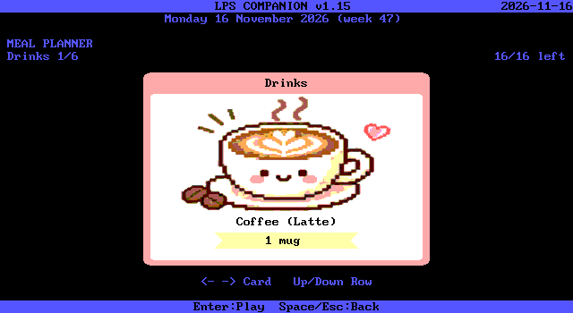
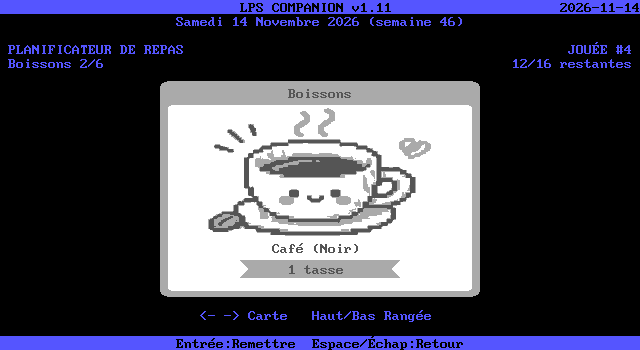
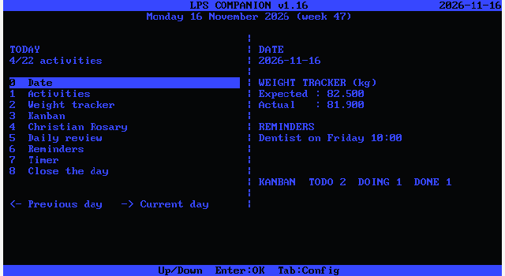
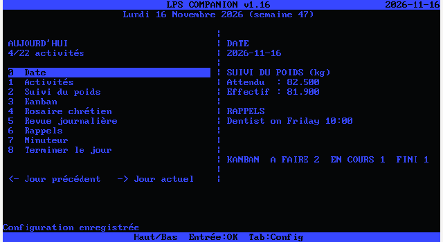
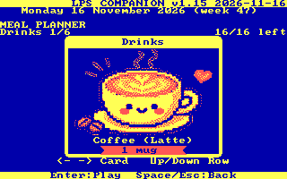
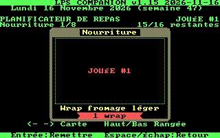

# LPS Companion for MS-DOS

**English** | [Francais](#lps-companion-pour-ms-dos)

A full port of [LPS Companion v1.15](https://github.com/TME520/LPS-Companion-PicoCalc) (PicoCalc) to real-mode 16-bit MS-DOS, now at **v1.16**
for Intel **8088**-class PCs with **640 KB** conventional memory. Keyboard only
(no mouse). Text mode **80×25** (content laid out in 40 columns, same as the
Companion). Data lives under `C:\LPS\` by default and uses the **same**
`SAVE_A.JSN` / `SAVE_B.JSN` (JSON save, schema 2), `EXPORT\*.ics` and
`WEIGHTS\*.csv` formats as the PicoCalc firmware v1.13 and later.

Ready-to-run files are at the **repository root** (the directory above this one): [`../LPSCOMP.EXE`](../LPSCOMP.EXE), [`../ROSARY.DAT`](../ROSARY.DAT), [`../MEALS.DAT`](../MEALS.DAT), [`../MEALSCGA.DAT`](../MEALSCGA.DAT) and [`../HELLO.EXE`](../HELLO.EXE). Copy **`LPSCOMP.EXE`, `ROSARY.DAT`, `MEALS.DAT` and `MEALSCGA.DAT` into the same directory** on the Book 8088; `ROSARY.DAT` holds the rosary prayer texts, `MEALS.DAT` the Meal Planner card pictures for EGA and `MEALSCGA.DAT` the same pictures for CGA (LPS-DOS-115-CHG14). Without `ROSARY.DAT` everything works except the Rosary, which then shows *ROSARY.DAT not found: copy it next to LPSCOMP.EXE*; without `MEALS.DAT` the Meal Planner runs in text mode on EGA; without `MEALSCGA.DAT` the CGA planner shows empty card frames. `make dos`, `make rosary`, `make meals`, `make mealscga` and `make hello` rebuild into this directory only; those local copies are gitignored. After a source change, copy the new files up (`cp LPSCOMP.EXE ROSARY.DAT MEALS.DAT MEALSCGA.DAT HELLO.EXE ..`) so the root copies stay current. CI rebuilds and fails if the root files differ.

The screen is the full **80×25** text mode (no 43/50-line modes). Home is two panes: the menu on the left, and a day summary (date, weight, reminders, kanban counts) on the right. The 22 activities sit on one page in three columns (see *Activities* below). Kanban shows TODO, DOING and DONE side by side. The rosary uses 80-character lines; the timer stays centered. Keys, English and French wording, palettes, and the SAVE/ICS/CSV bytes are unchanged. On the 8088 the video driver rewrites only the rows that changed.

Long texts (the rosary prayers) wrap at spaces, never inside a word; a word longer than the 80-column line is cut (LPS-DOS-115-CHG03c). Highlighted bars no longer blink on CGA, EGA or VGA: at start-up the program makes attribute bit 7 mean "bright background" (INT 10h AX=1003h on EGA/VGA, the 3D8h mode register on CGA), and on exit it restores the blink setting and the cursor shape, and leaves the last screen without bit 7. The five palettes keep their colours; their bars are now the bright shade of the text colour (orange stays brown).

As in PicoCalc v1.12, XP and keepsakes no longer appear on any screen (LPS-DOS-115-CHG01). The line under the title bar shows the long date and ISO week of the viewed day, for example **Sunday 8 November 2026 (week 45)** / **Dimanche 8 Novembre 2026 (semaine 45)**; it stays blank for an undated day. On the Daily Review (LPS116-FEAT02-CHG03) that line uses the full date in the language in use, for example **Monday 16 November 2026 - Week 47** / **Lundi 16 novembre 2026 - Semaine 47** (weekday capitalised, French month in lowercase, no leading zero, week number only). The longest form, **Mercredi 30 septembre 2026 - Semaine 40**, is 39 characters and fits the CGA 40-column fold. Other screens keep the v1.15 wording. Under that date (LPS116-FEAT02-CHG04) the Daily Review lists the title **DAILY REVIEW**, the day's actual weight as **Actual weight: 81.200 Kg** (or **-- Kg** if none), then **KANBAN** and each focused card on its own line (**No focused card** if none), then **MEAL PLANNER** with **Drinks: 3/6**, **Food: 4/8**, **Blank: 1/2** (played/total in the row; the deck has 6, 8 and 2 cards) and **Next: Light Cheese Wrap (Tea)** — the first unplayed Food card in deck order, then the first unplayed Drink in parentheses, using the planner's names, or **--** / **(--)** when a row is exhausted — then **ACTIVITIES** and one ticked activity per line (**No activity** if none). Kanban is omitted on an archived day; the meal lines then show **--**, because the save does not keep the deck per day. When the list is longer than the 21 content rows (LPS116-FEAT02-CHG05), **Up/Down** move one line and do not wrap; **Left/Right** (as in v1.15), **PgUp** and **PgDn** move a page, and **Home** / **End** jump to the ends. A CP437 arrow at the right of the first or last content row marks that more text sits above (↑) or below (↓); there is no marker when everything fits. The footer reads **Up/Down: scroll** and the visible range only while scrolling is possible, and keeps **Esc back**. Opening the review starts at the top; TAB and SPACE overlays come back to the same place on today. An archived day (LPS116-FEAT02-CHG06) has a third menu entry, **3 Daily review**, which opens that day's review (full date, archive banner, that day's weight, no KANBAN, meal lines **--**, frozen activity names). Esc returns to the archived-day menu with the cursor on that entry. TAB and SPACE stay on the review and show the read-only notice, as on the other archived screens and on PicoCalc v1.15. XP is still banked in `SAVE_A`/`SAVE_B` so old and new saves stay compatible, and the ICS description keeps an empty `XP:` line, byte for byte like the PicoCalc.

As in PicoCalc v1.12, the notepad is gone (LPS-DOS-115-CHG02) and the Home menu is renumbered **0 Date, 1 Activities, 2 Weight tracker, 3 Kanban, 4 Christian Rosary, 5 Daily review, 6 Config, 7 Reminders, 8 Timer, 9 Close the day**; an archived day offered **1 Activities, 2 Weight tracker**. Since LPS-DOS-115-CHG10 Config has left the menu (TAB opens it) and the entries are **0–8**, and since LPS-DOS-115-CHG11 only the entries checked in Config > Activities are shown, as on the PicoCalc v1.15.

**Activities** (LPS-DOS-115-CHG05, as PicoCalc v1.13 CHG08/08b/08c) come from the activity catalog in the save, not from a fixed list. A new save starts with the PicoCalc's **22 default activities**, with the same ids, names and order: the 16 earlier ones plus **Sport, Cooking, Chores, Family, Friends, Meditation** / **Sport, Cuisine, Ménage, Famille, Amis, Méditation**. A catalog customised on the PicoCalc (up to 30 entries, renamed or reordered) shows on DOS as it is.
- The screen has **three columns** of up to 10 rows, filled top to bottom: 22 activities are 8 + 8 + 6, and 30 fit in 10 + 10 + 10, so the whole list is on one page. Names longer than 20 characters are cut in the grid; the selected one is shown whole under the grid.
- **Up/Down** move within a column and wrap. **Left/Right** move to the next or previous column, keep the row (or the column's last entry), and wrap from the last column to the first. **Enter** (or Space) ticks the selected activity.
- **1–9, 0** tick rows 1 to 10 of the column the cursor is in. Only that column shows the key numbers, so the shortcut you see is the one you press, as on a PicoCalc page. A digit past the column's last entry does nothing. On an AZERTY keyboard the unshifted top row works too (see *Keyboard* below).
- Home shows **n/22 activities**, with the catalog's size as the total.
- An **archived day** shows the names it was closed with, read-only, as on the PicoCalc: the catalog ticks, then, ticked, any name the catalog no longer has. A day with more than 30 items (only possible in an archive) gets pages, shown as `ACTIVITIES  1/2`; Left/Right move across them.
- **Closing the day** freezes the ticked names in the history, in catalog order, as the PicoCalc does. The ICS lists the ticked activities in catalog order in the ICS language, and the save is written the PicoCalc's way, so the ICS, the CSV and the save stay byte-compatible.

**Custom activities** (LPS-DOS-115-CHG06, as PicoCalc v1.13 CHG07/07b), from the Activities screen, keyboard only:
- **E** renames the activity under the cursor, **N** adds one at the end (30 at most: *Limit: 30 activities*), **Del** deletes it after a confirmation (*Delete Walk?*, **Enter** yes, **Esc** no), **F4** / **F5** move it up or down and wrap from the first to the last place and back, as in the Kanban. Today's tick and the cursor follow the moved entry.
- A name is saved **in the current language only** (`"fr"` or `"en"` of the catalog entry); if the other language has no name, the same name shows in both. Up to 24 characters; spaces at the ends are trimmed; an empty name cancels; a name already in the list (any case) is refused with *That name already exists*.
- Names are typed in CP437 on screen and saved in UTF-8, so **é, è, ç, à** and the other CP437 letters work, from a French keyboard (`KEYB FR`) as well. The save allows 24 bytes and an accented letter takes two of them; since LPS-DOS-115-CHG06d the counter shows these bytes (*15/24 characters*) and a letter that would not fit is not typed, as for tasks. Text fields keep the characters; every screen keyed by digits reads the top row by key position (see *Keyboard* below).
- **Past days keep the names they were closed with.** Renaming an activity in French (the name a day stores) or deleting it leaves the old name in history: the archive shows it after the catalog, ticked and read-only. In an archived day, E, N, Del, F4 and F5 say *Archived day: read-only*.
- Edits are written to the save on Esc back to Home, like the other DOS edits. The save and the ICS stay byte-compatible with the PicoCalc for the same list.

### Keyboard: top row by key position (LPS-DOS-115-CHG06b)

On every screen keyed by digits (Home, the archived-day menu, Config, Language, Colors, Timer, Activities, Kanban moves, the reminder date and days, Date, Weight), the main keyboard's top row is read by its **BIOS scan code** (int 16h, 02h–0Bh = 1–9, 0), whatever the layout and Shift. On AZERTY (`KEYB FR`) `&`, `é`, `"`, … give 1, 2, 3, … without Shift; with Shift they still give the digits. On QWERTY, Shift+7 (`&`) is 7, never 1 by accident. The numeric keypad (NumLock on) gives digits too.

- Text fields get the real characters: activity names, Kanban task names and reminder text (é, è, ç, à, and ê, ô, ë… from the dead keys).
- Where a hyphen is typed (Date, reminder date, Kanban reorder), the AZERTY unshifted 6 key stays `-`; use Shift+6 for the digit 6.
- AltGr on a top-row key (AZERTY `~ # { [ | \` ^ @ ] }`) also counts as its digit on those screens.

### Accented task names and reminders (LPS-DOS-115-CHG06c)

Kanban task names and reminder texts take the CP437 letters, like activity names: é è ê ë à â ä å ç î ï ì ô ö ò û ù ü ÿ É Ç Ä Å Æ Ö Ü æ ñ Ñ á í ó ú, and ¢ £ ¥ (₧ and ƒ are refused since CHG06d: the PicoCalc cannot show them). With `KEYB FR`, é è ç à ù are on their keys and ê â ô û î, ë ï ü come from the ^ and ¨ dead keys.

- On screen they are CP437; in memory and in the files they are UTF-8 (see *Same files everywhere* below). The PicoCalc reads these saves and writes them back byte for byte (`tests/fixtures/picocalc_accents.jsn`).
- The limit is the PicoCalc's: **32 bytes of UTF-8**. An accented letter takes 2 bytes, so a name holds 32 plain letters or 16 accented ones; a letter that would not fit is not typed. The task counter counts these bytes, as on the PicoCalc (*32/32 characters*).
- Tasks and reminders are not in the ICS (as on the PicoCalc); the note and activity names there are UTF-8. The old `.BIN` saves never held accents (both writers were ASCII-only); after the migration, accents go to the JSON save.

### Same files everywhere (LPS-DOS-115-CHG06d)

The JSON saves, the ICS files and the weight CSV are the same bytes on the PicoCalc, DOS and the console version: a file written by one is read and written back unchanged by the others.

- Every text read from a save stays in memory as its exact UTF-8 bytes: task names, reminder texts, notes, catalog names and the names a past day keeps. Only the screen converts to CP437, so a character CP437 lacks (œ, À, €, an emoji) shows as `?` but is never changed in the files, even when its task or activity is opened and saved.
- A typed letter is turned into UTF-8 at once; Backspace removes one whole character (an emoji's 4 bytes at a time). Limits are UTF-8 bytes, as on the PicoCalc: 32 for a task or a reminder, 24 for an activity name, and the counters show bytes.
- Tested with PicoCalc-written fixtures (`tests/fixtures/picocalc_intl.*`, from `tools/picocalc_fixture.cpp intl` and `close`): DOS reads and writes the JSON byte for byte; closing that day on DOS writes the same ICS, weight CSV and next save as the PicoCalc's Finish screen (only the ICS file name differs, CHG02c); the PicoCalc reads DOS's saves and writes them back unchanged. The old `.BIN` migration is unchanged (those files only hold ASCII).
- Speed on an 8088 (DOSBox `cputype=8086`, `cycles=fixed 300`): a Kanban key with 24 tasks takes about 295 ms (was 281 ms), with emoji and € in the tasks 110–123 ms (was 96–103 ms); other screens are within a few ms. Plain ASCII text is drawn without a copy.

### Meal Planner (LPS-DOS-115-CHG07)

As on the PicoCalc v1.14/v1.15, **Space on Home** opens the Meal Planner: a deck of 16 cards in three rows, **Drinks** (6), **Food** (8) and **Blank** (2). On a colour EGA or VGA screen the planner switches to EGA graphics (640×350, 16 colours) and shows each card with the original card illustrations from the PicoCalc (`assets/meal_deck_sheet1.png` and `meal_deck_sheet2.png`, the same files), its name and portion. The rest of the screen keeps the text layout and the user's palette colour.

- **Left/Right** change card, **Up/Down** change row; both wrap. **Enter** plays the card (it turns grey and shows **PLAYED #n**, its place in the played order) or puts a played card back. **Space** or **Esc** returns to Home in text mode, with the blink setting, cursor and colours restored. On an archived day Space shows the read-only notice.
- The played order is the PicoCalc's `"meals":{"played":[…]}` in the save, byte for byte (tested with a save written by the PicoCalc's own code, `tests/fixtures/picocalc_meals.jsn`). DOS writes the save when the planner closes, like its other screens; the PicoCalc writes after each play. Closing the day starts a new deck, as on the PicoCalc.
- **Pictures:** `tools/mkmeals.py` (Python 3, standard library only; `make meals`) cuts the 13 card pictures out of the two sheets the way the PicoCalc's `meal_sprites.py` does, scales them to 240×128 EGA pixels (with the EGA's tall pixels taken into account) and picks for each card the 10 nearest of the EGA's 64 colours, plus the card body, ink, edge and ribbon colours. The artwork itself is not redrawn. The 13 pictures, stored by bit plane, make `MEALS.DAT` (199,964 bytes). LPSCOMP reads a picture from disk the first time it is shown and keeps it in far memory until the planner closes (15 KB each; when memory runs short it frees the others first).
- **Without colour EGA or CGA** (MDA/Hercules, mono EGA, an EGA card with only 64 KB), or when `MEALS.DAT` is missing or damaged on EGA, or memory runs out, the planner still works in **text mode**: the same cards, keys and save, drawn as a text box with the name and portion, and a line saying why (*No EGA/CGA colour screen: Meal Planner in text mode*, *MEALS.DAT not found: copy it next to LPSCOMP.EXE*, *MEALS.DAT is damaged: copy it again*, *Not enough memory for the pictures*).
- **Played cards** are greyed through the palette only: no pixel is redrawn.
- **Checks:** `MEALS.DAT` starts with `LPSMEALS`, version 1, 13 pictures of 240×128, then a table (16 palette bytes and a 32-bit sum per picture) protected by a CRC-32; the file size must match. Each picture is checked against its sum (two 16-bit running sums, as in Fletcher's checksum) when it is loaded, not with a CRC-32: a CRC-32 of one 15 KB picture took 1.2 s on the 8088, the sum takes 0.11 s.
- **Speed on an 8088** (DOSBox `machine=ega`, `cputype=8086`, `cycles=fixed 300`): Space on Home → planner drawn in 0.50 s (mode switch, whole screen, first picture read and checked); Left/Right to a picture not shown yet 0.24 s (0.155 s of it is the disk read and check), to a picture already in memory 0.15–0.16 s; Up/Down 0.17 s; Enter (play or put back) 0.15 s; Esc back to the text Home 0.22 s, plus the save (0.6 s for a small save). Drawing a whole card takes 88 ms. A real floppy or hard disk adds its own read time to the first view of each picture.
- SPACE and TAB work from every screen since LPS-DOS-115-CHG09 (see below).

### Meal Planner CSV (LPS-DOS-115-CHG08)

Leaving the Meal Planner (**Space** or **Esc**) rewrites `EXPORT\MPYYMMDD.CSV` for today, for example `EXPORT\MP261114.CSV` for 14 November 2026, as the PicoCalc v1.15 does (LPS-114-CHG02). The name is the PicoCalc's own: it is already 8.3, so unlike the ICS files (CHG02c) **there is no mapping**, and a file copied either way between `C:\LPS\EXPORT\` and the SD card's `LPS/EXPORT/` keeps its name.

```
order,category,card,portion
1,Drinks,Tea,1 cup
2,Drinks,Coffee (Latte),1 mug
3,Blank,Blank,
```

- **The same bytes as the PicoCalc**: CRLF line ends, UTF-8 (the names are plain ASCII), the played cards in order of play, the English names and portions whatever the screen language, an empty portion for Blank cards, RFC 4180 quoting. The code is the PicoCalc's `mealCsvName`, `writeCsvField` and `writeMealCsv`, line for line. `tests/fixtures/mealcsv/` holds files written by the PicoCalc's own code (`tools/picocalc_fixture.cpp mealcsv`), and the host tests compare DOS's output with them byte for byte (5 cards, and all 16 with a card put back and played again). In DOSBox, the file DOS wrote equals the one the PicoCalc's writer makes from the save DOS wrote.
- **When**: on every exit from the planner, after the save. Entering does not write. The whole file is rewritten each time. With nothing played, no file is created, but an existing file is reset to its header line. A failed write removes the incomplete file and shows *Meal CSV export failed* / *Export CSV repas échoué* on Home; the deck stays saved and the next exit tries again. An undated day writes nothing and shows *Set Date to export meals* / *Renseignez Date pour exporter les repas*.
- **Closing the day writes no CSV**, as on the PicoCalc: you can only reach Close the day from Home, so the file of the closed day is the one written when the planner was last left, and it stays as it is. The next day starts with a new deck (since LPS-DOS-115-CHG07) and gets its own file once a card is played.
- **Speed on an 8088** (DOSBox, `cputype=8086`, `cycles=fixed 300`): the export takes 13 ms with nothing played, 34 ms with 5 cards and 89 ms with all 16 (it was 144 ms before the file was built in memory and the per-field `strpbrk` was replaced by a single pass). Leaving the planner takes one BIOS tick (55 ms) more than before: 0.28 s instead of 0.22 s, or 0.66 s instead of 0.61 s when the save is written too. A real disk adds its own write time.






### TAB and SPACE everywhere (LPS-DOS-115-CHG09)

As on the PicoCalc v1.15 (LPS-115-CHG02/02b), **TAB opens Config** and **SPACE opens the Meal Planner** from any screen, not only from Home: Activities, Kanban, the Rosary, the daily review, Reminders, the Timer, and so on.

- **TAB again** (or Esc, or Save) closes Config and goes back to the screen it was opened from, on the same entry; **SPACE again** (or Esc) closes the planner the same way. Each overlay remembers one return point: from the planner, TAB opens Config, and TAB in Config goes back to the planner, which goes back to its own screen. SPACE does nothing in Config.
- **Not while typing or confirming**: the Date, activity names (E/N), Kanban tasks, reminder text and dates, the close-the-day confirmation, the reminder popup and the Activities delete prompt keep TAB and SPACE for themselves (SPACE types a space). On the **Weight tracker**, **Up/Down** switch between the expected and actual fields, **TAB** opens Config with both fields kept as typed, SPACE is ignored and **Enter** saves both fields, as on the PicoCalc.
- SPACE therefore **no longer ticks** in Activities (Enter and 1–9, 0 do) and **no longer moves on** in the Rosary (Enter does), as on the PicoCalc.
- On an archived day (read-only) TAB and SPACE show the read-only notice, as on the PicoCalc.
- The screen underneath is not reset: the Rosary keeps its page and its texts stay loaded, the planner keeps its pictures in memory while Config is open over it, and the Kanban, Reminders or Activities keep their cursor.
- **The timer keeps running** behind Config and the planner. When it ends, the end screen is shown; if the planner was open (directly or under Config), the save is written and the meal CSV is exported first, as when leaving the planner.
- Config also has a Home entry until LPS-DOS-115-CHG10, which removes it as on the PicoCalc v1.15.
- **Speed on an 8088** (DOSBox `machine=ega`, `cputype=8086`, `cycles=fixed 300`): TAB from Home to Config 0.11 s, back 0.17 s; SPACE from Kanban to the planner 0.61 s (mode switch, first picture read and checked), back 0.17 s; from the planner TAB to Config 0.17 s (EGA back to text) and TAB back to the planner 0.33 s (text to EGA, picture already in memory); SPACE from a Rosary prayer to the planner 0.50 s, back 0.17 s, with no reload of `ROSARY.DAT`. The timer costs nothing while the planner is shown (the planner is not redrawn every second).

### Config off the Home menu, Config > Activities (LPS-DOS-115-CHG10)

As on the PicoCalc v1.15 (LPS-115-CHG01, CHG03, CHG05), same code paths and texts:

- **Home has no Config entry any more**: **TAB** opens Config (see CHG09). The menu is renumbered **0 Date, 1 Activities, 2 Weight tracker, 3 Kanban, 4 Christian Rosary, 5 Daily review, 6 Reminders, 7 Timer, 8 Close the day**; **9** does nothing. The bottom line reads **Up/Down  Enter:OK  Tab:Config**. An archived day offered **1 Activities, 2 Weight tracker**; 0 and 3–8 showed the read-only notice there. Since LPS116-FEAT02-CHG06 it also offers **3 Daily review** (PicoCalc v1.15 still has only 1–2); 0 and 4–9 show the read-only notice.
- **Config** reads **1 Language, 2 Colors, 3 Activities (with a count, e.g. `3  Activities: 7/9`), 4 Save**: **Save moves from 3 to 4**. Hints: *Language, Activities: then Save.*, *Esc: discard changes*, *Tab: close Config*.
- **3 Activities** lists the nine Home entries with a checkbox each (`[x]` shown, `[ ]` hidden). **Up/Down** move (they wrap), **Enter** shows or hides the entry. **Date** and **Close the day** are always shown: they are tagged `(locked)` / `(verrouillé)` and Enter only says *Always shown*. Esc goes back to Configuration and keeps the choice; TAB closes Config and drops it; SPACE does nothing.
- Like the language, the choice is **pending until 4 Save**, which writes the language and the entries in one save and goes back to the screen Config was opened from. A finished timer that takes over drops it, and so does reopening Config.
- **If the save cannot be written**, Config stays open with the choice still pending, the old settings stay in force and the old file is untouched, as on the PicoCalc (*Save failed: restart device*). Colors does the same. Earlier DOS builds kept the new settings in memory, closed Config and said *Configuration saved*.
- **In the save** the choice is the PicoCalc's `"homeHidden"` key, byte for byte: ids in menu order after `"meals"`, for example `"homeHidden":["activities","daily_review"]`, `[]` when everything is shown, `date` and `close_day` never written, unknown ids ignored. DOS has read and written the key unchanged since CHG04; it is now `State.hiddenHome` (the separate far-heap block is gone). Checked: a save DOS wrote under DOSBox goes through the PicoCalc's own reader and writer (`tools/picocalc_fixture.cpp resave`) and comes out byte-identical; a PicoCalc save with Kanban and Rosary hidden shows `7/9` and `[ ]` on those two in DOS Config.
- Home shows only the checked entries since LPS-DOS-115-CHG11 (below).
- **Speed on an 8088** (DOSBox, `cputype=8086`, `cycles=fixed 300`): TAB to Config 0.11 s; 3 to the list 0.17 s; Up/Down 0.14 s; Enter (toggle) 0.13 s; Esc to Configuration 0.11 s; a Down on Home 0.17 s. 4 Save is the usual save write and read-back: 0.6 s for a small save, 3.2 s for a 31-day, 9.8 KB save (unchanged by this change).

### Home shows the checked entries only (LPS-DOS-115-CHG11)

As on the PicoCalc v1.15 (LPS-115-CHG04), same code paths:

- Today's Home lists **only the entries ticked in Config > Activities**, in their usual order, **numbered 0 to n−1 without gaps**. With Activities and Daily review hidden it reads `0  Date`, `1  Weight tracker`, `2  Kanban`, `3  Christian Rosary`, `4  Reminders`, `5  Timer`, `6  Close the day`. Date is always first and Close the day always last, so the menu is never empty.
- **Digits** open the entry at that position; digits past the end do nothing. The AZERTY top row works the same way by scan code (CHG06b): `é` is 2, `(` is 5. **Up/Down** move over the shown entries only and wrap.
- **The cursor stays on its entry**: after Config (closed by Save, TAB or Esc, from any of its screens) and after the Meal Planner, also when Config was opened over the planner, Home comes back with the cursor on the same entry at its new number. If that entry was just hidden, the cursor goes to the next shown entry below it (Close the day at the latest). Every other way back to Home starts on Date, as before.
- **Hidden entries keep working**: their data stay, a ticked activity still closes the day and shows in the archive, and a timer started before its entry was hidden runs to the end.
- **The archived-day menu is not filtered**: `1  Activities`, `2  Weight tracker`, and since LPS116-FEAT02-CHG06 `3  Daily review` (PicoCalc v1.15 still has only 1–2).
- The save does not change: `"homeHidden"` as in CHG10, byte for byte as the PicoCalc. Saves written by DOS under DOSBox with entries hidden go through the PicoCalc's reader and writer unchanged.
- **Speed on an 8088** (DOSBox `machine=ega`, `cputype=8086`, `cycles=fixed 300`): Down on Home 0.19 s with 9 entries, 0.17 s with 7; a digit and Esc back 0.45 s; TAB/TAB with the cursor kept 0.39 s for the pair; SPACE/SPACE through the planner 0.84 s for the pair; Config's Save back to the filtered Home 0.88 s with the write and read-back of a small save.

### Version 1.15 (LPS-DOS-115-CHG12)

The title bar and the start-up banner read **LPS COMPANION v1.15**, as on the PicoCalc v1.15 (LPS-115-CHG06). With LPS-DOS-115-CHG01 to CHG11 the DOS port now has the PicoCalc v1.15 features and files: JSON saves, ICS, weight CSV and Meal Planner CSV are byte-compatible; the differences left are listed under *Known differences*. The screenshots in `captures/` were taken again under DOSBox (`machine=ega`, `cputype=8086`, `cycles=fixed 300`) with v1.15. A test list for the real Book 8088 is in [`BOOK8088-TEST.md`](BOOK8088-TEST.md).

The **Timer / Minuteur** offers **5, 30 or 60 minutes** (LPS-DOS-115-CHG02b, as PicoCalc v1.12 CHG01/CHG02). Keys **1**, **2** and **3** start a duration directly, without Enter. On the completion screen they start a new countdown at once and Enter returns to the duration menu; while a countdown runs they are ignored, and Enter pauses or resumes. Timing still comes from the BIOS tick (about 55 ms).

French is shown with its accents (LPS-DOS-115-CHG03): **Activités, Journée, Rosaire chrétien, Revue journalière, Février, Août, Décembre…**, with the PicoCalc's wording, in the PC's own code page 437 font. CP437 has é è ê ë à â ä ç î ï ô û ù ü and É, but no other accented capitals, so À, È, Ê, Ô and  show without their accent (À FAIRE → A FAIRE, NOTRE PÈRE → NOTRE PERE, TÂCHE → TACHE). Files stay UTF-8 like the PicoCalc's: a French ICS now writes `Activités:` and accented activity names exactly as the PicoCalc does (earlier DOS builds wrote `Activites:`). See *Text encoding* below. A note already saved by an older version is kept in the save and still exported to the ICS (`\NNote: ...`) when its day is closed; it is no longer shown or editable.

Saves are JSON files, `SAVE_A.JSN` and `SAVE_B.JSN`, exactly as on the PicoCalc v1.13 and later (LPS-DOS-115-CHG04, PicoCalc LPS-113-CHG06). The data folder can be copied both ways between the PicoCalc SD card (`LPS/`) and `C:\LPS\`: when no Kanban card is focused, the two machines write the same schema 2 file, with the same keys in the same order, the A/B alternation, the generation number and the CRC-32 as the last key, and each machine opens the other's saves.
- **Kanban focus** (LPS116-FEAT01-CHG02): a focused card is written as `{"status":"todo","name":"Alpha","focus":true}`. A card that is not focused stays in the v1.15 form `{"status":"todo","name":"Alpha"}`, so a save with no focus is byte-identical to v1.15. `"focus":false` or a missing key means not focused; a focus on a DONE card is dropped on load. Focus is not stored in archived days, not in the old `.BIN` wire, and not in the ICS or CSV exports. PicoCalc v1.15 skips the unknown key and does not write it back.
- **Migration**: when `C:\LPS\` has no `.JSN` save yet, LPSCOMP reads the old `SAVE_A.BIN`/`SAVE_B.BIN` (formats v1 to v6, as before) and writes `SAVE_A.JSN` at start-up. The `.BIN` files are never modified or deleted; they stay as a backup. A `.JSN` save cannot be read by an earlier DOS build.
- **The activity catalog** (`{"id","fr","en"}` entries) is used since LPS-DOS-115-CHG05, and each day's activity names are kept, including names the catalog no longer has.
- **PicoCalc data that DOS does not use yet is kept**: the hidden Home entries (`"homeHidden"`), written back unchanged (chosen in Config > Activities since LPS-DOS-115-CHG10). The Meal Planner deck (`"meals":{"played":[…]}`) is used since LPS-DOS-115-CHG07. Closing the day on DOS resets the meal deck, as the PicoCalc does. A DOS tick on an activity that the PicoCalc renamed goes under the PicoCalc's name, as it does there.
- **Text** (notes, tasks, reminders) is UTF-8 in the file, as on the PicoCalc, and CP437 on screen. A character that CP437 does not have (for example `€`, `œ` or an emoji) is read as `?` and written back as `?`.
- Unknown keys are skipped, as on the PicoCalc, and are not written back. A save from a newer schema (version 3 or later) is refused and protected: LPSCOMP shows the read error and does not overwrite it.
- After each write, LPSCOMP reads the file back and checks its CRC-32 and generation before it marks the slot as current. The PicoCalc parses the whole file again at this point; DOS checks the CRC only, which is much faster on the 8088.





### Meal Planner on CGA (LPS-DOS-115-CHG13)

The Book 8088 has a **CGA** card, so the planner now has a CGA graphics mode as well. LPSCOMP picks the screen when the planner opens:

1. **EGA/VGA in colour** (INT 10h AH=12h answers, 128 KB or more): EGA 640×350, unchanged (LPS-DOS-115-CHG07).
2. **Colour CGA** (no EGA BIOS, the equipment word says colour rather than MDA/Hercules mono, and the 6845 at 3D4h answers): **320×200, 4 colours** (BIOS mode 04h), palette 0 high intensity (light green, light red, yellow). Colour 0 is black, or blue for the Blue colour theme. Text is green, red or yellow, whichever is nearest the theme (Blue: yellow on blue, Pink: light red).
3. Anything else: the text card, as before.

- **Same layout as EGA, scaled to 320×200.** The title, labels and footer use an 8×8 font on a 40-column grid. Each 80-column row is folded to 40 columns by `lps_fold_row` (`src/wrap.c`, host-tested): blocks of text separated by 6 or more spaces keep their text and are placed by where they sat (right edge → right-aligned, centred → centred, else the left indent is halved); blocks never overlap, and anything too wide is cut. The card (176×136, text rows 5–21) has a yellow rounded border with the row's name on its band, the picture box, the name, and the portion on a red ribbon with notched ends.
- **Font:** `src/cgafont.c` holds the CGA's 8×8 CP437 font (2 KB, taken from DOSBox Staging, GPL-2.0-or-later). Many CGA BIOSes leave the upper-128 glyphs (INT 1Fh) empty, so without it é, è, É and the other accented letters would not show in graphics mode.
- **Pictures:** since LPS-DOS-115-CHG14 the picture box shows the card's picture from `MEALSCGA.DAT` (next section). In CHG13 it was a dotted placeholder frame, which now shows only when `MEALSCGA.DAT` is missing or damaged. A played card is greyed out by a checkerboard and shows **PLAYED #n** / **JOUÉE #n** (LPS-DOS-115-CHG15, below). `MEALS.DAT` is not read on CGA.
- **Mode switches:** leaving the planner, or opening Config/Space over it with TAB, sets the text mode back, with bright backgrounds instead of blink, the cursor hidden and the text palette restored (the BIOS mode set reloads 3D9h). Coming back sets mode 04h again and redraws the whole screen.
- **Files unchanged:** saves, `MPYYMMDD.CSV`, ICS and weight CSV are the same bytes on every screen.
- **Speed on an 8088** (DOSBox `machine=cga`, `cputype=8086`, `cycles=fixed 300`):

  | Action | Time |
  |---|---|
  | Space from Home to the planner (mode 04h + card) | 0.50–0.55 s |
  | Left/Right/Up/Down, new card | 0.22 s |
  | Enter, play / put back | 0.28–0.33 s |
  | TAB, planner → Config | 0.17 s |
  | TAB, Config → planner | 0.39–0.44 s |
  | Esc to Home (save + CSV) | 0.72 s |

  EGA for comparison: open 0.50 s, card 0.23 s.
- **CGA snow:** mode 04h does not snow, even on an original IBM CGA (snow only hits its 80-column text mode). The text screens write VRAM directly as before, so a true IBM CGA or an exact clone could show brief snow there; most later CGA chips do not. DOSBox shows no snow either way. Check this on the Book 8088 ([`BOOK8088-TEST.md`](BOOK8088-TEST.md)).

### CGA pictures: MEALSCGA.DAT (LPS-DOS-115-CHG14)

The CGA planner now shows the card pictures, converted from the user's own sheets (`assets/meal_deck_sheet1.png`, `assets/meal_deck_sheet2.png`; nothing redrawn). The user picked the conversion from three trial sheets: **B, Atkinson error diffusion**.

- **Conversion** (`tools/mkmealscga.py`, Python 3 standard library only, `make mealscga`):
  1. The same crop as `tools/mkmeals.py`, which it imports.
  2. The drawing is fitted into the **160×96** picture box with the CGA pixel aspect (1.2).
  3. Saturation ×1.35, then contrast ×1.15.
  4. Serpentine Atkinson dithering in linear light, nearest colour in CIELAB, to palette 0 high intensity. The error is clamped and never spreads to the card background.
  5. The background is colour 0: black, or blue with the Blue theme.
- **Deterministic:** `make test` rebuilds the file and compares it with `../MEALSCGA.DAT`, like `MEALS.DAT`.
- **File:** 49,996 bytes.
  - Magic `LPSMEALC`, version 1, 13 pictures of 160×96, 3,840 bytes each.
  - A table with each picture's 32-bit sum, protected by a CRC-32.
  - The pictures, in the CGA's own 2-bit layout (40 bytes per row, leftmost pixel in bits 7–6), so one row is one copy to video memory.
  - `src/meals.c` reads `MEALS.DAT` and `MEALSCGA.DAT` with the same code.
- **On demand, CGA only:**
  - The table (52 bytes) is read when the planner opens.
  - A picture is read the first time its card shows, its sum is checked, and it is kept in far memory (3.75 KB each, at most 49 KB) until the planner closes.
  - `MEALS.DAT` is not read on CGA, and `MEALSCGA.DAT` is not read on EGA.
- **Fallback:** if `MEALSCGA.DAT` is missing, damaged, or a picture fails its sum, the planner stays in CGA graphics. The card shows the dotted empty frame (and *~ Blank ~* on Blank cards), and row 23 says *MEALSCGA.DAT missing: no pictures* or *MEALSCGA.DAT damaged: no pictures* (FR: *MEALSCGA.DAT absent : pas d'images*, *MEALSCGA.DAT abîmé : pas d'images*). Both messages fit the 40-column row.
- **Speed on an 8088** (DOSBox `machine=cga`, `cputype=8086`, `cycles=fixed 300`):

  | Action | Time |
  |---|---|
  | Space from Home (mode 04h, table, first picture) | 0.55 s |
  | Card not seen yet (disk read + sum + draw) | 0.22–0.24 s |
  | Card already in memory | 0.20–0.21 s |
  | Enter, play / put back | 0.28 s |
  | TAB → Config | 0.17 s |
  | TAB → planner (redraw with picture) | 0.39 s |
  | TAB/TAB round trip | 0.59 s |
  | Esc to Home (save + CSV) | 0.72 s |
  | Space/Space round trip (pictures read again) | 0.75 s |

  DOSBox reads files almost instantly. On the Book 8088's own disk, a picture's first read (3.8 KB) will add more.



### CGA played card (LPS-DOS-115-CHG15)

On EGA a played card turns grey through the palette registers, without moving a pixel. Mode 04h has only one 4-colour palette for the whole screen, so the CGA greys the card another way.

- **Checkerboard:** every other pixel of the whole card (border, header band, picture, name and ribbon) becomes colour 0, the background. The card reads as faded, like the EGA grey, and its colours still show. Colour 0 is the theme background, so the card fades towards blue with the Blue theme and towards black with the others.
- **PLAYED #n / JOUÉE #n** sits in the middle of the picture on a solid box (colour 0 inside a yellow frame), so it stays sharp over the checkerboard. On a Blank card without `MEALSCGA.DAT`, *~ Blank ~* moves up to make room for it.
- **Fast:** colour 0 is `00` in video memory, so greying is one AND per word. The mask is fixed for each line parity (`CCCCh` on even lines, `3333h` on odd ones; `lps_cga_grey_mask` in `wrap.c`, host-tested). The card is 22 words wide and 136 lines tall: 2,992 word ANDs, about one 55 ms timer tick on an 8088.
  - Playing the card on screen only greys what is there and adds the box. It no longer redraws the card, so it is faster than in CHG14.
  - Showing a card that is already played (moving onto it, coming back from Config) draws it, then greys it.
  - Putting a card back redraws it normally. The result is identical to the card before it was played.
- **The EGA is unchanged.**
- **Speed on an 8088** (DOSBox `machine=cga`, `cputype=8086`, `cycles=fixed 300`, 10-play average; the timer ticks every 55 ms):

  | Action | CHG14 | CHG15 |
  |---|---|---|
  | Enter, play | 0.28 s | 0.22 s |
  | Enter, put back | 0.28 s | 0.28 s |
  | Left/Right onto a played card (picture in memory) | 0.28 s | 0.33 s |
  | TAB, Config → planner on a played card | 0.44 s | 0.50 s |

  Other keys are as in CHG14.



### Final validation (LPS-DOS-115-CHG16)

The last CGA change. A full regression run with the root files of this commit, in DOSBox Staging at 8088 speed (`cputype=8086`, `cycles=fixed 300`):

- **`machine=ega`:** every Home entry, Config (language, save), TAB/SPACE, the Meal Planner, Close the day and the archive. Captures 01–09 retaken from a fresh save are **pixel-identical** to the ones in `captures/`.
- **`machine=cga`:** the text screens in 80×25, the planner with pictures, a played card and putting it back. Captures 10–11 are pixel-identical too.
- **`machine=hercules`:** text screens and the text-mode planner (*No EGA/CGA colour screen: Meal Planner in text mode*). Play, TAB and Esc all work, and `EXPORT\MP*.CSV` is written.
- **PicoCalc round trip**, checked with the PicoCalc v1.15 code built on the host (`tools/picocalc_fixture.cpp`):
  - A PicoCalc save (`picocalc_custom.jsn`) was opened on DOS, edited (an activity, a card) and saved. The PicoCalc reader accepts the DOS save and writes it back byte for byte; `homeHidden`, custom activities and the meal deck are kept.
  - DOS's `MP*.CSV` matches the PicoCalc's.
  - Closing a day on DOS writes the same ICS, weights CSV and JSON save as the PicoCalc closing the same day.
- **Reference times** (the timer ticks every 55 ms; averages over several keys):

  | Action | EGA | CGA | Hercules (text) |
  |---|---|---|---|
  | Start-up (short save) to Home | 0.77 s | 0.77 s | 0.72 s |
  | Home, Down | 0.17 s | 0.17 s | 0.16 s |
  | Activities, tick | 0.11 s | 0.11 s | 0.10 s |
  | Activities, Esc (save) | 0.72 s | 0.66 s | 0.66 s |
  | Space, open the planner | 0.50 s | 0.55 s | 0.17 s |
  | Card not seen yet / already seen | 0.24 / 0.14 s | 0.23 / 0.21 s | 0.09 s |
  | Enter, play / put back | 0.11 / 0.11 s | 0.22 / 0.28 s | 0.11 s |
  | Moving onto a played card | 0.22 s | 0.33 s | 0.11 s |
  | TAB → Config / → planner | 0.17 / 0.33 s | 0.17 / 0.39 s | 0.11 / 0.11 s |
  | Esc, planner → Home (save + CSV) | 0.72 s | 0.72 s | 0.66 s |

### Version 1.16 (LPS116-CHG07)

The title bar and the start-up banner read **LPS COMPANION v1.16**. File compatibility with PicoCalc v1.15 is unchanged when no card is focused: JSON saves, ICS, the weights CSV and the Meal Planner CSV stay byte-identical. The screenshots in `captures/` were taken again under DOSBox (`cputype=8086`, `cycles=fixed 300`) with v1.16. The Book 8088 checklist is [`BOOK8088-TEST.md`](BOOK8088-TEST.md).

**Kanban focus** (LPS116-FEAT01): **F** toggles focus on the selected card. A focused card shows a `*` before its name. Moving a card to DONE clears focus; **F** on a DONE card does nothing. Focus is a way to highlight priority cards and lasts only as long as the cards. In the JSON save a focused card is written as `"focus":true` after the name; an unfocused card stays in the v1.15 form, so a save with no focus is byte-identical to v1.15. PicoCalc v1.15 skips the unknown key and opens the file; a resave on the PicoCalc drops `"focus"`. Focus is not stored in archived days, not in the old `.BIN` wire, and not in the ICS or CSV exports.

**Daily Review** (LPS116-FEAT02): the first line is the full date with the ISO week in the language in use, for example **Monday 16 November 2026 - Week 47** / **Lundi 16 novembre 2026 - Semaine 47** (weekday capitalised, French month in lowercase, no leading zero). Then **DAILY REVIEW** / **REVUE JOURNALIÈRE** (no short `YYYY-MM-DD` on the title), the day's actual weight as **Actual weight: 81.200 Kg** / **Poids effectif : 81.200 Kg** (or **-- Kg** if none), **KANBAN** and each focused card on its own line (**No focused card** / **Aucune carte en focus** if none), **MEAL PLANNER** / **PLANIFICATEUR DE REPAS** with **Drinks: 3/6**, **Food: 4/8**, **Blank: 1/2** (played/total; the deck has 6, 8 and 2 cards; French puts a space before the colon) and **Next: Light Cheese Wrap (Tea)** / **Prochain : Wrap fromage léger (Thé)** — the first unplayed Food card in deck order, then the first unplayed Drink in parentheses, using the planner's names, or **--** / **(--)** when a row is exhausted — then **ACTIVITIES** / **ACTIVITÉS** and one ticked activity per line (**No activity** / **Aucune activité** if none).

When the list is longer than the 21 content rows, **Up/Down** move one line and do not wrap; **Left/Right** (as in v1.15), **PgUp** and **PgDn** move a page; **Home** / **End** jump to the ends. A CP437 arrow at the right of the first or last content row marks that more text sits above (↑) or below (↓). The footer reads **Up/Down: scroll** / **Haut/Bas : défiler** and the visible range only while scrolling is possible. Opening the review starts at the top; on today, TAB and SPACE overlays come back to the same place.

An archived day has a third menu entry, **3 Daily review** / **3 Revue journalière** (PicoCalc v1.15 still has only 1–2). That review shows the archived day's full date, the archive banner, that day's weight, no KANBAN section, meal lines **--** (including **Next: --** / **Prochain : --**), and the frozen activity names (orphans as the archive shows them). Esc returns to the archived-day menu with the cursor on that entry. TAB and SPACE stay on the review and show the read-only notice. A per-day meal snapshot is postponed, so the meal lines of an archived day are always **--**, even if cards were played before the day was closed.


## Requirements

- MS-DOS 3.3+ / FreeDOS / MS-DOS 7.x (FAT12/16)
- Intel 8088 or compatible (EXE built with Open Watcom `-0`)
- ~360 KB free disk for `LPSCOMP.EXE` (~107 KB), `ROSARY.DAT` (~10 KB), `MEALS.DAT` (~195 KB) and `MEALSCGA.DAT` (~49 KB); the data folder grows with history (each JSON save is up to about 10 KB)
- Colour text (CGA/EGA/VGA) for palettes; mono (MDA/Hercules) still readable
- Meal Planner pictures: EGA (128 KB or more) or VGA in colour, with `MEALS.DAT`; or a colour CGA, such as the Book 8088's, with `MEALSCGA.DAT` (320×200, 4 colours, LPS-DOS-115-CHG13/14/15); on a mono screen the planner runs in text mode
- 640 KB conventional memory recommended; the Meal Planner's pictures are read on demand into far memory and freed when it closes
- Python 3 to build `MEALS.DAT` and `MEALSCGA.DAT` (`make meals`, `make mealscga`, `make test`)
- Open Watcom C/C++ (v2) to build; gcc to run the host tests

## Feature parity (Companion v1.15)

| Feature | Status |
|---|---|
| Date entry (2000–2099) | Yes |
| Activities: 22 defaults, catalog of up to 30 from the save, 3 columns | Yes (LPS-DOS-115-CHG05) |
| Custom activities: E rename, N new, Del delete, F4/F5 move | Yes (LPS-DOS-115-CHG06) |
| Notepad | Removed, as in v1.12 (legacy notes kept in SAVE and ICS) |
| Weight expected/measured | Yes |
| Kanban 24 tasks TODO/DOING/DONE | Yes |
| Kanban focus (F, `*` marker, `"focus":true` in JSON) | Yes (LPS116-FEAT01; PicoCalc v1.15 reads the save and drops the key on resave) |
| Christian Rosary (4 modes, FR/EN) | Yes (French accents in CP437) |
| Daily review | Yes (v1.16 layout, ISO week, scroll, archive entry 3; LPS116-FEAT02) |
| Config language EN/FR + 5 palettes, opened with TAB | Yes (text attributes; LPS-DOS-115-CHG10) |
| Home entries shown/hidden (Config > Activities, `"homeHidden"`) | Yes (LPS-DOS-115-CHG10/CHG11) |
| TAB/SPACE from every screen (Config, Meal Planner) | Yes (LPS-DOS-115-CHG09) |
| 3 reminders | Yes |
| Timer 5/30/60, keys 1-3 (BIOS tick) | Yes |
| Close day (XP and keepsakes hidden, as in v1.12) | Yes |
| 31-day history ←/→ | Yes |
| Dual A/B JSON save (`SAVE_A/B.JSN`, schema 2) + CRC | Yes (read **and** write, PicoCalc-compatible) |
| `SAVE_A/B.BIN` v1–v6 migration | Yes (read once; `.BIN` files left untouched) |
| ICS + weights CSV byte-compatible | Yes |
| Meal Planner (16 cards, Space, card pictures, played cards greyed) | Yes (LPS-DOS-115-CHG07, EGA graphics; CGA 320×200, LPS-DOS-115-CHG13, with dithered pictures from LPS-DOS-115-CHG14 and greyed played cards from LPS-DOS-115-CHG15; text mode on mono screens) |
| Meal Planner CSV `EXPORT\MPYYMMDD.CSV` byte-compatible | Yes (LPS-DOS-115-CHG08, same name as the PicoCalc) |

## Build

Install [Open Watcom V2](https://github.com/open-watcom/open-watcom-v2/releases) for your host.
The Linux x64 release file is a zip archive (it also has an ELF installer stub; unzipping is enough):

```sh
curl -fL -o /tmp/ow-c-linux-x64 \
  https://github.com/open-watcom/open-watcom-v2/releases/download/2026-11-01-Build/open-watcom-2_0-c-linux-x64
unzip -q /tmp/ow-c-linux-x64 -d "$HOME/watcom"
# The zip stores host tools without the executable bit.
chmod a+x "$HOME/watcom"/binl64/* "$HOME/watcom"/binl/* 2>/dev/null || true
export WATCOM="$HOME/watcom"
export PATH="$WATCOM/binl64:$PATH"   # binl/ on a 32-bit host
export INCLUDE="$WATCOM/h"
export LIB="$WATCOM/lib286"
```

On Windows, use the official installer and point `WATCOM` at that directory
(`binnt` / `binw` instead of `binl64`; the Makefile picks `binl64` or `binl`).

From this directory:

```sh
make dos      # LPSCOMP.EXE  (-0 -bt=dos -ml, 8086/8088, soft FP, 4 KB stack)
make rosary   # ROSARY.DAT   prayer texts, built by tools/mkrosary (host gcc)
make meals    # MEALS.DAT    Meal Planner pictures, built by tools/mkmeals.py (python3)
make mealscga # MEALSCGA.DAT the same pictures for CGA, built by tools/mkmealscga.py (python3)
make hello    # HELLO.EXE    BIOS smoke test
make test     # host gcc tests (no WATCOM required; builds ROSARY.DAT, MEALS.DAT and MEALSCGA.DAT first)
make clean
```

`make` (no target) builds both EXEs, `ROSARY.DAT`, `MEALS.DAT` and `MEALSCGA.DAT`, and runs the host tests. `make dos` and
`make hello` prepend `$WATCOM/binl64` (or `binl`) to `PATH` for that command:
`wcl` looks up `wcc` and `wlink` on `PATH`, not beside the `wcl` binary.
`make captures` regenerates text dumps under `captures/` with the host UI driver.

Every build first converts the sources to CP437 (see *Text encoding*), so use
Make rather than calling `wcl` or `gcc` on `src/` directly. The steps Make runs:

```sh
gcc -std=c89 -Wall -Wextra -O2 -Isrc -DLPS_HOST -o tools/cp437 tools/cp437.c src/cp437.c
mkdir -p build/cp437
for f in src/*.c src/*.h tests/test_storage.c tools/mkrosary.c; do
  ./tools/cp437 "$f" build/cp437/$(basename "$f"); done
G=build/cp437
wcl -0 -bt=dos -ml -zt256 -ox -fpc -k4096 -dLPS_DOS -i=$G -fe=LPSCOMP.EXE \
  $G/state.c $G/ics.c $G/save.c $G/jsave.c $G/paths.c $G/rosary.c $G/meals.c $G/app.c $G/cp437.c \
  $G/wrap.c $G/ega.c $G/cga.c $G/cgafont.c $G/plat_dos.c $G/main.c
```

### Host tests (gcc, no DOS)

`make test` builds `tools/mkrosary`, `ROSARY.DAT`, `MEALS.DAT` and `MEALSCGA.DAT` (and
checks that `MEALS.DAT` and `MEALSCGA.DAT` match the copies at the repository root, and with
`tools/checkdocs.py` that the READMEs, `BOOK8088-TEST.md` and `dosbox.conf` list the files
to copy with the root files' sizes, LPS-DOS-115-CHG16), then
`tests/test_storage` from the CP437 copies, and runs it from this directory so
it finds `tests/fixtures/v12_payload.bin`, the PicoCalc JSON saves
`tests/fixtures/picocalc_*.jsn` and `ROSARY.DAT`. The JSON tests cover the
round trip and A/B alternation, byte-identical rewriting of the PicoCalc
fixtures, BIN migration, a damaged A falling back to B, unknown keys and a
newer schema. The Meal Planner tests cover `MEALS.DAT` (load, sums, damaged and
missing files) and the planner itself (keys, wrap, play and put back, saves,
archived days, text cards, the graphics hooks, French) and its CSV (names,
quoting, PicoCalc files byte for byte, overwrite rules, failures, undated
day, close day).

`tools/picocalc_fixture.cpp` builds the PicoCalc's own save code (from a
checkout of [LPS-Companion-PicoCalc](https://github.com/TME520/LPS-Companion-PicoCalc))
to regenerate the fixtures or to check a DOS save with the PicoCalc reader:

```sh
P=/path/to/LPS-Companion-PicoCalc
g++ -std=c++17 -I$P/src -I$P/tests -o /tmp/pcfix tools/picocalc_fixture.cpp
/tmp/pcfix full tests/fixtures/picocalc_full.jsn
/tmp/pcfix custom tests/fixtures/picocalc_custom.jsn
/tmp/pcfix meals tests/fixtures/picocalc_custom.jsn tests/fixtures/picocalc_meals.jsn 8 2 0 9 14 15 13
/tmp/pcfix meals tests/fixtures/picocalc_intl.jsn tests/fixtures/picocalc_meals_all.jsn 13 15 4 0 11 7 2 13 9 1 14 5 10 3 8 12 6 0 0
/tmp/pcfix mealcsv tests/fixtures/picocalc_meals.jsn tests/fixtures/mealcsv       # MP261114.CSV
/tmp/pcfix mealcsv tests/fixtures/picocalc_meals_all.jsn tests/fixtures/mealcsv   # MP261115.CSV
/tmp/pcfix check C:/LPS/SAVE_A.JSN      # prints valid / damaged / ...
```

### Text encoding (LPS-DOS-115-CHG03)

- **Sources are UTF-8**, like the PicoCalc's, so French strings read and diff
  the same as there (`"Activités"`, `"Rosaire chrétien"`).
- **The screen is CP437.** `tools/cp437` copies each source file into
  `build/cp437/` and rewrites every non-ASCII character *inside a string or
  character literal* as a three-digit octal escape of its CP437 byte
  (`é` → `\202`). Comments and code are copied unchanged, line for line, so
  compiler messages keep their line numbers. DOS, the host tests and
  `mkrosary` all compile these copies and see the same bytes.
- Characters CP437 lacks are folded by a fixed table (À Â → A, È Ê → E,
  Ô → O, œ → oe, curly quotes and dashes → ASCII). Any other character stops
  the build with its file and line, so nothing is lost silently.
- **Files are UTF-8**, byte for byte like the PicoCalc: `ics.c` turns CP437
  program text back into UTF-8 (`cp437_to_utf8`, same table as the tool).
  User text (notes, tasks, reminders, activity names) is kept as the file's
  UTF-8 bytes in memory (LPS-DOS-115-CHG06d) and converted to CP437 only when
  drawn; a character CP437 lacks shows as `?` and stays intact in the files.
- This was chosen over hand-written `\x82` escapes: those are hard to read,
  easy to get wrong (`"\x82e"` is one byte, not two) and cannot be compared
  with the PicoCalc's sources.

### Memory layout (LPS-DOS-115-CHG03b)

The EXE uses Open Watcom's **large model** (`-ml`): far data pointers and one
code segment per module. The 64 KB DGROUP (near data + 4 KB stack) used to be
almost full (63,088 bytes); it is now about 19 KB (17,664 bytes with
LPS-DOS-115-CHG06d, 18,992 bytes with the EGA Meal Planner of
LPS-DOS-115-CHG07, 19,552 bytes with the CGA planner of LPS-DOS-115-CHG13, 19,984 bytes with the MEALSCGA.DAT reader of LPS-DOS-115-CHG14, unchanged with the CGA played card of LPS-DOS-115-CHG15). The Meal Planner pictures live in `MEALS.DAT` and the far
heap, never in DGROUP.

- The prayer texts are not in the EXE. `tools/mkrosary` builds `ROSARY.DAT`
  from `src/rosary_text.c`, the single source of the texts, and LPSCOMP loads
  it into the far heap when the Rosary opens and frees it on leaving.
  `LPSCOMP` looks for it next to itself (the path in `argv[0]`), then in the
  current directory. A missing or damaged file shows a message on Home; it
  never crashes.
- The big work buffers (two `State` copies, the legacy BIN record, the ICS
  and CSV export buffers) are one far-heap block allocated at start-up
  (`lps_buffers_init`), as are the `App` and the screen shadow. The CSV buffer
  used to be an 8 KB local on the 4 KB stack.
- The JSON save (`jsave.c`) reads a whole slot into one far-heap buffer (up to
  65,000 bytes, freed at once) and parses it in a single pass with a pointer,
  without recursion or big locals. Writing goes through a 512-byte near buffer
  and folds each chunk into the CRC-32. The activity catalog (30 × 2 names of
  24 bytes) is part of `State`. Each day's activity names (31 days + today,
  30 names each) sit in a separate ~24 KB far-heap table, so the `State`
  copied at each save stays small. The meal deck and the hidden Home entries
  are in `State` (LPS-DOS-115-CHG07, CHG10).
- `ROSARY.DAT` layout (little-endian): `LPSROSRY` magic, u16 version 2,
  u16 string count (138: 69 texts × EN/FR), u32 payload size, u32 CRC-32 of the
  payload, then a u16 offset table and the NUL-terminated strings: printable
  ASCII plus the CP437 accented letters 0x80–0xA5. Version 2 (LPS-DOS-115-CHG03)
  holds the accented French texts; a version 1 file from an earlier build is
  refused with *ROSARY.DAT is damaged: copy it again*, so copy both files
  together.
- `MEALS.DAT` layout (little-endian, LPS-DOS-115-CHG07): `LPSMEALS` magic,
  u16 version 1, u16 picture count 13, u16 width 240, u16 height 128, u16
  picture size 15,360, u32 CRC-32 of the table; a table of 13 entries
  (16 EGA palette values 0–63, u32 picture sum); then the 13 pictures, each
  as 4 bit planes of 128 rows × 30 bytes. Palette entries 2–5 are the card
  body, ink, edge and ribbon; 6–15 the picture's own colours; 0 and 1 stay
  black and the user's text colour.

Check the segment sizes with `wcl ... -fm=LPSCOMP.MAP` and look at `DGROUP`.

## Book 8088 / real hardware notes

On the first Book 8088 test, `LPSCOMP.EXE` cleared the screen then hung with a
blinking cursor. Root cause: the DOS default **stack was only 2 KB**, while
`app_start` / `commit` put a **~6 KB `Blob` and ~4.6 KB `State` on the stack**
→ immediate stack smash after `int 10h` mode setup (blank screen, cursor, no UI).

Fixes kept in this tree:

- `Blob` / `State` scratch moved to **static BSS** (`g_blob`, `g_scratch`);
  since LPS-DOS-115-CHG03b they live in the far heap (see *Memory layout*)
- Linker stack raised off the 2 KB default. It was **8 KB** (`-k8192`) in that
  first fix; after the SAVE buffers below moved to BSS, the link uses **4 KB**
  (`-k4096`), which is what `make dos` passes
- Video: detect MDA vs CGA via BIOS equipment word + mode `0Fh`; use **B000**
  or **B800** accordingly; only set mode `03h`/`07h` if not already text
- Early BIOS teletype banner (`LPS COMPANION v1.16` since LPS116-CHG07) before dirs / UI
- Soft FP (`-fpc`) — no 8087 required
- **`HELLO.EXE`** (built with `make hello`): tiny BIOS-only smoke test (prints mode / equipment)

### Keyboard freeze on Date / Activities (fixed)

Second Book 8088 bug: first save (confirm date or toggle activity) hung the UI.
Cause: `save_write_ab` / `decode_state` put **~14 KB of locals on the stack**
(record + verify + `State`) while DGROUP stack was only a few KB → smash on
first commit. Fix: all large SAVE/decode buffers are **static BSS**, shared where
safe; keyboard is pure **int 16h** (no `conio`, no mouse int 33h); the top
row maps to digits by scan code on digit screens (CHG06b).

### Deferred SAVE (Book 8088 HDD)

Edits (date, activities, weight, kanban, …) update **RAM only** and set a dirty
flag. Disk write of one `SAVE_A.JSN`/`SAVE_B.JSN` slot (2 to 10 KB) happens on:
Esc back to Home (if dirty), confirming Date/Weight/Config, Close the day,
and Quit (`Q`). Status shows `Saving...` / `Saved`. Since LPS-DOS-115-CHG04 the
written slot is read back and its CRC-32 checked (no full re-parse), so a bad
write never replaces the good slot.

Measured in DOSBox Staging, `cputype=8086`, `cycles=fixed 300` (about a
4.77 MHz 8088; disk time on the real machine comes on top): a small save
(2.3 KB) loads in 0.6 s and saves in 0.7 s; a full one (31 days, 24 tasks,
about 10 KB) loads in 2.4 s and saves in 3.6 s. The old BIN code took 9.9 s to
load and 6.2 s to save the same full state.

Keypress to redrawn screen on the 3-column Activities screen, same setup
(LPS-DOS-115-CHG05): 96 ms for Up/Down, 116–123 ms for Left/Right, 113–116 ms
for a tick. The CHG04 build took 500–630 ms per key on its 2-column screen:
the video driver compared the 2,000 cells one by one, and text was copied a
character at a time. It now compares whole rows (`memcmp`) and copies text in
blocks, which speeds up every screen (Home redraws in about 100 ms).

Custom activities, same setup (LPS-DOS-115-CHG06), on a new save / on a full
save with 31 closed days: E opens the editor in about 130 ms (so does Esc back),
a typed letter shows in about 70 ms, Enter on a rename or a new activity takes
165 / 220 ms, F4/F5 130 / 178 ms, Del 55 ms and its Enter 110 / 220 ms. Esc
back to Home then writes the save: 0.6 s / 3.4 s. A move or a delete renumbers
the history's ticks in place instead of matching every closed day's names
again (0.7 s with 31 days); when two entries share a stored name, which only a
PicoCalc-edited list can have, it falls back to the full match.

### What to try on the Book

1. Copy **`HELLO.EXE`**, **`LPSCOMP.EXE`**, **`ROSARY.DAT`**, **`MEALS.DAT`** and **`MEALSCGA.DAT`** from the repository root to one directory on the HDD or a floppy.
2. Run `HELLO` — you must see `LPS COMPANION - HELLO` and video info; any key quits.
3. Run `LPSCOMP` or `LPSCOMP C:\LPS` — you should briefly see the banner, then the home screen.
4. Quit with **Q** from Home.
5. If the banner appears but the UI does not, note whether the machine is mono or colour and open an issue.
6. Then work through the full checklist in [`BOOK8088-TEST.md`](BOOK8088-TEST.md) (French, with a short English version), which has the DOSBox reference times for EGA and CGA.


Other screens (activities, kanban, rosary, timer) are in `captures/`.

## Install on a real machine / DOSBox

1. Copy the repository-root `LPSCOMP.EXE`, **`ROSARY.DAT`, `MEALS.DAT` and `MEALSCGA.DAT`** into the same directory on a floppy or the hard disk (and `HELLO.EXE` for the smoke test).
2. Create `C:\LPS` (or pass the path as argv: `LPSCOMP D:\DATA`).
3. Optional: `SET LPSDIR=C:\LPS`
4. Run `LPSCOMP` or `LPSCOMP C:\LPS`.
5. Quit from Home with **Q**.

DOSBox-X or DOSBox Staging. `dosbox.conf` mounts the current directory as `C:` and sets an 8086 CPU with EGA, so the EXE has to sit in this directory. Copy the root binaries down (they are gitignored here) or use a local `make dos`, then start DOSBox:

```sh
cp ../LPSCOMP.EXE ../ROSARY.DAT ../MEALS.DAT ../MEALSCGA.DAT ../HELLO.EXE .
dosbox-x -conf dosbox.conf
```

Equivalent by hand, mounting the repository root:

```
mount C /path/to/Book8088-slopware
C:
LPSCOMP.EXE C:\LPS
```

Use `machine=cga` and `cputype=8086` (or `8088`) with `cycles=fixed 300` to match the Book 8088 (CGA); `machine=ega` shows the EGA Meal Planner and `machine=hercules` the text-mode one.
DOSBox 0.74 cannot set `cputype=8086`; use DOSBox-X or DOSBox Staging.

## Keys (same ideas as Companion / LPS Console)

Global: **Up/Down** select, **Enter** confirm, **Esc** back. **Q** quits on Home.

Home digits, as in PicoCalc v1.15 (LPS-DOS-115-CHG10), with every entry shown; since LPS-DOS-115-CHG11 hidden entries are left out and the others renumbered without gaps:

| Key | Today | Archived day |
|---|---|---|
| `0` | Date | — |
| `1` | Activities | Activities (read-only) |
| `2` | Weight tracker | Weight tracker (read-only) |
| `3` | Kanban | — |
| `4` | Christian Rosary | — |
| `5` | Daily review | — |
| `6` | Reminders | — |
| `7` | Timer | — |
| `8` | Close the day | — |
| `Tab` | Config (LPS-DOS-115-CHG10: no menu entry) | read-only notice |

**Left/Right** browse the last 31 closed days (read-only). **Space** opens the
Meal Planner (LPS-DOS-115-CHG07): **Left/Right** card, **Up/Down** row,
**Enter** play / put back, **Space** or **Esc** back. Since LPS-DOS-115-CHG09
**Space** (planner) and **Tab** (Config) work from every screen except text
entry and confirmations, and close back to the screen they were opened from.

Activities (LPS-DOS-115-CHG05): **Up/Down** within a column, **Left/Right**
between columns (both wrap), **Enter** ticks (Space opens the planner), **1–9, 0** tick
rows 1–10 of the cursor's column (the numbers are shown on that column only).
LPS-DOS-115-CHG06: **E** rename, **N** new, **Del** delete (Enter confirms,
Esc cancels), **F4/F5** move up/down.

The PicoCalc README documents the full per-screen binding list; this port follows
the same map (F1–F5 on Kanban, F to toggle Focus, N/Del on Kanban and Reminders, etc.).

## Data layout

```
C:\LPS\
  SAVE_A.JSN     dual-slot JSON saves (schema 2, generation + CRC-32), as on the PicoCalc
  SAVE_B.JSN
  SAVE_A.BIN     old saves (before LPS-DOS-115-CHG04): read once for migration, never changed
  SAVE_B.BIN
  EXPORT\YYYYMMDD.ICS        e.g. EXPORT\20260917.ICS
  EXPORT\MPYYMMDD.CSV        Meal Planner, e.g. EXPORT\MP261114.CSV (same name as on the PicoCalc)
  WEIGHTS\YYYY.csv
```

The ICS file name differs from the PicoCalc's `YYYY-MM-DD_LPS-Companion.ics`
(LPS-DOS-115-CHG02c): DOS keeps only 8.3 names and cut the long name to
`YYYY-MM-.ICS`, so every day of a month overwrote the same file. The new name is
`YYYYMMDD.ICS`, one file per day; the file content is unchanged and older files
already in `EXPORT\` are left alone. On Linux a FAT disk usually shows these
names in upper case, so a reader that looks only for `*.ics` misses them.

The folder is interchangeable with the PicoCalc SD card's `LPS/` folder: copy
`SAVE_A.JSN`, `SAVE_B.JSN`, `EXPORT\` and `WEIGHTS\` either way (copy both
saves together). Do not change the on-disk layout: the saves, ICS and CSV stay
byte-compatible with the firmware.

## Source layout

| File | Role |
|---|---|
| `src/state.c` | Dates, ISO week, long date, banked XP, encode/decode v1–v6, activity catalog and day names |
| `src/save.c` | A/B slot choice, load, store and BIN migration |
| `src/jsave.c` | JSON save (schema 2): single-pass reader, writer, CRC readback, catalog and day names, PicoCalc extras |
| `src/ics.c` | ICS + weights CSV |
| `src/app.c` | Full UI state machine |
| `src/rosary.c` | Rosary step engine; loads `ROSARY.DAT` |
| `src/rosary_text.c` | Rosary texts (single source, not linked into the EXE) |
| `tools/mkrosary.c` | Writes `ROSARY.DAT` from `src/rosary_text.c` |
| `src/cp437.c` | CP437 ↔ Unicode table; CP437 ↔ UTF-8 for the save and the ICS |
| `tools/cp437.c` | Build step: UTF-8 string literals → CP437 copies in `build/cp437/` |
| `src/wrap.c` | Word wrap at spaces for the 80-column screen (rosary texts); 80 → 40 column fold for CGA (LPS-DOS-115-CHG13); CGA played-card mask and PLAYED #n label (LPS-DOS-115-CHG15) |
| `src/meals.c` | Meal Planner deck, keys and played order; loads `MEALS.DAT` and `MEALSCGA.DAT`; writes `EXPORT\MPYYMMDD.CSV` |
| `src/ega.c` | EGA mode 10h drawing for the Meal Planner (DOS only) |
| `src/cga.c`, `src/cga.h` | CGA mode 04h drawing for the Meal Planner, card with its `MEALSCGA.DAT` picture, greyed out when played (DOS only, LPS-DOS-115-CHG13/14/15) |
| `src/cgafont.c` | 8×8 CP437 font for CGA graphics (2 KB) |
| `tools/mkmeals.py` | Writes `MEALS.DAT` from `assets/meal_deck_sheet*.png` |
| `tools/mkmealscga.py` | Writes `MEALSCGA.DAT` (CGA pictures, Atkinson dithering) from the same sheets (LPS-DOS-115-CHG14) |
| `tools/checkdocs.py` | `make test`: the files to copy and their sizes in the docs match the root files (LPS-DOS-115-CHG16) |
| `assets/meal_deck_sheet*.png` | The PicoCalc's Meal Planner card illustrations |
| `src/plat_dos.c` | BIOS video/keyboard/timer; EGA/CGA detection and switch for the Meal Planner |
| `src/plat_host.c` | Linux host for tests |
| `src/hello.c` | `HELLO.EXE` BIOS smoke test |
| `tests/test_storage.c` | Host encode/decode, ICS, CSV, A/B, `ROSARY.DAT`, v1.2 fixture, French CP437 screens, JSON saves, activities, custom activities, `MEALS.DAT`/`MEALSCGA.DAT`, Meal Planner and its CSV, TAB/SPACE, CGA 40-column fold and played-card mask |
| `tests/fixtures/v12_payload.bin` | Synthetic Companion v1.2 payload |
| `tests/fixtures/picocalc_*.jsn` | JSON saves written by the PicoCalc's own code |
| `tests/fixtures/mealcsv/MP*.CSV` | Meal Planner CSV files written by the PicoCalc's own code |
| `tools/picocalc_fixture.cpp` | Builds the PicoCalc save code on the host: fixtures and checks |

## Known differences

- Capitals À, È, Ê, Ô and  show without their accent: code page 437 does not have them (LPS-DOS-115-CHG03).
- ICS files are named `EXPORT\YYYYMMDD.ICS` (8.3) instead of `YYYY-MM-DD_LPS-Companion.ics`; the content is the same (LPS-DOS-115-CHG02c).
- Saves are written when leaving a screen, confirming Date/Weight/Config, closing the day or quitting (**Q**), not after every change; the Meal Planner saves when it closes, not after each card. After a write DOS checks the CRC-32 only, not a full re-parse (8088 speed).
- Meal Planner pictures are checked with a 32-bit sum instead of a CRC-32 (8088 speed). On CGA the planner is in 320×200 graphics with 4-colour dithered pictures (LPS-DOS-115-CHG14); a played card is greyed out by a checkerboard of the background colour, with PLAYED #n on a solid box (LPS-DOS-115-CHG15), where the EGA uses grey palette registers. Without colour EGA or CGA it is in text mode.
- No low-battery warning (no such hardware). Config has no "SD import" entry: the DOS disk **is** the storage.
- On an archived day the Daily Review has no KANBAN section and the meal lines show **--**; a per-day meal snapshot is postponed (LPS116-FEAT02). PicoCalc v1.15 still has only **1 Activities, 2 Weight tracker** on that menu; DOS v1.16 adds **3 Daily review**.

## Captures

PNG screenshots under `captures/`, raw DOSBox grabs of v1.16 at 8088 speed (`cputype=8086`, `cycles=fixed 300`), retaken in LPS116-CHG07. 01–09 are 640×350 (`machine=ega`): Home EN/FR, Activities, Kanban (with a focused card marked `*`), Rosary mode, Timer, a DOSBox Home grab and the EGA Meal Planner (EN, and FR with a played card). 10–11 are raw 320×200 CGA planner grabs: `10-meal-planner-cga.png` (EN, Blue theme, Coffee (Latte)) and `11-meal-planner-cga-played-fr.png` (FR, Green theme, Café (Latte) played, greyed out). 12–14 are 640×350 EGA: `12-daily-review.png` (the v1.16 layout), `13-archive-menu.png` (entries 1–3) and `14-archive-review.png`. Text dumps are not stored; `make captures` rewrites
`captures/*.txt` from the host UI driver.

---

# LPS Companion pour MS-DOS

Port complet de [LPS Companion v1.15](https://github.com/TME520/LPS-Companion-PicoCalc)
vers MS-DOS 16 bits (8088, 640 Ko), désormais en **v1.16**, clavier uniquement, mode texte 80×25.
Memes formats `SAVE_A/B.JSN` (sauvegarde JSON, schema 2), ICS et CSV que le firmware PicoCalc v1.13 et suivants.

Seul le nom du fichier ICS differe de la PicoCalc (LPS-DOS-115-CHG02c) : `EXPORT\YYYYMMDD.ICS`, par exemple `EXPORT\20260917.ICS`, au lieu de `YYYY-MM-DD_LPS-Companion.ics`. DOS ne garde que des noms 8.3 et coupait le nom long en `YYYY-MM-.ICS` : tous les jours d'un mois ecrasaient le meme fichier. Le contenu ne change pas, et les anciens fichiers deja dans `EXPORT\` restent en place. Sous Linux, un disque FAT affiche en general ces noms en majuscules : un lecteur qui ne cherche que `*.ics` ne les voit pas.

Les fichiers prets a lancer sont a la **racine du depot** : [`../LPSCOMP.EXE`](../LPSCOMP.EXE), [`../ROSARY.DAT`](../ROSARY.DAT), [`../MEALS.DAT`](../MEALS.DAT), [`../MEALSCGA.DAT`](../MEALSCGA.DAT) et [`../HELLO.EXE`](../HELLO.EXE). Copiez **`LPSCOMP.EXE`, `ROSARY.DAT`, `MEALS.DAT` et `MEALSCGA.DAT` dans le meme dossier** sur le Book 8088 ; `ROSARY.DAT` contient les textes du rosaire, `MEALS.DAT` les images des cartes du planificateur de repas en EGA et `MEALSCGA.DAT` les memes images en CGA (LPS-DOS-115-CHG14). Sans `ROSARY.DAT`, tout fonctionne sauf le rosaire, qui affiche *ROSARY.DAT introuvable : copiez-le a cote de LPSCOMP.EXE* ; sans `MEALS.DAT`, le planificateur passe en mode texte en EGA ; sans `MEALSCGA.DAT`, le planificateur CGA montre des cadres vides. `make dos` / `make rosary` / `make meals` / `make mealscga` / `make hello` reconstruisent seulement dans ce dossier (copies non versionnees). Apres une modification des sources, recopiez-les a la racine (`cp LPSCOMP.EXE ROSARY.DAT MEALS.DAT MEALSCGA.DAT HELLO.EXE ..`). La CI reconstruit et echoue si les fichiers a la racine different.

L'ecran utilise tout le mode texte **80×25**. L'accueil a deux volets : le menu a gauche, le resume du jour a droite (date, poids, rappels, kanban). Les 22 activites tiennent sur une page en trois colonnes (voir *Activites* plus bas). Le kanban montre A FAIRE, EN COURS et FINI cote a cote. Le rosaire utilise des lignes de 80 caracteres ; le minuteur reste centre. Les touches, les textes, les palettes et les octets SAVE/ICS/CSV ne changent pas. Sur 8088, seules les lignes modifiees sont reecrites.

Les textes longs (prières du rosaire) passent à la ligne entre les mots, jamais au milieu d'un mot ; un mot plus long que la ligne de 80 colonnes est coupé (LPS-DOS-115-CHG03c). Les barres en surbrillance ne clignotent plus sur CGA, EGA ou VGA : au démarrage, le bit 7 de l'attribut devient « fond clair » (INT 10h AX=1003h sur EGA/VGA, registre 3D8h sur CGA) ; en quittant, le programme rétablit le clignotement et la forme du curseur, et laisse le dernier écran sans bit 7. Les cinq palettes gardent leurs couleurs ; leurs barres prennent la teinte claire de la couleur du texte (l'orange reste brun).

Comme sur la PicoCalc v1.12, l'XP et les souvenirs n'apparaissent plus sur aucun ecran (LPS-DOS-115-CHG01). La ligne sous la barre de titre affiche la date longue et la semaine ISO du jour affiche, par exemple **Dimanche 8 Novembre 2026 (semaine 45)** ; elle reste vide pour un jour sans date. Sur la revue journalière (LPS116-FEAT02-CHG03), cette ligne utilise la date complète dans la langue en cours, par exemple **Lundi 16 novembre 2026 - Semaine 47** / **Monday 16 November 2026 - Week 47** (jour capitalisé, mois français en minuscules, pas de zéro initial, numéro de semaine seulement). La forme la plus longue, **Mercredi 30 septembre 2026 - Semaine 40**, fait 39 caractères et tient dans le pliage CGA 40 colonnes. Les autres écrans gardent la formulation v1.15. Sous cette date (LPS116-FEAT02-CHG04), la revue journalière affiche le titre **REVUE JOURNALIÈRE**, le poids effectif du jour **Poids effectif : 81.200 Kg** (ou **-- Kg** s'il manque), puis **KANBAN** et chaque carte en focus sur une ligne (**Aucune carte en focus** s'il n'y en a pas), puis **PLANIFICATEUR DE REPAS** avec **Boissons : 3/6**, **Nourriture : 4/8**, **Blank : 1/2** (jouées/total dans la rangée ; le paquet a 6, 8 et 2 cartes) et **Prochain : Wrap fromage léger (Thé)** — la première carte Nourriture non jouée dans l'ordre du paquet, puis la première Boisson entre parenthèses, avec les noms du planificateur, ou **--** / **(--)** si une rangée est épuisée — puis **ACTIVITÉS** et une activité cochée par ligne (**Aucune activité** s'il n'y en a pas). Le Kanban est omis sur un jour archivé ; les lignes de repas y affichent **--**, car la sauvegarde ne garde pas le paquet par jour. Quand la liste dépasse les 21 lignes utiles (LPS116-FEAT02-CHG05), **Haut/Bas** avancent d'une ligne sans boucler ; **Gauche/Droite** (comme en v1.15), **PgUp** et **PgDn** sautent une page, et **Début** / **Fin** vont aux extrémités. Une flèche CP437 à droite de la première ou de la dernière ligne utile indique qu'il reste du texte au-dessus (↑) ou en dessous (↓) ; pas de repère quand tout tient. Le pied affiche **Haut/Bas : défiler** et la plage visible seulement si le défilement est possible, et garde **Échap retour**. Ouvrir la revue revient en haut ; les calques TAB et ESPACE reviennent au même endroit pour le jour en cours. Un jour archivé (LPS116-FEAT02-CHG06) a une troisième entrée de menu, **3 Revue journalière**, qui ouvre la revue de ce jour (date complète, bandeau d'archive, poids du jour, pas de KANBAN, lignes de repas **--**, noms d'activités figés). Échap ramène au menu du jour archivé, curseur sur cette entrée. TAB et ESPACE restent sur la revue et affichent l'avis de lecture seule, comme sur les autres écrans d'archive et sur la PicoCalc v1.15. L'XP reste enregistree dans `SAVE_A`/`SAVE_B` pour la compatibilite, et la description ICS garde une ligne `XP:` vide, comme sur la PicoCalc.

Comme sur la PicoCalc v1.12, le bloc notes disparait (LPS-DOS-115-CHG02) et le menu d'accueil est renumerote : **0 Date, 1 Activites, 2 Suivi du poids, 3 Kanban, 4 Rosaire chretien, 5 Revue journaliere, 6 Config, 7 Rappels, 8 Minuteur, 9 Terminer le jour**. Un jour archive proposait **1 Activites, 2 Suivi du poids**. Depuis LPS-DOS-115-CHG10, Config a quitte le menu (TAB l'ouvre) et les entrees vont de **0 a 8**, et depuis LPS-DOS-115-CHG11 seules les entrees cochees dans Config > Activites sont affichees, comme sur la PicoCalc v1.15.

Le français s'affiche avec ses accents (LPS-DOS-115-CHG03) : **Activités, Journée, Rosaire chrétien, Revue journalière, Février, Août, Décembre…**, avec le texte exact de la PicoCalc, dans la police du PC (page de code 437). La CP437 a é è ê ë à â ä ç î ï ô û ù ü et É, mais pas les autres capitales accentuées : À, È, Ê, Ô et  s'affichent sans accent (À FAIRE → A FAIRE, NOTRE PÈRE → NOTRE PERE, TÂCHE → TACHE). Les sources restent en UTF-8 comme celles de la PicoCalc ; `tools/cp437` convertit les chaînes en CP437 à la compilation (voir *Text encoding*). Les fichiers restent en UTF-8 : un ICS en français écrit désormais `Activités:` et les noms d'activités accentués, octet pour octet comme la PicoCalc (les versions DOS précédentes écrivaient `Activites:`). `ROSARY.DAT` passe en version 2 : un ancien fichier est refusé avec *ROSARY.DAT endommagé : recopiez-le* ; copiez toujours `LPSCOMP.EXE` et `ROSARY.DAT` ensemble.

Les sauvegardes sont des fichiers JSON, `SAVE_A.JSN` et `SAVE_B.JSN`, exactement comme sur la PicoCalc v1.13 et suivantes (LPS-DOS-115-CHG04, PicoCalc LPS-113-CHG06). Le dossier de donnees se copie dans les deux sens entre la carte SD de la PicoCalc (`LPS/`) et `C:\LPS\` : quand aucune carte Kanban n'est en focus, les deux machines ecrivent le meme fichier schema 2, memes cles dans le meme ordre, alternance A/B, numero de generation et CRC-32 en derniere cle, et chacune ouvre les sauvegardes de l'autre.
- **Focus du Kanban** (LPS116-FEAT01-CHG02) : une carte en focus s'écrit `{"status":"todo","name":"Alpha","focus":true}`. Une carte sans focus reste dans la forme v1.15 `{"status":"todo","name":"Alpha"}`, donc une sauvegarde sans focus est identique octet pour octet à v1.15. `"focus":false` ou une clé absente veut dire pas de focus ; un focus sur une carte FINI est ignoré à la lecture. Le focus n'est pas dans les jours archivés, pas dans l'ancien fil `.BIN`, et pas dans les exports ICS ou CSV. La PicoCalc v1.15 ignore cette clé inconnue et ne la réécrit pas.
- **Migration** : si `C:\LPS\` n'a pas encore de sauvegarde `.JSN`, LPSCOMP lit les anciens `SAVE_A.BIN`/`SAVE_B.BIN` (formats v1 a v6, comme avant) et ecrit `SAVE_A.JSN` au demarrage. Les `.BIN` ne sont jamais modifies ni effaces ; ils restent comme copie de secours. Une sauvegarde `.JSN` ne se relit pas avec une version DOS precedente.
- **Le catalogue d'activites** (entrees `{"id","fr","en"}`) est utilise depuis LPS-DOS-115-CHG05, et les noms d'activites de chaque jour sont conserves, y compris ceux que le catalogue n'a plus.
- **Les donnees PicoCalc que DOS n'utilise pas encore sont conservees** : les entrees d'accueil masquees (`"homeHidden"`), reecrites telles quelles (choisies dans Config > Activites depuis LPS-DOS-115-CHG10). Le paquet du planificateur de repas (`"meals":{"played":[…]}`) est utilise depuis LPS-DOS-115-CHG07. Terminer le jour sur DOS remet le paquet de repas a zero, comme la PicoCalc. Une activite cochee sur DOS et renommee sur la PicoCalc s'enregistre sous le nom de la PicoCalc, comme la-bas.
- **Le texte** (notes, taches, rappels) est en UTF-8 dans le fichier, comme sur la PicoCalc, et en CP437 a l'ecran. Un caractere absent de la CP437 (par exemple `€`, `œ` ou un emoji) est lu `?` et reecrit `?`.
- Les cles inconnues sont ignorees, comme sur la PicoCalc, et ne sont pas reecrites. Une sauvegarde d'un schema plus recent (version 3 ou plus) est refusee et protegee : LPSCOMP affiche l'erreur de lecture et ne l'ecrase pas.
- Apres chaque ecriture, LPSCOMP relit le fichier et verifie son CRC-32 et sa generation avant d'en faire le slot courant. La PicoCalc relit et analyse tout le fichier a ce moment ; DOS verifie seulement le CRC, bien plus rapide sur 8088.

Les **Activités** (LPS-DOS-115-CHG05, comme les CHG08/08b/08c de la PicoCalc v1.13) viennent du catalogue d'activités de la sauvegarde, et non plus d'une liste fixe. Une nouvelle sauvegarde part des **22 activités par défaut** de la PicoCalc, avec les mêmes identifiants, noms et ordre : les 16 d'avant plus **Sport, Cuisine, Ménage, Famille, Amis, Méditation**. Un catalogue personnalisé sur la PicoCalc (jusqu'à 30 entrées, renommées ou réordonnées) s'affiche tel quel sur DOS.
- L'écran a **trois colonnes** de 10 lignes au plus, remplies de haut en bas : 22 activités font 8 + 8 + 6, et 30 tiennent en 10 + 10 + 10, donc toute la liste est sur une page. Un nom de plus de 20 caractères est coupé dans la grille ; celui qui est sélectionné s'affiche en entier sous la grille.
- **Haut/Bas** se déplacent dans une colonne et bouclent. **Gauche/Droite** passent à la colonne suivante ou précédente, gardent la ligne (ou la dernière entrée de la colonne) et bouclent de la dernière colonne à la première. **Entrée** (ou Espace) coche l'activité sélectionnée.
- **1–9, 0** cochent les lignes 1 à 10 de la colonne du curseur. Seule cette colonne affiche les numéros : le raccourci affiché est celui qu'on tape, comme sur une page de la PicoCalc. Un chiffre au-delà de la dernière entrée de la colonne ne fait rien. Sur un clavier AZERTY, la rangée du haut sans Maj marche aussi (voir *Clavier* plus bas).
- L'accueil affiche **n/22 activités**, le total étant la taille du catalogue.
- Un **jour archivé** affiche les noms avec lesquels il a été clos, en lecture seule, comme sur la PicoCalc : les activités cochées du catalogue, puis, cochés, les noms que le catalogue n'a plus. Un jour de plus de 30 éléments (possible seulement dans les archives) a des pages, affichées `ACTIVITÉS  1/2` ; Gauche/Droite les parcourent.
- **Terminer le jour** fige les noms cochés dans l'historique, dans l'ordre du catalogue, comme la PicoCalc. L'ICS liste les activités cochées dans l'ordre du catalogue et dans la langue de l'ICS, et la sauvegarde s'écrit comme sur la PicoCalc : ICS, CSV et sauvegarde restent identiques octet pour octet.

**Activités personnalisées** (LPS-DOS-115-CHG06, comme les CHG07/07b de la PicoCalc v1.13), depuis l'écran Activités, au clavier seulement :
- **E** renomme l'activité sous le curseur, **N** en ajoute une à la fin (30 au plus : *Limite : 30 activités*), **Suppr** la supprime après confirmation (*Supprimer Marche ?*, **Entrée** oui, **Échap** non), **F4** / **F5** la montent ou la descendent et bouclent de la première à la dernière place, comme dans le Kanban. La coche du jour et le curseur suivent l'entrée déplacée.
- Un nom s'enregistre **dans la langue courante seulement** (`"fr"` ou `"en"` de l'entrée du catalogue) ; si l'autre langue n'a pas de nom, le même nom s'affiche dans les deux. 24 caractères au plus ; les espaces aux bouts sont retirés ; un nom vide annule ; un nom déjà dans la liste (majuscules ou non) est refusé : *Ce nom existe déjà*.
- Les noms se tapent en CP437 à l'écran et s'enregistrent en UTF-8 : **é, è, ç, à** et les autres lettres CP437 marchent, y compris depuis un clavier français (`KEYB FR`). La sauvegarde permet 24 octets et une lettre accentuée en prend deux ; depuis LPS-DOS-115-CHG06d le compteur montre ces octets (*15/24 caractères*) et une lettre qui ne tient plus n'est pas tapée, comme pour les tâches. Les champs de texte gardent les caractères ; les écrans à chiffres lisent la rangée du haut par position de touche (voir *Clavier* plus bas).
- **Les jours passés gardent les noms avec lesquels ils ont été clos.** Renommer une activité en français (le nom que le jour enregistre) ou la supprimer laisse l'ancien nom dans l'historique : l'archive l'affiche après le catalogue, coché, en lecture seule. Dans un jour archivé, E, N, Suppr, F4 et F5 affichent *Jour archivé : lecture seule*.
- Les modifications s'écrivent dans la sauvegarde en revenant à l'accueil avec Échap, comme les autres modifications DOS. Sauvegarde et ICS restent identiques octet pour octet à ceux de la PicoCalc pour la même liste.

### Clavier : rangée du haut par position de touche (LPS-DOS-115-CHG06b)

Sur tous les écrans à chiffres (Accueil, menu d'un jour archivé, Config, Langue, Couleurs, Minuteur, Activités, déplacements Kanban, date et jours d'un rappel, Date, Poids), la rangée du haut du clavier principal se lit par son **code de balayage BIOS** (int 16h, 02h–0Bh = 1–9, 0), quels que soient la disposition et Maj. En AZERTY (`KEYB FR`), `&`, `é`, `"`, … donnent 1, 2, 3, … sans Maj ; avec Maj, toujours les chiffres. En QWERTY, Maj+7 (`&`) donne 7, jamais 1 par erreur. Le pavé numérique (Verr Num allumé) donne aussi les chiffres.

- Les champs de texte reçoivent les vrais caractères : noms d'activités, tâches Kanban et texte des rappels (é, è, ç, à, et ê, ô, ë… par les touches mortes).
- Là où l'on tape un tiret (Date, date d'un rappel, ordre Kanban), la touche 6 AZERTY sans Maj reste `-` ; Maj+6 donne le chiffre 6.
- AltGr sur une touche de la rangée du haut (AZERTY `~ # { [ | \` ^ @ ] }`) compte aussi comme son chiffre sur ces écrans.

### Tâches et rappels accentués (LPS-DOS-115-CHG06c)

Les noms de tâches Kanban et les textes des rappels acceptent les lettres CP437, comme les noms d'activités : é è ê ë à â ä å ç î ï ì ô ö ò û ù ü ÿ É Ç Ä Å Æ Ö Ü æ ñ Ñ á í ó ú, et ¢ £ ¥ (₧ et ƒ sont refusés depuis CHG06d : la PicoCalc ne sait pas les afficher). Avec `KEYB FR`, é è ç à ù sont sur leurs touches, et ê â ô û î, ë ï ü viennent des touches mortes ^ et ¨.

- À l'écran ils sont en CP437 ; en mémoire et dans les fichiers, en UTF-8 (voir *Mêmes fichiers partout* plus bas). La PicoCalc relit ces sauvegardes et les réécrit octet pour octet (`tests/fixtures/picocalc_accents.jsn`).
- La limite est celle de la PicoCalc : **32 octets d'UTF-8**. Une lettre accentuée prend 2 octets : un nom tient 32 lettres simples ou 16 accentuées ; une lettre qui ne tient plus n'est pas tapée. Le compteur des tâches compte ces octets, comme sur la PicoCalc (*32/32 caractères*).
- Tâches et rappels ne sont pas dans l'ICS (comme sur la PicoCalc) ; la note et les noms d'activités y sont en UTF-8. Les anciennes sauvegardes `.BIN` n'ont jamais contenu d'accents (les deux programmes n'écrivaient que de l'ASCII) ; après la migration, les accents vont dans la sauvegarde JSON.

### Mêmes fichiers partout (LPS-DOS-115-CHG06d)

Les sauvegardes JSON, les ICS et le CSV des poids sont les mêmes octets sur la PicoCalc, sous DOS et dans la version console : un fichier écrit par l'une est relu et réécrit tel quel par les autres.

- Tout texte lu dans une sauvegarde reste en mémoire avec ses octets UTF-8 exacts : tâches, rappels, notes, noms du catalogue et noms gardés par les jours passés. Seul l'écran convertit en CP437 : un caractère absent de la CP437 (œ, À, €, un émoji) s'affiche `?` mais n'est jamais modifié dans les fichiers, même quand sa tâche ou son activité est ouverte puis enregistrée.
- Une lettre tapée passe en UTF-8 tout de suite ; Retour efface un caractère entier (les 4 octets d'un émoji d'un coup). Les limites sont en octets UTF-8, comme sur la PicoCalc : 32 pour une tâche ou un rappel, 24 pour un nom d'activité, et les compteurs montrent des octets.
- Testé avec des fichiers écrits par le code de la PicoCalc (`tests/fixtures/picocalc_intl.*`, par `tools/picocalc_fixture.cpp intl` et `close`) : DOS relit et réécrit le JSON octet pour octet ; terminer ce jour sous DOS écrit le même ICS, le même CSV des poids et la même sauvegarde suivante que l'écran Terminer de la PicoCalc (seul le nom du fichier ICS diffère, CHG02c) ; la PicoCalc relit les sauvegardes DOS et les réécrit à l'identique. La migration des anciens `.BIN` ne change pas (ils ne contiennent que de l'ASCII).
- Vitesse sur 8088 (DOSBox `cputype=8086`, `cycles=fixed 300`) : une touche dans le Kanban avec 24 tâches prend environ 295 ms (281 ms avant), avec émojis et € dans les tâches 110 à 123 ms (96 à 103 ms avant) ; les autres écrans varient de quelques ms. Le texte ASCII s'affiche sans copie.

### Planificateur de repas (LPS-DOS-115-CHG07)

Comme sur la PicoCalc v1.14/v1.15, **Espace sur l'accueil** ouvre le planificateur de repas : un paquet de 16 cartes en trois rangées, **Boissons** (6), **Nourriture** (8) et **Blank** (2). Sur un écran EGA ou VGA couleur, le planificateur passe en graphisme EGA (640×350, 16 couleurs) et montre chaque carte avec les illustrations d'origine de la PicoCalc (`assets/meal_deck_sheet1.png` et `meal_deck_sheet2.png`, les mêmes fichiers), son nom et sa portion. Le reste de l'écran garde la mise en page texte et la couleur de la palette choisie.

- **Gauche/Droite** changent de carte, **Haut/Bas** de rangée ; les deux bouclent. **Entrée** joue la carte (elle passe en gris et affiche **JOUÉE #n**, son rang dans l'ordre joué) ou remet une carte jouée. **Espace** ou **Échap** revient à l'accueil en mode texte, avec clignotement, curseur et couleurs rétablis. Sur un jour archivé, Espace affiche l'avis de lecture seule.
- L'ordre joué est celui de la PicoCalc, `"meals":{"played":[…]}` dans la sauvegarde, octet pour octet (testé avec une sauvegarde écrite par le code de la PicoCalc, `tests/fixtures/picocalc_meals.jsn`). DOS écrit la sauvegarde en quittant le planificateur, comme ses autres écrans ; la PicoCalc écrit après chaque carte. Terminer le jour remet le paquet à neuf, comme sur la PicoCalc.
- **Images :** `tools/mkmeals.py` (Python 3, bibliothèque standard seulement ; `make meals`) découpe les 13 images des deux planches comme le `meal_sprites.py` de la PicoCalc, les met à 240×128 pixels EGA (en tenant compte des pixels hauts de l'EGA) et choisit pour chaque carte les 10 plus proches des 64 couleurs EGA, plus les couleurs du fond, de l'encre, du bord et du ruban. Les dessins ne sont pas refaits. Les 13 images, rangées par plan de bits, forment `MEALS.DAT` (199 964 octets). LPSCOMP lit une image sur le disque la première fois qu'elle s'affiche et la garde en mémoire lointaine jusqu'à la fermeture du planificateur (15 Ko chacune ; si la mémoire manque, il libère d'abord les autres).
- **Sans EGA ni CGA couleur** (MDA/Hercules, EGA monochrome, carte EGA de 64 Ko seulement), ou si `MEALS.DAT` manque ou est abîmé en EGA, ou si la mémoire manque, le planificateur marche quand même en **mode texte** : mêmes cartes, mêmes touches, même sauvegarde, dessinées dans un cadre texte avec nom et portion, et une ligne qui dit pourquoi (*Pas d'écran couleur EGA/CGA : planificateur en mode texte*, *MEALS.DAT introuvable : copiez-le à côté de LPSCOMP.EXE*, *MEALS.DAT endommagé : recopiez-le*, *Mémoire insuffisante pour les images*).
- **Les cartes jouées** passent en gris par la palette seule : aucun pixel n'est redessiné.
- **Contrôles :** `MEALS.DAT` commence par `LPSMEALS`, version 1, 13 images de 240×128, puis une table (16 octets de palette et une somme 32 bits par image) protégée par un CRC-32 ; la taille du fichier doit correspondre. Chaque image est vérifiée au chargement par sa somme (deux sommes 16 bits cumulées, comme la somme de Fletcher), pas par un CRC-32 : un CRC-32 d'une image de 15 Ko prenait 1,2 s sur le 8088, la somme 0,11 s.
- **Vitesse sur 8088** (DOSBox `machine=ega`, `cputype=8086`, `cycles=fixed 300`) : Espace sur l'accueil → planificateur affiché en 0,50 s (changement de mode, écran entier, première image lue et vérifiée) ; Gauche/Droite vers une image pas encore vue 0,24 s (dont 0,155 s de lecture et de contrôle), vers une image déjà en mémoire 0,15 à 0,16 s ; Haut/Bas 0,17 s ; Entrée (jouer ou remettre) 0,15 s ; Échap vers l'accueil texte 0,22 s, plus la sauvegarde (0,6 s pour une petite sauvegarde). Dessiner une carte entière prend 88 ms. Une vraie disquette ou un vrai disque dur ajoute son temps de lecture à la première vue de chaque image.
- ESPACE et TAB marchent depuis tous les écrans depuis LPS-DOS-115-CHG09 (voir plus bas).

### CSV du planificateur de repas (LPS-DOS-115-CHG08)

Quitter le planificateur (**Espace** ou **Échap**) réécrit `EXPORT\MPYYMMDD.CSV` pour le jour en cours, par exemple `EXPORT\MP261114.CSV` pour le 14 novembre 2026, comme la PicoCalc v1.15 (LPS-114-CHG02). Le nom est celui de la PicoCalc : il est déjà en 8.3, donc contrairement aux fichiers ICS (CHG02c) **il n'y a aucune correspondance de nom à faire**, et un fichier copié dans un sens ou dans l'autre entre `C:\LPS\EXPORT\` et `LPS/EXPORT/` sur la carte SD garde son nom.

- **Les mêmes octets que la PicoCalc** : fins de ligne CRLF, UTF-8 (les noms sont en ASCII), les cartes jouées dans l'ordre, les noms et portions anglais quelle que soit la langue de l'écran, une portion vide pour les cartes Blank, guillemets RFC 4180. Le code reprend ligne à ligne `mealCsvName`, `writeCsvField` et `writeMealCsv` de la PicoCalc. `tests/fixtures/mealcsv/` contient des fichiers écrits par le code de la PicoCalc (`tools/picocalc_fixture.cpp mealcsv`) ; les tests les comparent octet pour octet avec ceux de DOS. Sous DOSBox, le fichier écrit par DOS est identique à celui que l'écrivain de la PicoCalc produit à partir de la sauvegarde DOS.
- **Quand** : à chaque sortie du planificateur, après la sauvegarde ; l'entrée n'écrit rien. Le fichier est réécrit en entier. Sans carte jouée, aucun fichier n'est créé, mais un fichier existant est remis à sa seule ligne d'en-tête. Une écriture ratée supprime le fichier incomplet et affiche *Export CSV repas échoué* sur l'accueil ; le paquet reste sauvegardé et la sortie suivante réessaie. Un jour sans date n'écrit rien et affiche *Renseignez Date pour exporter les repas*.
- **Terminer le jour n'écrit pas de CSV**, comme sur la PicoCalc : on ne termine le jour que depuis l'accueil, donc le fichier du jour terminé est celui écrit à la dernière sortie du planificateur, et il ne change plus. Le jour suivant commence avec un paquet neuf et a son propre fichier dès qu'une carte est jouée.
- **Vitesse sur 8088** (DOSBox, `cputype=8086`, `cycles=fixed 300`) : l'export prend 13 ms sans carte jouée, 34 ms avec 5 cartes et 89 ms avec les 16 (144 ms avant que le fichier soit construit en mémoire en un seul passage). Quitter le planificateur prend un tic BIOS (55 ms) de plus : 0,28 s au lieu de 0,22 s, ou 0,66 s au lieu de 0,61 s avec la sauvegarde. Un vrai disque ajoute son temps d'écriture.


### TAB et ESPACE partout (LPS-DOS-115-CHG09)

Comme sur la PicoCalc v1.15 (LPS-115-CHG02/02b), **TAB ouvre Config** et **ESPACE ouvre le planificateur de repas** depuis n'importe quel écran, pas seulement l'accueil : Activités, Kanban, Rosaire, revue journalière, Rappels, Minuteur…

- **TAB à nouveau** (ou Échap, ou Enregistrer) ferme Config et revient à l'écran d'où il a été ouvert, sur la même entrée ; **ESPACE à nouveau** (ou Échap) ferme le planificateur de la même façon. Chaque superposition retient un seul point de retour : depuis le planificateur, TAB ouvre Config, et TAB dans Config revient au planificateur, qui revient à son propre écran. ESPACE ne fait rien dans Config.
- **Pas pendant une saisie ou une confirmation** : la Date, les noms d'activités (E/N), les tâches Kanban, le texte et les dates des rappels, la confirmation de clôture, la fenêtre de rappel et la confirmation de suppression des Activités gardent TAB et ESPACE pour elles (ESPACE tape une espace). Dans le **Suivi du poids**, **Haut/Bas** passent du champ attendu au champ effectif, **TAB** ouvre Config en gardant les deux champs tels que tapés, ESPACE est ignoré et **Entrée** enregistre les deux champs, comme sur la PicoCalc.
- ESPACE **ne coche donc plus** dans Activités (Entrée et 1–9, 0 cochent) et **n'avance plus** dans le Rosaire (Entrée avance), comme sur la PicoCalc.
- Sur un jour archivé (lecture seule), TAB et ESPACE affichent l'avis de lecture seule, comme sur la PicoCalc.
- L'écran du dessous n'est pas réinitialisé : le Rosaire garde sa page et ses textes restent chargés, le planificateur garde ses images en mémoire pendant que Config est ouvert par-dessus, et le Kanban, les Rappels ou les Activités gardent leur curseur.
- **Le minuteur continue** derrière Config et le planificateur. À la fin, l'écran de fin s'affiche ; si le planificateur était ouvert (directement ou sous Config), la sauvegarde est écrite et le CSV des repas est exporté avant, comme en quittant le planificateur.
- Config garde aussi une entrée sur l'accueil jusqu'à LPS-DOS-115-CHG10, qui la retire comme sur la PicoCalc v1.15.
- **Vitesse sur 8088** (DOSBox `machine=ega`, `cputype=8086`, `cycles=fixed 300`) : TAB de l'accueil à Config 0,11 s, retour 0,17 s ; ESPACE du Kanban au planificateur 0,61 s (changement de mode, première image lue et contrôlée), retour 0,17 s ; depuis le planificateur, TAB vers Config 0,17 s (EGA vers texte) et TAB retour au planificateur 0,33 s (texte vers EGA, image déjà en mémoire) ; ESPACE d'une prière du Rosaire au planificateur 0,50 s, retour 0,17 s, sans relire `ROSARY.DAT`. Le minuteur ne coûte rien pendant que le planificateur est affiché (il n'est pas redessiné chaque seconde).

### Config hors du menu d'accueil, Config > Activités (LPS-DOS-115-CHG10)

Comme sur la PicoCalc v1.15 (LPS-115-CHG01, CHG03, CHG05), avec la même logique et les mêmes textes :

- **L'accueil n'a plus d'entrée Config** : **TAB** ouvre Config (voir CHG09). Le menu est renuméroté **0 Date, 1 Activités, 2 Suivi du poids, 3 Kanban, 4 Rosaire chrétien, 5 Revue journalière, 6 Rappels, 7 Minuteur, 8 Terminer le jour** ; **9** ne fait rien. La ligne du bas indique **Haut/Bas  Entrée:OK  Tab:Config**. Un jour archivé proposait **1 Activités, 2 Suivi du poids** ; 0 et 3 à 8 y affichaient l'avis de lecture seule. Depuis LPS116-FEAT02-CHG06 il propose aussi **3 Revue journalière** (la PicoCalc v1.15 n'a toujours que 1–2) ; 0 et 4 à 9 affichent l'avis de lecture seule.
- **Config** affiche **1 Langue, 2 Couleurs, 3 Activités (avec un compte, par ex. `3  Activités: 7/9`), 4 Enregistrer** : **Enregistrer passe de 3 à 4**. Aides : *Langue, Activités : puis enregistrer.*, *Échap : annuler les modifications*, *Tab : fermer la configuration*.
- **3 Activités** liste les neuf entrées de l'accueil, chacune avec une case (`[x]` affichée, `[ ]` masquée). **Haut/Bas** déplacent (en bouclant), **Entrée** affiche ou masque l'entrée. **Date** et **Terminer le jour** sont toujours affichées : elles portent `(verrouillé)` et Entrée dit seulement *Toujours affiché*. Échap revient à Configuration en gardant le choix ; TAB ferme Config et l'abandonne ; ESPACE ne fait rien.
- Comme la langue, le choix **attend 4 Enregistrer**, qui écrit la langue et les entrées en une seule sauvegarde et revient à l'écran d'où Config a été ouvert. Un minuteur qui se termine l'abandonne, de même que rouvrir Config.
- **Si la sauvegarde ne peut pas être écrite**, Config reste ouvert avec le choix en attente, les anciens réglages restent en vigueur et l'ancien fichier n'est pas touché, comme sur la PicoCalc (*Échec sauvegarde : redémarrer*). Couleurs fait de même. Les versions DOS précédentes gardaient les nouveaux réglages en mémoire, fermaient Config et affichaient *Configuration enregistrée*.
- **Dans la sauvegarde**, le choix est la clé `"homeHidden"` de la PicoCalc, octet pour octet : identifiants dans l'ordre du menu après `"meals"`, par exemple `"homeHidden":["activities","daily_review"]`, `[]` quand tout est affiché, `date` et `close_day` jamais écrits, identifiants inconnus ignorés. DOS lit et réécrit cette clé telle quelle depuis CHG04 ; elle est maintenant dans `State.hiddenHome` (le petit bloc à part en mémoire lointaine disparaît). Vérifié : une sauvegarde écrite par DOS sous DOSBox passe par le lecteur et l'écrivain de la PicoCalc (`tools/picocalc_fixture.cpp resave`) et ressort identique à l'octet près ; une sauvegarde PicoCalc avec Kanban et Rosaire masqués affiche `7/9` et `[ ]` sur ces deux entrées dans la Config DOS.
- L'accueil n'affiche que les entrées cochées depuis LPS-DOS-115-CHG11 (plus bas).
- **Vitesse sur 8088** (DOSBox, `cputype=8086`, `cycles=fixed 300`) : TAB vers Config 0,11 s ; 3 vers la liste 0,17 s ; Haut/Bas 0,14 s ; Entrée (cocher) 0,13 s ; Échap vers Configuration 0,11 s ; Bas sur l'accueil 0,17 s. 4 Enregistrer est l'écriture habituelle avec relecture : 0,6 s pour une petite sauvegarde, 3,2 s pour une sauvegarde de 31 jours (9,8 Ko), sans changement.

### L'accueil n'affiche que les entrées cochées (LPS-DOS-115-CHG11)

Comme sur la PicoCalc v1.15 (LPS-115-CHG04), avec la même logique :

- L'accueil du jour ne liste **que les entrées cochées dans Config > Activités**, dans leur ordre habituel, **numérotées de 0 à n−1 sans trou**. Avec Activités et Revue journalière masquées : `0  Date`, `1  Suivi du poids`, `2  Kanban`, `3  Rosaire chrétien`, `4  Rappels`, `5  Minuteur`, `6  Terminer le jour`. Date est toujours la première et Terminer le jour la dernière : le menu n'est jamais vide.
- **Les chiffres** ouvrent l'entrée à cette position ; au-delà de la dernière, ils ne font rien. La rangée du haut AZERTY marche de même par code de touche (CHG06b) : `é` vaut 2, `(` vaut 5. **Haut/Bas** ne passent que par les entrées affichées et bouclent.
- **Le curseur reste sur son entrée** : après Config (fermé par Enregistrer, TAB ou Échap, depuis n'importe lequel de ses écrans) et après le planificateur de repas, y compris quand Config a été ouvert par-dessus le planificateur, l'accueil revient avec le curseur sur la même entrée, à son nouveau numéro. Si cette entrée vient d'être masquée, le curseur passe à l'entrée affichée suivante en dessous (au plus tard Terminer le jour). Les autres retours à l'accueil partent de Date, comme avant.
- **Les entrées masquées continuent de fonctionner** : leurs données restent, une activité cochée compte toujours à la clôture du jour et apparaît dans l'archive, et un minuteur lancé avant de masquer son entrée va jusqu'au bout.
- **Le menu d'un jour archivé n'est pas filtré** : `1  Activités`, `2  Suivi du poids`, et depuis LPS116-FEAT02-CHG06 `3  Revue journalière` (la PicoCalc v1.15 n'a toujours que 1–2).
- La sauvegarde ne change pas : `"homeHidden"` comme pour CHG10, octet pour octet comme la PicoCalc. Les sauvegardes écrites par DOS sous DOSBox avec des entrées masquées passent par le lecteur et l'écrivain de la PicoCalc sans changer.
- **Vitesse sur 8088** (DOSBox `machine=ega`, `cputype=8086`, `cycles=fixed 300`) : Bas sur l'accueil 0,19 s avec 9 entrées, 0,17 s avec 7 ; un chiffre puis Échap 0,45 s ; TAB/TAB avec le curseur gardé 0,39 s pour la paire ; ESPACE/ESPACE par le planificateur 0,84 s pour la paire ; Enregistrer dans Config jusqu'à l'accueil filtré 0,88 s, écriture et relecture d'une petite sauvegarde comprises.

### Version 1.15 (LPS-DOS-115-CHG12)

La barre de titre et la bannière de démarrage affichent **LPS COMPANION v1.15**, comme la PicoCalc v1.15 (LPS-115-CHG06). Avec LPS-DOS-115-CHG01 à CHG11, le portage DOS a les fonctions et les fichiers de la PicoCalc v1.15 : sauvegardes JSON, ICS, CSV des poids et CSV du planificateur de repas sont compatibles à l'octet près ; les écarts restants sont listés sous *Ecarts connus*. Les captures de `captures/` ont été refaites sous DOSBox (`machine=ega`, `cputype=8086`, `cycles=fixed 300`) avec la v1.15. Une liste de tests pour le vrai Book 8088 est dans [`BOOK8088-TEST.md`](BOOK8088-TEST.md).

Le **Minuteur** propose **5, 30 ou 60 minutes** (LPS-DOS-115-CHG02b, comme les CHG01/CHG02 de la PicoCalc v1.12). Les touches **1**, **2** et **3** lancent directement une duree, sans Entree. Sur l'ecran de fin, elles relancent aussitot un compte a rebours et Entree revient au choix de la duree ; pendant un compte a rebours, elles sont ignorees et Entree met en pause ou reprend. Le temps vient toujours du tic BIOS (environ 55 ms). Une note deja enregistree par une ancienne version reste dans la sauvegarde et part toujours dans l'ICS (`\NNote: ...`) a la cloture du jour ; elle n'est plus affichee ni modifiable.

### Planificateur de repas en CGA (LPS-DOS-115-CHG13)

Le Book 8088 a une carte **CGA** : le planificateur a donc aussi un mode graphique CGA. LPSCOMP choisit l'écran à l'ouverture du planificateur :

1. **EGA/VGA couleur** (INT 10h AH=12h répond, 128 Ko ou plus) : EGA 640×350, inchangé (LPS-DOS-115-CHG07).
2. **CGA couleur** (pas de BIOS EGA, le mot d'équipement indique la couleur et non MDA/Hercules, et le 6845 en 3D4h répond) : **320×200, 4 couleurs** (mode BIOS 04h), palette 0 haute intensité (vert clair, rouge clair, jaune). La couleur 0 est noire, ou bleue avec le thème Bleu. Le texte prend la couleur la plus proche du thème (Bleu : jaune sur bleu, Rose : rouge clair).
3. Sinon : la carte en mode texte, comme avant.

- **Même disposition qu'en EGA, ramenée à 320×200.** Le titre, les libellés et le pied de page utilisent une police 8×8 sur une grille de 40 colonnes. Chaque ligne de 80 colonnes est repliée sur 40 colonnes par `lps_fold_row` (`src/wrap.c`, testé sur l'hôte) : les blocs de texte séparés par 6 espaces ou plus gardent leur texte et leur place (bord droit → aligné à droite, centré → centré, sinon retrait gauche divisé par deux) ; les blocs ne se chevauchent jamais et ce qui dépasse est coupé. La carte (176×136, lignes 5 à 21) a un bord jaune arrondi avec le nom de la rangée sur son bandeau, le cadre de l'image, le nom, et la portion sur un ruban rouge à bouts échancrés.
- **Police :** `src/cgafont.c` contient la police CP437 8×8 du CGA (2 Ko, reprise de DOSBox Staging, GPL-2.0 ou ultérieure). Beaucoup de BIOS CGA laissent vides les 128 caractères du haut (INT 1Fh) : sans elle, é, è, É et les autres lettres accentuées ne s'afficheraient pas en mode graphique.
- **Images :** depuis LPS-DOS-115-CHG14, le cadre montre l'image de la carte, lue dans `MEALSCGA.DAT` (section suivante). Dans CHG13, c'était un cadre provisoire en pointillés, qui n'apparaît plus que si `MEALSCGA.DAT` manque ou est abîmé. Une carte jouée est grisée par un damier et affiche **JOUÉE #n** / **PLAYED #n** (LPS-DOS-115-CHG15, plus bas). `MEALS.DAT` n'est pas lu en CGA.
- **Changements de mode :** quitter le planificateur, ou ouvrir Config/Espace par-dessus avec TAB, remet le mode texte, avec fonds clairs au lieu du clignotement, curseur caché et palette texte rétablie (le changement de mode BIOS recharge 3D9h). Au retour, le mode 04h est remis et tout l'écran est redessiné.
- **Fichiers inchangés :** sauvegardes, `MPYYMMDD.CSV`, ICS et CSV des poids sont les mêmes octets quel que soit l'écran.
- **Vitesse sur 8088** (DOSBox `machine=cga`, `cputype=8086`, `cycles=fixed 300`) :

  | Action | Temps |
  |---|---|
  | Espace de l'accueil au planificateur (mode 04h + carte) | 0,50 à 0,55 s |
  | Gauche/Droite/Haut/Bas, nouvelle carte | 0,22 s |
  | Entrée, jouer / remettre | 0,28 à 0,33 s |
  | TAB, planificateur → Config | 0,17 s |
  | TAB, Config → planificateur | 0,39 à 0,44 s |
  | Échap vers l'accueil (sauvegarde + CSV) | 0,72 s |

  En EGA, pour comparer : ouverture 0,50 s, carte 0,23 s.
- **« Neige » CGA :** le mode 04h ne neige pas, même sur une CGA IBM d'origine (la neige ne touche que son mode texte 80 colonnes). Les écrans texte écrivent toujours directement en mémoire vidéo : une vraie CGA IBM ou un clone exact pourrait y montrer un peu de neige ; la plupart des puces CGA plus récentes non. DOSBox n'en montre jamais. À vérifier sur le Book 8088 ([`BOOK8088-TEST.md`](BOOK8088-TEST.md)).

### Images CGA : MEALSCGA.DAT (LPS-DOS-115-CHG14)

Le planificateur CGA affiche maintenant les images des cartes, converties depuis les planches de l'utilisateur (`assets/meal_deck_sheet1.png`, `assets/meal_deck_sheet2.png` ; rien n'est redessiné). L'utilisateur a choisi la conversion parmi trois planches d'essai : **B, diffusion d'erreur d'Atkinson**.

- **Conversion** (`tools/mkmealscga.py`, Python 3, bibliothèque standard seulement, `make mealscga`) :
  1. Le même découpage que `tools/mkmeals.py`, qu'il importe.
  2. Le dessin est ajusté au cadre de **160×96** avec le rapport des pixels CGA (1,2).
  3. Saturation ×1,35, puis contraste ×1,15.
  4. Tramage d'Atkinson en serpentin, en lumière linéaire, couleur la plus proche en CIELAB, vers la palette 0 haute intensité. L'erreur est bornée et ne déborde jamais sur le fond de la carte.
  5. Le fond est la couleur 0 : noir, ou bleu avec le thème Bleu.
- **Déterministe :** `make test` reconstruit le fichier et le compare à `../MEALSCGA.DAT`, comme `MEALS.DAT`.
- **Fichier :** 49 996 octets.
  - Signature `LPSMEALC`, version 1, 13 images de 160×96, de 3 840 octets chacune.
  - Une table avec la somme 32 bits de chaque image, protégée par un CRC-32.
  - Les images, dans la disposition 2 bits du CGA (40 octets par ligne, pixel de gauche dans les bits 7-6) : une ligne se copie d'un bloc en mémoire vidéo.
  - `src/meals.c` lit `MEALS.DAT` et `MEALSCGA.DAT` avec le même code.
- **À la demande, en CGA seulement :**
  - La table (52 octets) est lue à l'ouverture du planificateur.
  - Une image est lue la première fois que sa carte s'affiche, sa somme est vérifiée, et elle reste en mémoire lointaine (3,75 Ko chacune, 49 Ko au plus) jusqu'à la fermeture du planificateur.
  - `MEALS.DAT` n'est pas lu en CGA, et `MEALSCGA.DAT` n'est pas lu en EGA.
- **Repli :** si `MEALSCGA.DAT` manque, est abîmé, ou si une image a une mauvaise somme, le planificateur reste en graphique CGA. La carte montre le cadre vide en pointillés (et *~ Blank ~* sur les cartes Blank), et la ligne 23 indique *MEALSCGA.DAT absent : pas d'images* ou *MEALSCGA.DAT abîmé : pas d'images*. Les deux messages tiennent sur la ligne de 40 colonnes.
- **Vitesse sur 8088** (DOSBox `machine=cga`, `cputype=8086`, `cycles=fixed 300`) :

  | Action | Temps |
  |---|---|
  | Espace depuis l'accueil (mode 04h, table, première image) | 0,55 s |
  | Carte pas encore vue (lecture disque + somme + dessin) | 0,22 à 0,24 s |
  | Carte déjà en mémoire | 0,20 à 0,21 s |
  | Entrée, jouer / remettre | 0,28 s |
  | TAB → Config | 0,17 s |
  | TAB → planificateur (redessin avec image) | 0,39 s |
  | Aller-retour TAB/TAB | 0,59 s |
  | Échap vers l'accueil (sauvegarde + CSV) | 0,72 s |
  | Aller-retour Espace/Espace (images relues) | 0,75 s |

  DOSBox lit les fichiers presque instantanément. Sur le disque du Book 8088, la première lecture d'une image (3,8 Ko) prendra plus de temps.

### Carte jouée en CGA (LPS-DOS-115-CHG15)

En EGA, une carte jouée passe en gris par les registres de palette, sans toucher un pixel. Le mode 04h n'a qu'une palette de 4 couleurs pour tout l'écran : le CGA grise la carte autrement.

- **Damier :** un pixel sur deux de toute la carte (bord, bandeau, image, nom et ruban) prend la couleur 0, celle du fond. La carte paraît estompée, comme le gris EGA, et ses couleurs restent visibles. La couleur 0 est le fond du thème : la carte s'estompe vers le bleu avec le thème Bleu, vers le noir avec les autres.
- **JOUÉE #n / PLAYED #n** est au milieu de l'image sur un cadre plein (couleur 0 dans un cadre jaune) : il reste net sur le damier. Sur une carte Blank sans `MEALSCGA.DAT`, *~ Blank ~* remonte pour lui laisser la place.
- **Rapide :** la couleur 0 vaut `00` en mémoire vidéo, donc griser coûte un ET par mot. Le masque est fixe selon la parité de la ligne (`CCCCh` sur les lignes paires, `3333h` sur les impaires ; `lps_cga_grey_mask` dans `wrap.c`, testé sur l'hôte). La carte fait 22 mots de large sur 136 lignes : 2 992 ET, environ un tic d'horloge de 55 ms sur 8088.
  - Jouer la carte affichée ne fait que griser ce qui est là et ajouter le cadre. La carte n'est plus redessinée : c'est plus rapide qu'en CHG14.
  - Afficher une carte déjà jouée (en y allant, en revenant de Config) la dessine puis la grise.
  - Remettre une carte la redessine normalement. Le résultat est identique à la carte avant d'être jouée.
- **L'EGA ne change pas.**
- **Vitesse sur 8088** (DOSBox `machine=cga`, `cputype=8086`, `cycles=fixed 300`, moyenne de 10 coups ; l'horloge avance par pas de 55 ms) :

  | Action | CHG14 | CHG15 |
  |---|---|---|
  | Entrée, jouer | 0,28 s | 0,22 s |
  | Entrée, remettre | 0,28 s | 0,28 s |
  | Gauche/Droite vers une carte jouée (image en mémoire) | 0,28 s | 0,33 s |
  | TAB, Config → planificateur sur une carte jouée | 0,44 s | 0,50 s |

  Les autres touches sont comme en CHG14.

### Validation finale (LPS-DOS-115-CHG16)

Dernière modification CGA. Passe de non-régression complète avec les fichiers racine de ce commit, sous DOSBox Staging à la vitesse d'un 8088 (`cputype=8086`, `cycles=fixed 300`) :

- **`machine=ega` :** toutes les entrées de l'accueil, Config (langue, enregistrer), TAB/ESPACE, le planificateur, Terminer le jour et l'archive. Les captures 01 à 09 refaites depuis une sauvegarde neuve sont **identiques au pixel près** à celles de `captures/`.
- **`machine=cga` :** les écrans texte en 80×25, le planificateur avec images, une carte jouée puis remise. Les captures 10 et 11 sont identiques elles aussi.
- **`machine=hercules` :** écrans texte et planificateur en mode texte (*No EGA/CGA colour screen: Meal Planner in text mode*). Jouer, TAB et Échap marchent, et `EXPORT\MP*.CSV` est écrit.
- **Aller-retour PicoCalc**, vérifié avec le code PicoCalc v1.15 compilé sur l'hôte (`tools/picocalc_fixture.cpp`) :
  - Une sauvegarde PicoCalc (`picocalc_custom.jsn`) a été ouverte sous DOS, modifiée (une activité, une carte) et enregistrée. Le lecteur PicoCalc accepte la sauvegarde DOS et la réécrit octet pour octet ; `homeHidden`, les activités personnalisées et le paquet de repas sont conservés.
  - Le `MP*.CSV` de DOS est identique à celui de la PicoCalc.
  - Terminer le jour sous DOS écrit le même ICS, le même CSV des poids et la même sauvegarde JSON que la PicoCalc pour le même jour.
- **Temps de référence** (l'horloge avance par pas de 55 ms ; moyennes sur plusieurs touches) :

  | Action | EGA | CGA | Hercules (texte) |
  |---|---|---|---|
  | Démarrage (petite sauvegarde) jusqu'à l'accueil | 0,77 s | 0,77 s | 0,72 s |
  | Accueil, Bas | 0,17 s | 0,17 s | 0,16 s |
  | Activités, cocher | 0,11 s | 0,11 s | 0,10 s |
  | Activités, Échap (sauvegarde) | 0,72 s | 0,66 s | 0,66 s |
  | Espace, ouvrir le planificateur | 0,50 s | 0,55 s | 0,17 s |
  | Carte pas encore vue / déjà vue | 0,24 / 0,14 s | 0,23 / 0,21 s | 0,09 s |
  | Entrée, jouer / remettre | 0,11 / 0,11 s | 0,22 / 0,28 s | 0,11 s |
  | Aller sur une carte jouée | 0,22 s | 0,33 s | 0,11 s |
  | TAB → Config / → planificateur | 0,17 / 0,33 s | 0,17 / 0,39 s | 0,11 / 0,11 s |
  | Échap, planificateur → accueil (sauvegarde + CSV) | 0,72 s | 0,72 s | 0,66 s |

### Version 1.16 (LPS116-CHG07)

La barre de titre et la bannière de démarrage affichent **LPS COMPANION v1.16**. La compatibilité des fichiers avec la PicoCalc v1.15 est inchangée quand aucune carte n'est en focus : les sauvegardes JSON, l'ICS, le CSV des poids et le CSV du planificateur restent identiques à l'octet près. Les captures de `captures/` ont été refaites sous DOSBox (`cputype=8086`, `cycles=fixed 300`) avec la v1.16. La liste de tests pour le Book 8088 est dans [`BOOK8088-TEST.md`](BOOK8088-TEST.md).

**Focus du Kanban** (LPS116-FEAT01) : **F** inverse le focus de la carte sélectionnée. Une carte en focus affiche un `*` devant son nom. La passer en FINI retire le focus ; **F** sur une carte FINI ne fait rien. Le focus sert à mettre en avant des cartes prioritaires et ne dure pas plus longtemps que les cartes. Dans la sauvegarde JSON, une carte en focus s'écrit `"focus":true` après le nom ; une carte sans focus garde la forme v1.15, donc une sauvegarde sans focus est identique à l'octet près à la v1.15. La PicoCalc v1.15 ignore la clé inconnue et ouvre le fichier ; une réécriture sur la PicoCalc retire `"focus"`. Le focus n'est pas stocké dans les jours archivés, ni dans l'ancien fil `.BIN`, ni dans les exports ICS ou CSV.

**Revue journalière** (LPS116-FEAT02) : la première ligne est la date complète avec la semaine ISO dans la langue en cours, par exemple **Lundi 16 novembre 2026 - Semaine 47** / **Monday 16 November 2026 - Week 47** (jour capitalisé, mois français en minuscules, pas de zéro initial). Puis **REVUE JOURNALIÈRE** / **DAILY REVIEW** (sans le court `YYYY-MM-DD` sur le titre), le poids effectif du jour **Poids effectif : 81.200 Kg** / **Actual weight: 81.200 Kg** (ou **-- Kg** s'il manque), **KANBAN** et chaque carte en focus sur une ligne (**Aucune carte en focus** / **No focused card** s'il n'y en a pas), **PLANIFICATEUR DE REPAS** / **MEAL PLANNER** avec **Boissons : 3/6**, **Nourriture : 4/8**, **Blank : 1/2** (jouées/total ; le paquet a 6, 8 et 2 cartes ; l'anglais n'a pas d'espace avant le deux-points) et **Prochain : Wrap fromage léger (Thé)** / **Next: Light Cheese Wrap (Tea)** — la première carte Nourriture non jouée dans l'ordre du paquet, puis la première Boisson entre parenthèses, avec les noms du planificateur, ou **--** / **(--)** si une rangée est épuisée — puis **ACTIVITÉS** / **ACTIVITIES** et une activité cochée par ligne (**Aucune activité** / **No activity** s'il n'y en a pas).

Quand la liste dépasse les 21 lignes utiles, **Haut/Bas** avancent d'une ligne sans boucler ; **Gauche/Droite** (comme en v1.15), **PgUp** et **PgDn** sautent une page ; **Début** / **Fin** vont aux extrémités. Une flèche CP437 à droite de la première ou de la dernière ligne utile indique qu'il reste du texte au-dessus (↑) ou en dessous (↓). Le pied affiche **Haut/Bas : défiler** / **Up/Down: scroll** et la plage visible seulement si le défilement est possible. Ouvrir la revue revient en haut ; pour le jour en cours, les calques TAB et ESPACE reviennent au même endroit.

Un jour archivé a une troisième entrée de menu, **3 Revue journalière** / **3 Daily review** (la PicoCalc v1.15 n'a toujours que 1–2). Cette revue montre la date complète de ce jour, le bandeau d'archive, le poids du jour, pas de section KANBAN, les lignes de repas en **--** (y compris **Prochain : --** / **Next: --**), et les noms d'activités figés (orphelins comme l'archive les affiche). Échap ramène au menu du jour archivé, curseur sur cette entrée. TAB et ESPACE restent sur la revue et affichent l'avis de lecture seule. Une sauvegarde des repas par jour est reportée, donc les lignes de repas d'un jour archivé sont toujours **--**, même si des cartes ont été jouées avant la clôture.


## Configuration requise

- MS-DOS 3.3+ / FreeDOS / MS-DOS 7.x (FAT12/16)
- Intel 8088 ou compatible (EXE compilé avec Open Watcom `-0`)
- ~360 Ko libres sur le disque pour `LPSCOMP.EXE` (~107 Ko), `ROSARY.DAT` (~10 Ko), `MEALS.DAT` (~195 Ko) et `MEALSCGA.DAT` (~49 Ko) ; le dossier de données grandit avec l'historique (une sauvegarde JSON fait 10 Ko au plus environ)
- Texte couleur (CGA/EGA/VGA) pour les palettes ; un écran mono (MDA/Hercules) reste lisible
- Images du planificateur : EGA (128 Ko ou plus) ou VGA couleur, avec `MEALS.DAT` ; ou CGA couleur, comme celle du Book 8088, avec `MEALSCGA.DAT` (320×200, 4 couleurs, LPS-DOS-115-CHG13/14/15) ; sur écran mono, le planificateur passe en mode texte
- 640 Ko de mémoire conventionnelle conseillés ; les images du planificateur sont lues à la demande en mémoire lointaine et libérées à sa fermeture
- Python 3 pour construire `MEALS.DAT` et `MEALSCGA.DAT` (`make meals`, `make mealscga`, `make test`)
- Open Watcom C/C++ (v2) pour compiler ; gcc pour les tests sur l'hôte

## Parité des fonctions (Companion v1.15)

| Fonction | État |
|---|---|
| Saisie de la date (2000–2099) | Oui |
| Activités : 22 par défaut, catalogue de 30 au plus lu dans la sauvegarde, 3 colonnes | Oui (LPS-DOS-115-CHG05) |
| Activités personnalisées : E renommer, N nouvelle, Suppr supprimer, F4/F5 déplacer | Oui (LPS-DOS-115-CHG06) |
| Bloc-notes | Retiré, comme en v1.12 (anciennes notes gardées dans SAVE et ICS) |
| Poids attendu / mesuré | Oui |
| Kanban 24 tâches A FAIRE / EN COURS / FINI | Oui |
| Rosaire chrétien (4 modes, FR/EN) | Oui (accents français en CP437) |
| Revue journalière | Oui |
| Config langue EN/FR + 5 palettes, ouverte par TAB | Oui (attributs texte ; LPS-DOS-115-CHG10) |
| Entrées d'accueil affichées / masquées (Config > Activités, `"homeHidden"`) | Oui (LPS-DOS-115-CHG10/CHG11) |
| TAB/ESPACE depuis tous les écrans (Config, planificateur) | Oui (LPS-DOS-115-CHG09) |
| 3 rappels | Oui |
| Minuteur 5/30/60, touches 1 à 3 (horloge BIOS) | Oui |
| Terminer le jour (XP et souvenirs masqués, comme en v1.12) | Oui |
| Historique de 31 jours ←/→ | Oui |
| Double sauvegarde JSON A/B (`SAVE_A/B.JSN`, schéma 2) + CRC | Oui (lecture **et** écriture, compatible PicoCalc) |
| Migration `SAVE_A/B.BIN` v1 à v6 | Oui (lus une fois ; les `.BIN` restent intacts) |
| ICS + CSV des poids identiques octet pour octet | Oui |
| Planificateur de repas (16 cartes, Espace, images, cartes jouées grisées) | Oui (LPS-DOS-115-CHG07, graphique EGA ; CGA 320×200, LPS-DOS-115-CHG13, images tramées depuis LPS-DOS-115-CHG14, cartes jouées grisées depuis LPS-DOS-115-CHG15 ; mode texte sur écran mono) |
| CSV du planificateur `EXPORT\MPYYMMDD.CSV` identique octet pour octet | Oui (LPS-DOS-115-CHG08, même nom que sur la PicoCalc) |

## Book 8088 / materiel reel

Premier essai Book 8088 : ecran vide + curseur. Cause : **pile DOS 2 Ko** trop
petite pour `Blob` (~6 Ko) / `State` (~4,6 Ko) alloues sur la pile au demarrage.
Correctifs : tampons en BSS, pile a **4 Ko** (`-k4096`; elle avait ete montee a
8 Ko avant le deplacement des gros tampons SAVE), video CGA/MDA, banniere BIOS,
`HELLO.EXE`. Deuxieme bug : gel clavier sur Date/Activites — tampons SAVE encore
trop gros sur la pile ; tout est en BSS, clavier en int 16h pur. Les editions
restent en RAM (drapeau dirty) et un seul slot A/B est ecrit en quittant un
ecran, en confirmant Date/Poids/Config, en cloturant le jour, ou avec **Q**.
Depuis LPS-DOS-115-CHG04, le slot ecrit est relu et son CRC-32 verifie.

Mesure sous DOSBox Staging, `cputype=8086`, `cycles=fixed 300` (environ un
8088 a 4,77 MHz ; le temps disque reel s'ajoute) : une petite sauvegarde
(2,3 Ko) se charge en 0,6 s et s'ecrit en 0,7 s ; une sauvegarde complete
(31 jours, 24 taches, environ 10 Ko) se charge en 2,4 s et s'ecrit en 3,6 s.
L'ancien code BIN mettait 9,9 s a charger et 6,2 s a ecrire le meme etat.

Touche puis ecran redessine sur les Activites en 3 colonnes, meme mesure
(LPS-DOS-115-CHG05) : 96 ms pour Haut/Bas, 116 a 123 ms pour Gauche/Droite,
113 a 116 ms pour cocher. La version CHG04 mettait 500 a 630 ms par touche sur
son ecran a 2 colonnes : le pilote video comparait les 2 000 cellules une a une
et le texte etait copie caractere par caractere. Il compare maintenant des
lignes entieres (`memcmp`) et copie le texte par blocs, ce qui accelere tous
les ecrans (l'accueil se redessine en 100 ms environ).

Activites personnalisees, meme mesure (LPS-DOS-115-CHG06), sur une sauvegarde
neuve / pleine (31 jours clos) : E ouvre l'editeur en 130 ms environ (le
retour par Echap aussi), une lettre tapee s'affiche en 70 ms environ, Entree sur un
renommage ou une nouvelle activite prend 165 / 220 ms, F4/F5 130 / 178 ms,
Suppr 55 ms et son Entree 110 / 220 ms. Echap vers l'accueil ecrit ensuite la
sauvegarde : 0,6 s / 3,4 s. Un deplacement ou une suppression renumerote les
coches de l'historique sur place au lieu de recomparer les noms de chaque jour
clos (0,7 s avec 31 jours) ; si deux entrees ont le meme nom enregistre, ce
qu'une liste modifiee sur la PicoCalc peut seule avoir, tout est recompare.

## Donnees

```
C:\LPS\
  SAVE_A.JSN     sauvegardes JSON A/B (schema 2, generation + CRC-32), comme sur la PicoCalc
  SAVE_B.JSN
  SAVE_A.BIN     anciennes sauvegardes (avant LPS-DOS-115-CHG04) : lues une fois, jamais modifiees
  SAVE_B.BIN
  EXPORT\YYYYMMDD.ICS
  EXPORT\MPYYMMDD.CSV   planificateur de repas, meme nom que sur la PicoCalc
  WEIGHTS\YYYY.csv
```

Le dossier s'echange avec le dossier `LPS/` de la carte SD de la PicoCalc :
copiez `SAVE_A.JSN`, `SAVE_B.JSN`, `EXPORT\` et `WEIGHTS\` dans un sens ou
dans l'autre (les deux sauvegardes ensemble).

## Compilation

Open Watcom V2, variable `WATCOM` pointant sur la racine du compilateur
(voir la section **Build** ci-dessus). Puis, dans ce dossier :

```sh
make dos      # LPSCOMP.EXE (-0 -bt=dos -ml)
make rosary   # ROSARY.DAT (textes du rosaire)
make meals    # MEALS.DAT (images du planificateur de repas, python3)
make mealscga # MEALSCGA.DAT (les memes images pour le CGA, python3)
make hello    # HELLO.EXE
make test     # tests gcc, sans Watcom ; verifie aussi la liste et les tailles des fichiers dans la doc
```

## Utilisation

Copier `LPSCOMP.EXE`, `ROSARY.DAT`, `MEALS.DAT`, `MEALSCGA.DAT` (dans le meme dossier) et `HELLO.EXE` depuis la racine du depot, creer `C:\LPS`, lancer `LPSCOMP` (ou `LPSCOMP chemin`).
**Q** quitte depuis l'accueil. Les touches reprennent celles du Companion.
Activites (LPS-DOS-115-CHG05) : **Haut/Bas** dans une colonne, **Gauche/Droite**
entre les colonnes (les deux bouclent), **Entree** coche (Espace ouvre le planificateur), **1–9, 0**
cochent les lignes 1 a 10 de la colonne du curseur (numeros affiches sur cette
colonne seulement). LPS-DOS-115-CHG06 : **E** renommer, **N** nouvelle,
**Suppr** supprimer (Entree confirme, Echap annule), **F4/F5** monter/descendre.
**Espace** ouvre le planificateur de repas (LPS-DOS-115-CHG07) :
**Gauche/Droite** carte, **Haut/Bas** rangee, **Entree** jouer / remettre,
**Espace** ou **Echap** retour. Depuis LPS-DOS-115-CHG09, **Espace**
(planificateur) et **Tab** (Config) marchent depuis tous les ecrans sauf les
saisies et les confirmations, et reviennent a l'ecran de depart.

DOSBox-X / DOSBox Staging (`cputype=8086`, `cycles=fixed 300` ; `machine=cga` comme le Book 8088, `machine=ega` pour le planificateur EGA, `machine=hercules` pour le mode texte) : copier les EXE, `ROSARY.DAT`, `MEALS.DAT` et `MEALSCGA.DAT` de la racine ici, puis `dosbox-x -conf dosbox.conf`.

## Empreinte

`LPSCOMP.EXE` fait environ **107 Ko** (modele large, 8086, pile 4 Ko), `ROSARY.DAT` environ **10 Ko**, `MEALS.DAT` environ **195 Ko** et `MEALSCGA.DAT` environ **49 Ko**. `HELLO.EXE` ~3 Ko.

Depuis LPS-DOS-115-CHG03b, le segment DGROUP de 64 Ko (donnees proches + pile) passe d'environ 63 Ko a environ 14 Ko (17,3 Ko avec LPS-DOS-115-CHG06d, 18,5 Ko avec le planificateur EGA de LPS-DOS-115-CHG07, 19,1 Ko avec le planificateur CGA de LPS-DOS-115-CHG13, 19,5 Ko avec le lecteur de MEALSCGA.DAT de LPS-DOS-115-CHG14 (inchange avec la carte jouee CGA de LPS-DOS-115-CHG15), dont les images restent dans `MEALS.DAT` et la memoire lointaine) : les textes du rosaire sont dans `ROSARY.DAT`, charge en memoire lointaine a l'ouverture du rosaire, et les gros tampons (copies de `State`, sauvegarde, exports ICS/CSV) sont alloues en memoire lointaine au demarrage. Un `ROSARY.DAT` absent ou abime affiche un message, sans plantage.

## Ecarts connus

- Capitales À, È, Ê, Ô et  affichées sans accent : la page de code 437 ne les
  a pas (LPS-DOS-115-CHG03).
- Pas d'avertissement batterie (pas de materiel equivalent).
- Config n'a pas d'entree « import SD » : le disque DOS **est** le stockage.
- Planificateur de repas (LPS-DOS-115-CHG07) : la sauvegarde est ecrite
  en quittant le planificateur, pas a chaque carte ; les images sont controlees
  par une somme 32 bits au lieu d'un CRC-32 (vitesse sur 8088) ; en CGA, le
  planificateur est en 320×200 avec des images tramees en 4 couleurs
  (LPS-DOS-115-CHG14) ; une carte jouee est grisee par un damier de la couleur
  de fond, avec JOUEE #n sur un cadre plein (LPS-DOS-115-CHG15), la ou l'EGA
  passe la palette en gris ; sans EGA ni CGA couleur, il passe en mode texte.
- Fichiers ICS nommes `EXPORT\YYYYMMDD.ICS` (8.3) au lieu de
  `YYYY-MM-DD_LPS-Companion.ics` ; contenu identique (LPS-DOS-115-CHG02c).
- Sauvegarde ecrite en quittant un ecran, en confirmant Date/Poids/Config, en
  cloturant le jour ou en quittant (**Q**), pas a chaque modification ; apres
  l'ecriture, DOS verifie le CRC-32 seulement, sans tout relire (vitesse 8088).
- Sur un jour archivé, la Revue journalière n'a pas de section KANBAN et les lignes de repas affichent **--** ; une sauvegarde des repas par jour est reportée (LPS116-FEAT02). La PicoCalc v1.15 n'a toujours que **1 Activités, 2 Suivi du poids** sur ce menu ; DOS v1.16 ajoute **3 Revue journalière**.

## Captures

Captures PNG dans `captures/`, prises brutes sous DOSBox de la v1.16 à la vitesse d'un 8088 (`cputype=8086`, `cycles=fixed 300`), refaites dans LPS116-CHG07 :

- 01 à 09 : 640×350 (`machine=ega`) : accueil EN/FR, Activités, Kanban (avec une carte en focus marquée `*`), mode du rosaire, minuteur, accueil sous DOSBox, planificateur EGA (EN, et FR avec une carte jouée).
- 10 et 11 : 320×200 (`machine=cga`) : `10-meal-planner-cga.png` (EN, thème Bleu, Coffee (Latte)) et `11-meal-planner-cga-played-fr.png` (FR, thème Vert, Café (Latte) joué et grisé).
- 12 à 14 : 640×350 EGA : `12-daily-review.png` (présentation v1.16), `13-archive-menu.png` (entrées 1–3) et `14-archive-review.png`.

Les dumps texte ne sont pas versionnés ; `make captures` réécrit `captures/*.txt` depuis le pilote d'interface hôte.
